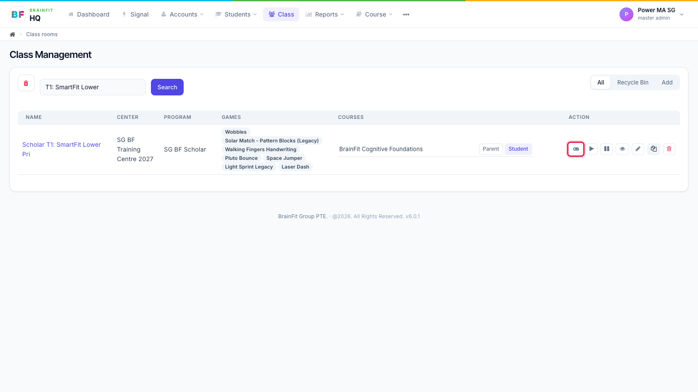
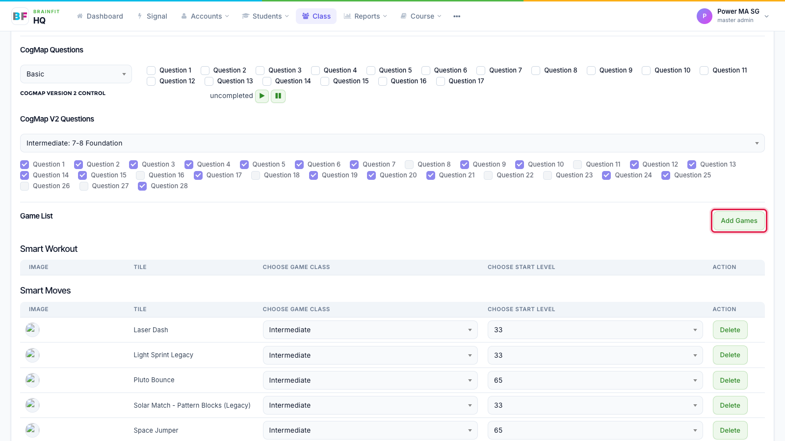
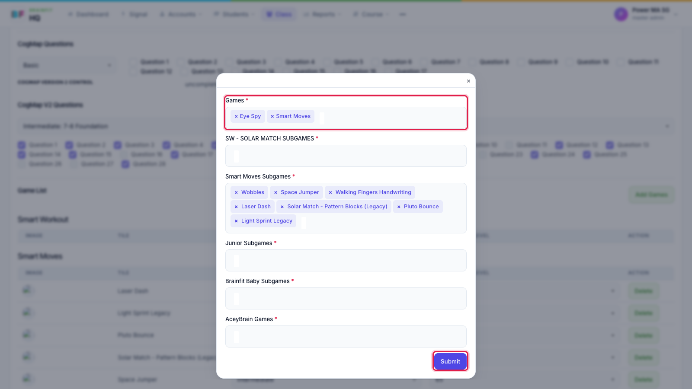
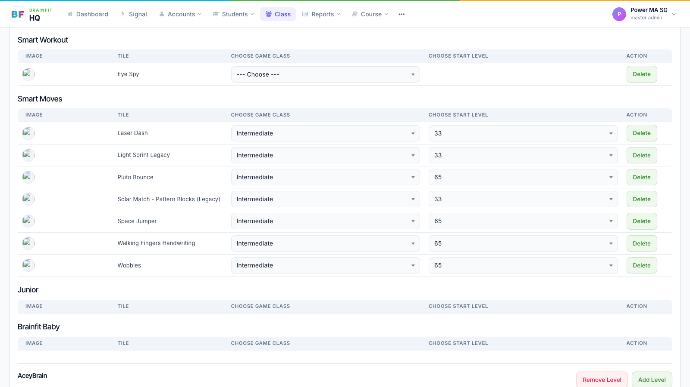

# Assign Games to a Class
This feature is for SA, ML, MA, CA

Games assigned to a class go to every student in that class.

1. In **Class**, click the **gamepad** icon on the class's row (or the gamepad on the class page).

2. On the class's **Game config** page, scroll to **Game List** and click **Add Games**.

3. The form shows **all** of the class's games: keep the ones already there, add the new ones (and their subgames), then click **Submit**.

4. The new game appears in its list. Choose the **game class** and **start level** for the class.

:::caution
**Add Games** saves the whole list. A game you remove from the form is taken off the class (and its students). Check the existing games are still selected before you click Submit.
:::
