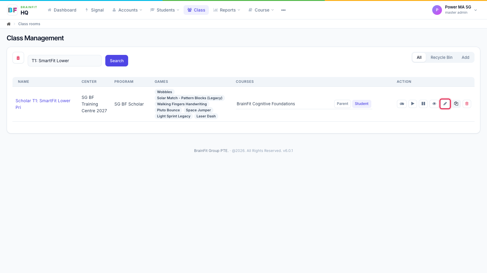
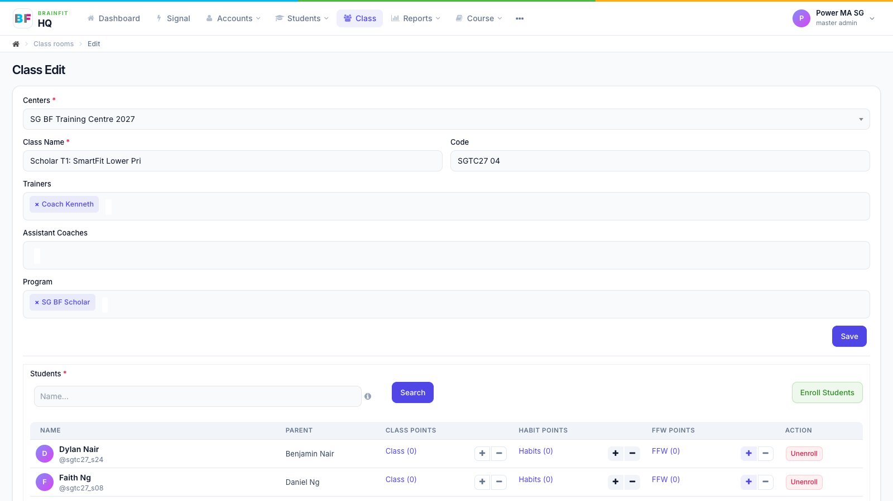

# Edit a Class
This feature is for SA, ML, MA, CA

1. In **Class**, click the **pencil** icon on the class's row (or the pencil on the class page).

2. Change the centre, name, code, trainers, assistant coaches or program and click **Save**. The same page also has the students, assessment templates and alumni lists.

**Note:** to copy a class with its setup, see [Clone a Class](/docs/Guideline/Class%20Managemnet/clone-class).
