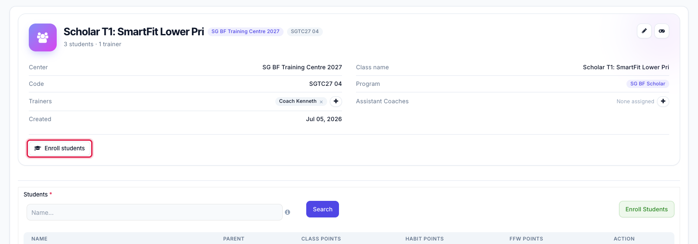
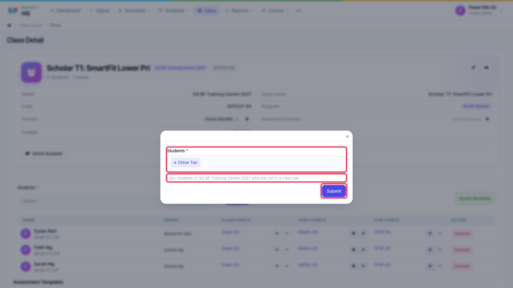
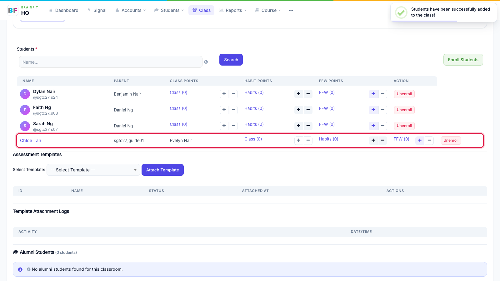

# Enrol Students into a Class
This feature is for SA, ML, MA, CA, Trainer

1. On the class page, click **Enroll students**.

2. Pick one or more students and click **Submit**. The list shows the students of this class's centre who are **not in a class yet**. A student in another class has to be moved from their own edit page instead.

3. The student is added to the class list straight away.

