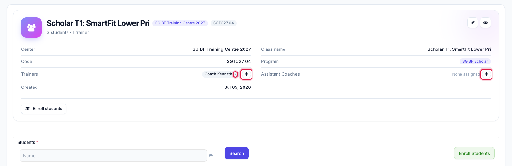
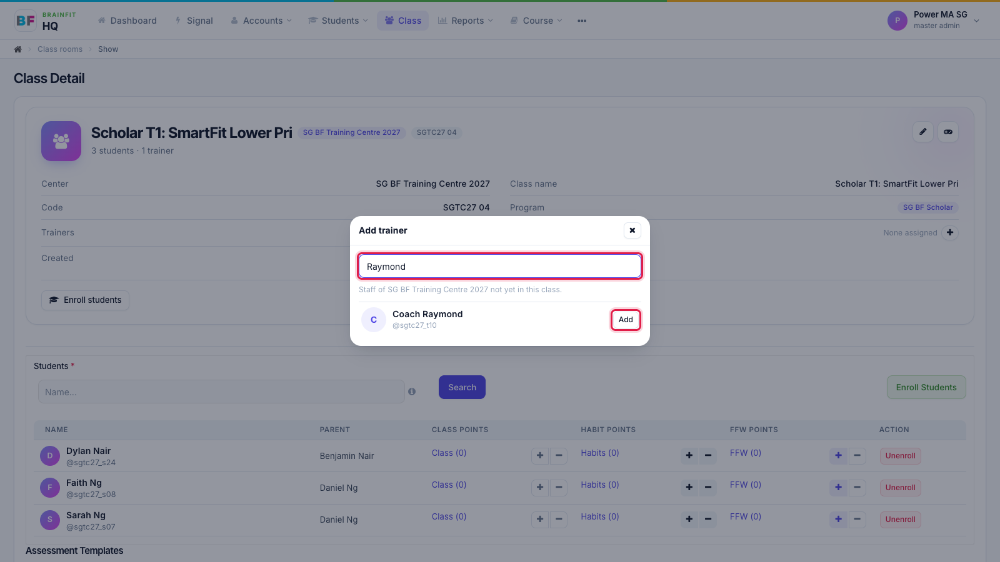
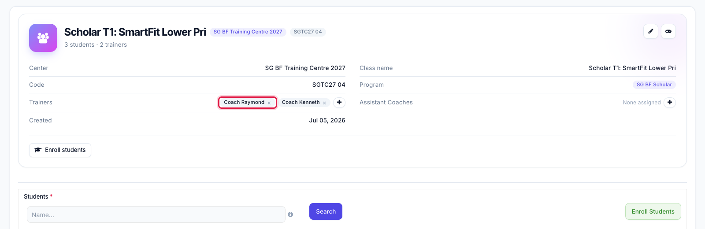
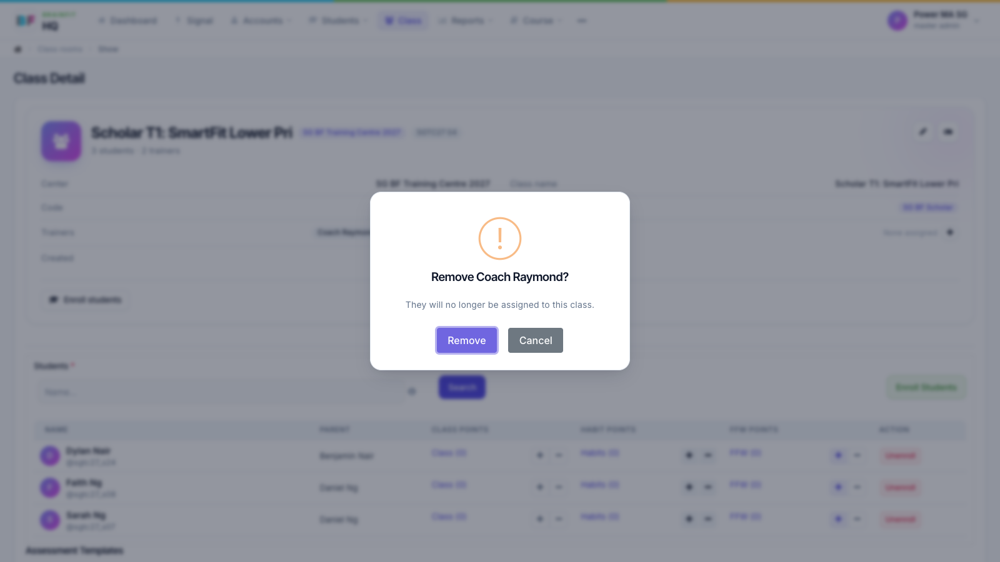

# Add or Remove Trainers and Assistant Coaches
This feature is for SA, ML, MA, CA, Trainer

1. On the class page, click **+** next to **Trainers** (or **Assistant Coaches**). The **×** on a name removes that person from the class.

2. Search by name or username. The list only shows staff of this class's centre who aren't in the class yet. Click **Add**.

3. The trainer now shows on the class.

4. To remove someone, click **×** on their name and confirm with **Remove**.

**Note:** this only changes who teaches the class. The class's games and students stay as they are.
