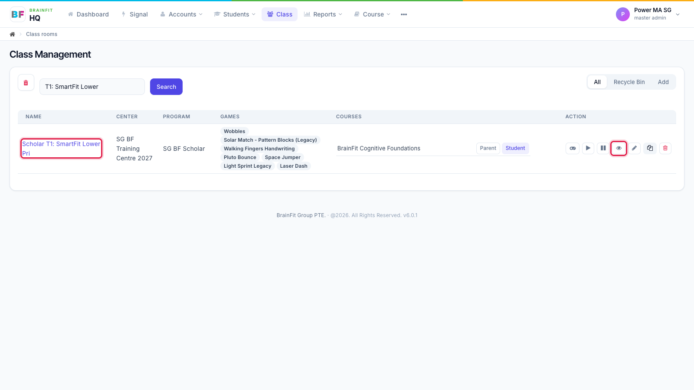
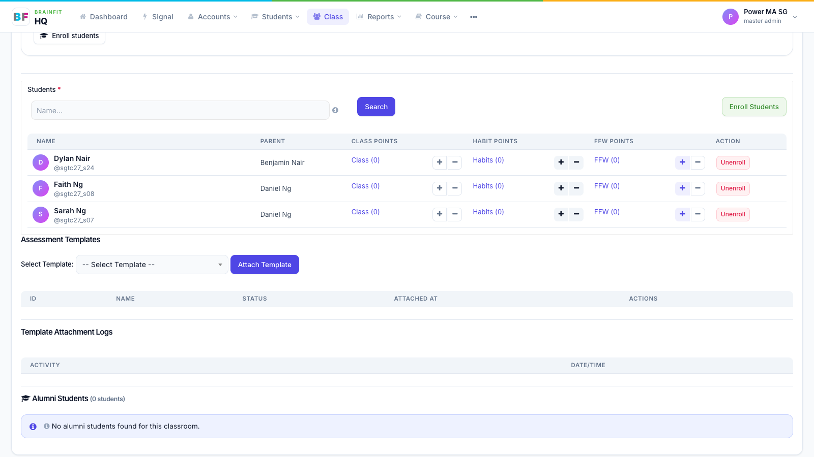

# View a Class
This feature is for SA, ML, MA, CA, Trainer, Assistant Coach

**Watch (about 1 min):**

<video controls preload="metadata" width="100%">
  <source src="/video/hq/class-view.mp4" type="video/mp4" />
</video>

1. Open **Class** in the top menu. Click the class name, or the **eye** icon in the Action column.

2. The class page shows the class details: centre, code, program, trainers, assistant coaches and how many students it has. The **pencil** at the top right opens the full edit page; the **gamepad** opens the class's game config.

3. Below the details: the **Students** list with their Class, Habit and FFW points (**+** / **−** to add or redeem points, **Unenroll** to take a student out of the class), then Assessment Templates and Alumni Students.

