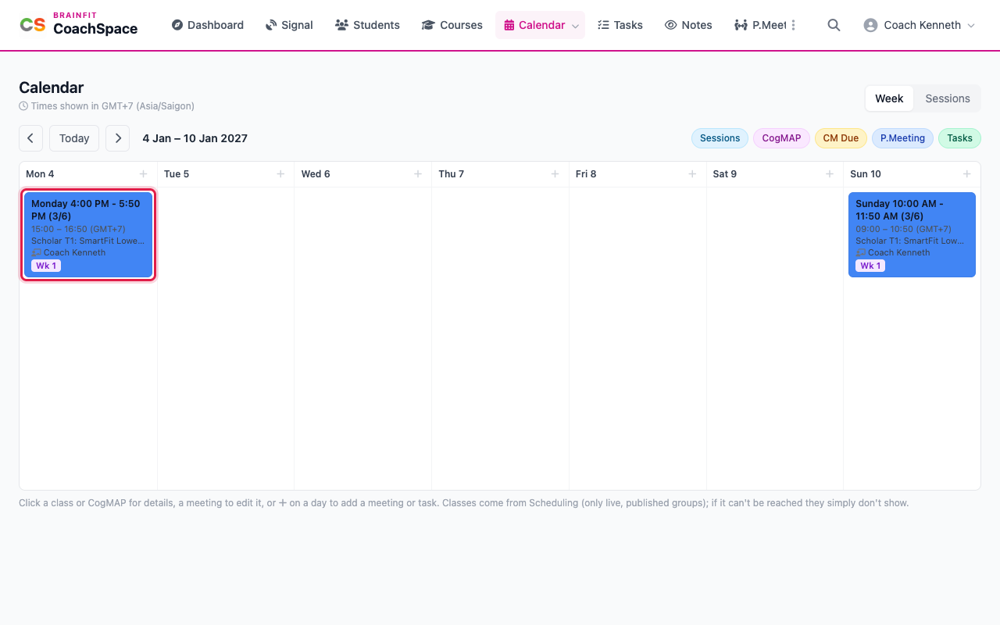
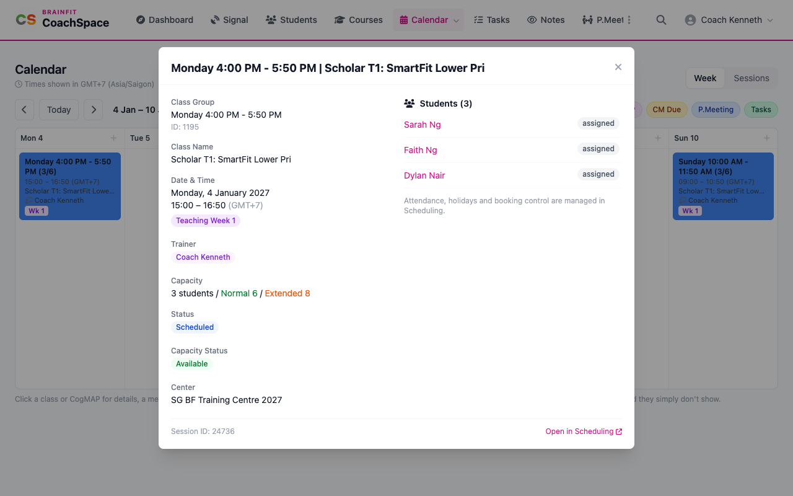
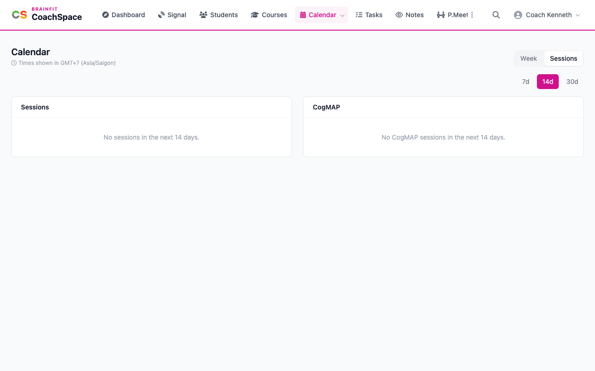

# Calendar and sessions

**Calendar** shows your classes, CogMAP sessions, progress meetings and task due dates in one weekly grid.

**Watch (about 1½ minutes):**

<video controls preload="metadata" width="100%">
  <source src="/video/hq/cs-calendar.mp4" type="video/mp4" />
</video>

**Good to know:** the practice centre runs in 2027, so the pictures show the first week of January 2027. Your own calendar opens on the current week.

## 1. Read the week

Click **Calendar** in the menu. The arrows move one week back or forward, and **Today** jumps back to the current week. Each class is a card on its day, with the class time, the class name, the trainer and the teaching week of the term (for example **Wk 1**). The brackets show how many students are in the class and how many it can take.

## 2. Open a class

Click a class to see its date and time, the trainer, the capacity and every student booked in. Click a student's name to open their page. **Open in Scheduling** takes you to the full class record.

## 3. Turn layers on and off

The coloured buttons above the grid switch a layer on or off: **Sessions**, **CogMAP**, **CM Due** (CogMAP due dates), **P.Meeting** and **Tasks**. The **+** at the top of a day adds a progress meeting or a task on that day.

## 4. The list of upcoming sessions

**Sessions** (top right, or **Sessions** in the Calendar menu) is a plain list of the sessions in the next 7, 14 or 30 days, with the CogMAP sessions kept apart. When nothing is booked, it says so.

