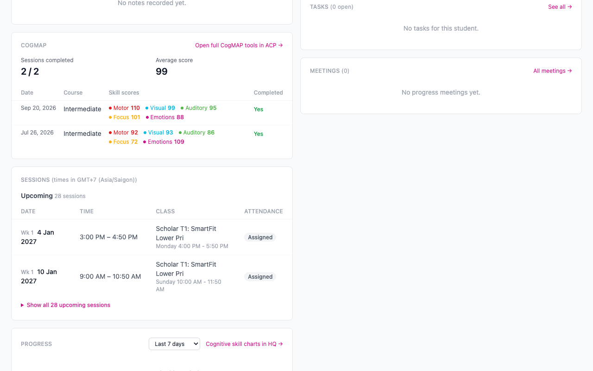
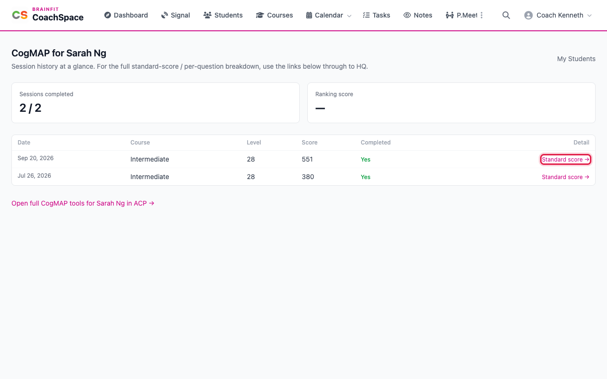
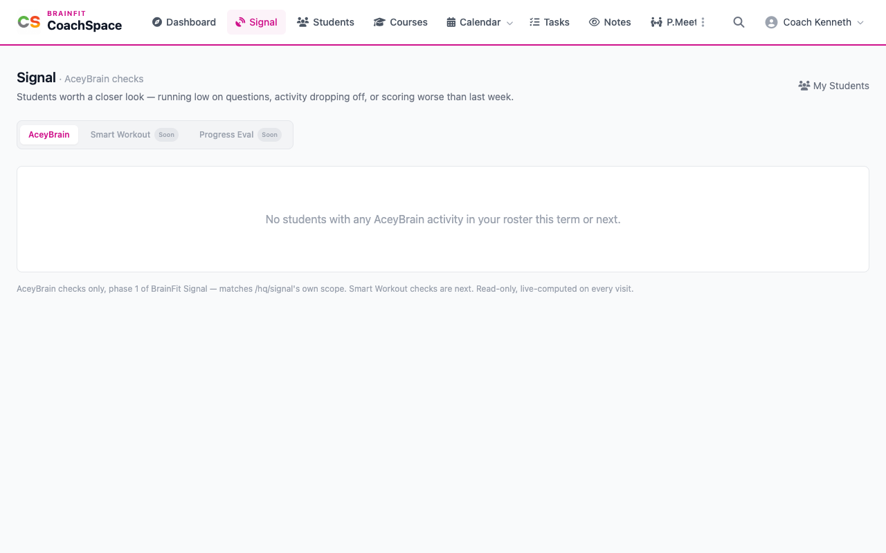

# CogMAP results and Signal

Two places help you decide which student needs attention: the CogMAP results on a student's page, and **Signal**.

**Watch (about 1¼ minutes):**

<video controls preload="metadata" width="100%">
  <source src="/video/hq/cs-cogmap-signal.mp4" type="video/mp4" />
</video>

## 1. CogMAP on the student's page

Open a student. The **Profile** card shows their **CogMAP Rounds**, the **Latest CogMAP**, the **Next CogMAP** due date and whether the next one is **Booked**. The **CogMAP** card below shows the sessions completed, the average score and each session with its skill scores.

## 2. The CogMAP page

Click the heading of the CogMAP card, or open the page for the student, to see every session as a row: date, course, level, score and whether it was completed. **Standard score** opens that session's full result in BrainFit HQ, with the standard score for each skill. **Open full CogMAP tools** goes to the student's CogMAP tools.

## 3. Signal

**Signal** is the place to spot students who need attention. It looks for students who are running low on questions, whose activity is dropping off, or who score worse than they did last week.

The **AceyBrain** tab is live. **Smart Workout** and **Progress Eval** are marked **Soon**, because those checks are still on the way. Students who need a look are listed on the AceyBrain tab. When none of your students has AceyBrain activity this term or next, it says so, as in the picture.
