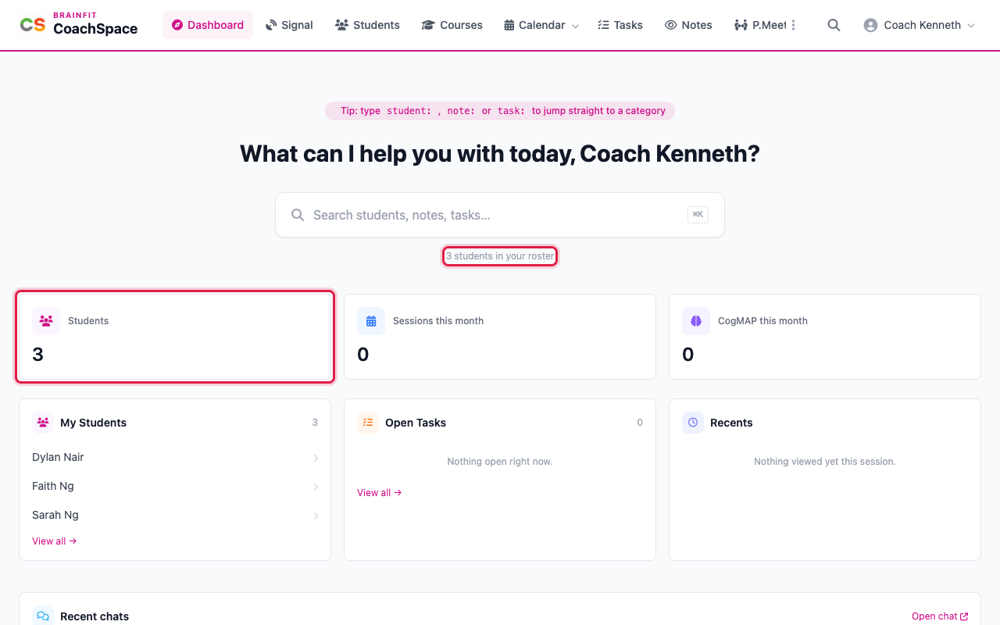
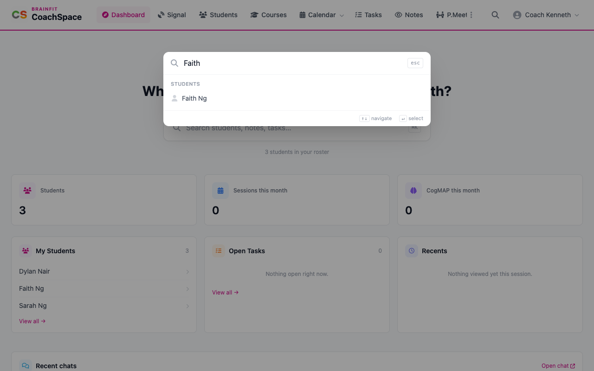
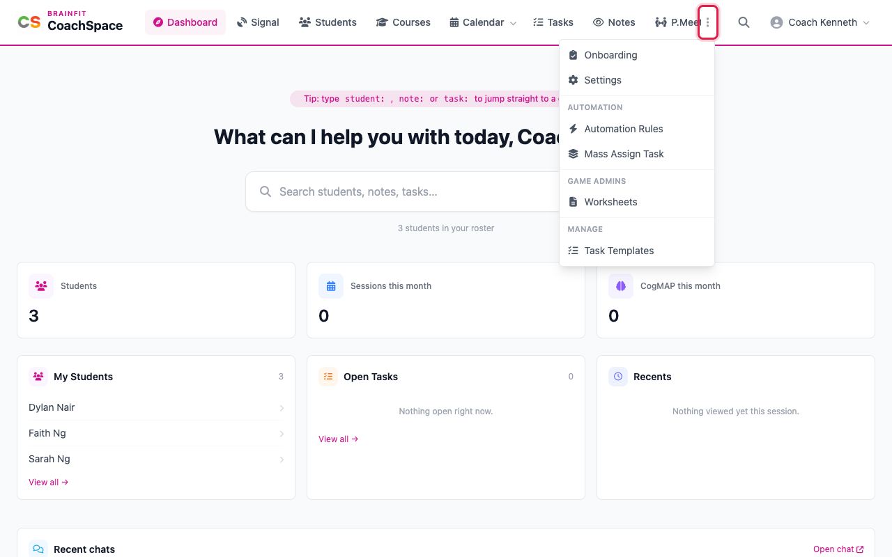

# Get started and the Dashboard

CoachSpace is the trainer's workspace. It shows only your own students and classes, and it opens on the Dashboard.

**Watch (about 1½ minutes):**

<video controls preload="metadata" width="100%">
  <source src="/video/hq/cs-dashboard.mp4" type="video/mp4" />
</video>

**Good to know:** the pictures and the video in this guide use a practice centre (SG BF Training Centre 2027) with pretend students. You only ever see the students of your own classes.

## 1. Sign in

Open CoachSpace in your browser and sign in with your trainer username and password. You land on the Dashboard, which greets you by name.

## 2. Use the menu

The menu across the top takes you to **Signal**, **Students**, **Courses**, **Calendar**, **Tasks**, **Notes** and **P.Meeting** (Progress Meetings). Click the logo at any time to return to the Dashboard.

## 3. Search

Click the search box (or press the **/** key) and start typing. Students, notes and tasks that match appear as you type. Start with `student:`, `note:` or `task:` to search only that category.

## 4. Read the cards

Three cards count what is on your plate: the **Students** in your roster, the **Sessions this month** you run, and the **CogMAP this month** sessions. Below them:

- **My Students** lists your roster. Click a name to open that student.
- **Open Tasks** shows what you still have to do.
- **Recents** remembers the students you opened in this visit.
- A month calendar marks the days with sessions, with **Open full calendar** underneath.

## 5. More tools

The three dots at the end of the menu open **Onboarding**, **Settings**, **Mass Assign Task**, **Worksheets** and **Task Templates**. Your name opens the account menu, where you sign out.

