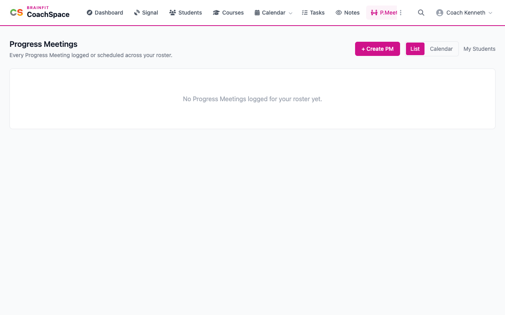
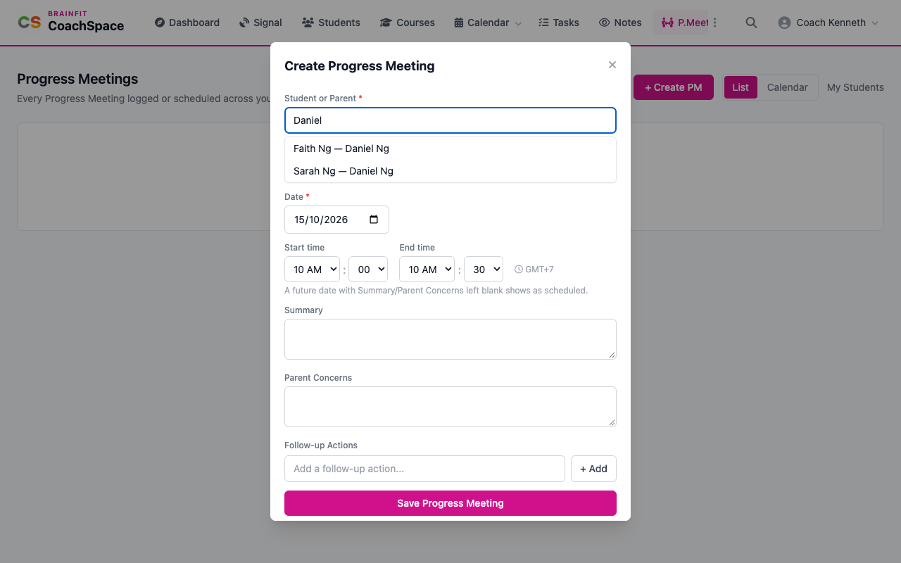
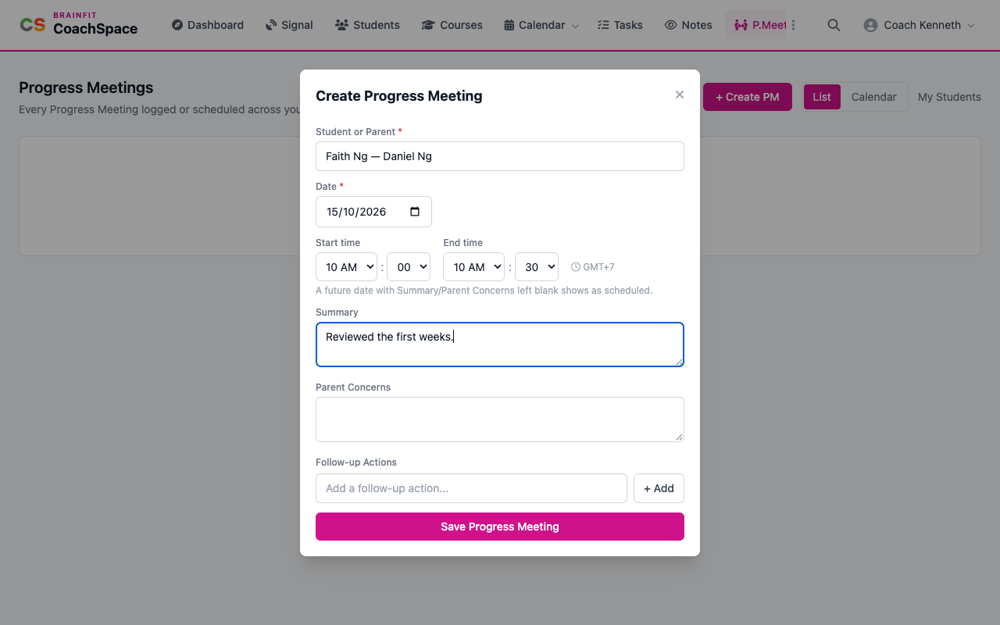
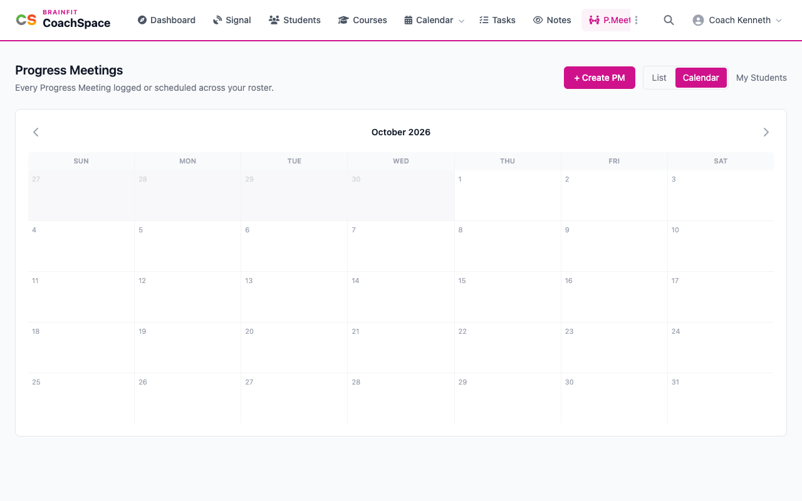

# Progress meetings

A progress meeting is a catch-up with a parent about how their child is doing. **P.Meeting** keeps a record of each one, and turns your follow-up actions into tasks.

**Watch (about 1¾ minutes):**

<video controls preload="metadata" width="100%">
  <source src="/video/hq/cs-meetings.mp4" type="video/mp4" />
</video>

## 1. The meetings list

Click **P.Meeting** in the menu. Every meeting you held or planned is listed, with one row for each student. **List** and **Calendar** switch the view, and **My Students** narrows it to your own students.

## 2. Create a meeting

Click **+ Create PM**. Search for the student or the parent by name and click the match (one match for each pair of parent and child).

Choose the **Date** and the **Start time** and **End time**. A future date with the summary left blank is saved as **scheduled**. A meeting that already happened, with a summary, is saved as held. Write the **Summary** and the **Parent Concerns**, add any **Follow-up Actions** one at a time (each becomes a task for you), and click **Save Progress Meeting**.

Nothing is sent to the parent. The meeting is a record for you and your centre.

## 3. Open, edit or delete

Click a meeting to open it. Change the time, the summary or the concerns and click **Save changes**. The follow-up actions are listed at the bottom. **Delete** removes the meeting for good, after you confirm.

## 4. See meetings by day

**Calendar** shows your meetings on their day. Click one to open it, and the **+** on a day adds a new one.

