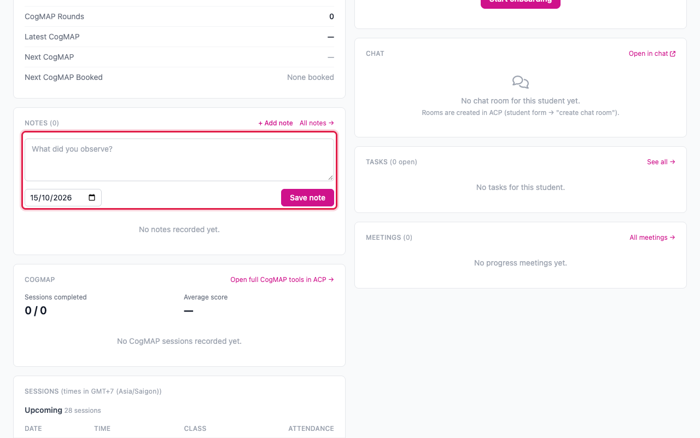
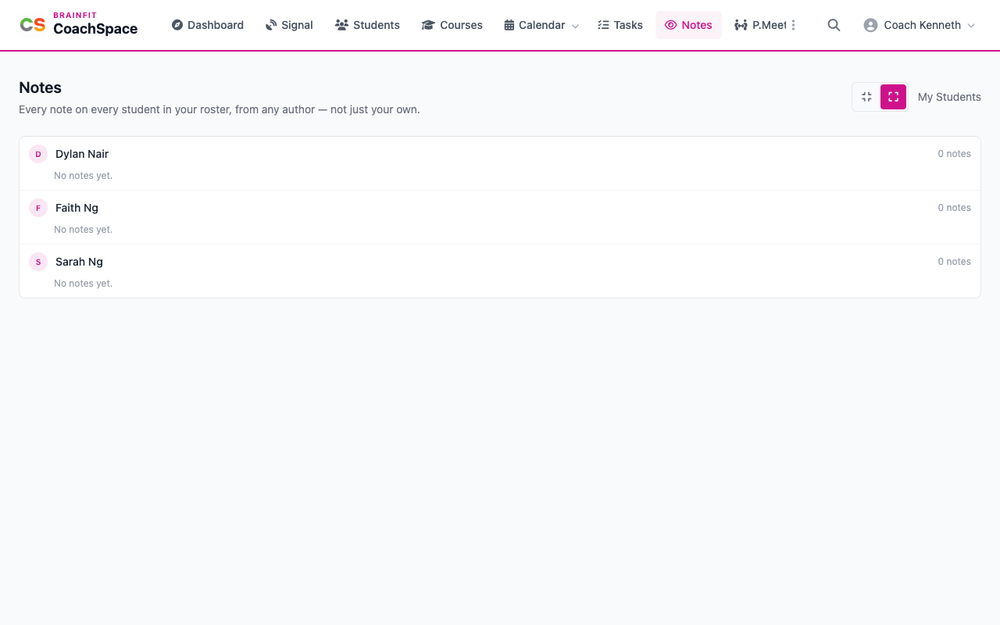

# Notes

Notes are how you record what you see in a student. Any trainer of the student can read them, so a note helps the next person who works with the child.

**Watch (about 1¼ minutes):**

<video controls preload="metadata" width="100%">
  <source src="/video/hq/cs-notes.mp4" type="video/mp4" />
</video>

## 1. Add a note

Open the student's page and find the **Notes** card. Click **+ Add note**, write what you observed, and click **Save note**. The date is today. You can change it if the note is about an earlier day.

The note appears on the card with your name and the date, the newest first.

## 2. See all notes

**Notes** in the menu gathers every note on every student in your roster, from any author, not just yours. Each student has their own group.

## 3. Edit or delete a note

Click **Edit** on a note to change its text or its date, and to tag it (for example **Positive Behaviour** or **Needs Attention**). Click **Save changes**. **Delete** removes the note for good, and a pop-up asks you to confirm first.
