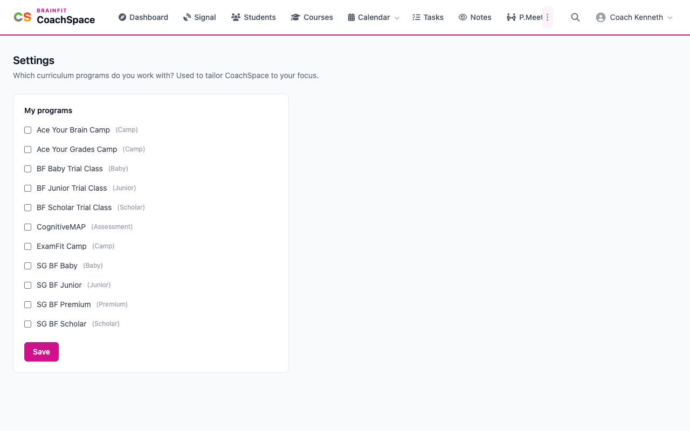

# Settings

Settings is where you choose the curriculum programs you work with. CoachSpace uses this to tailor itself to your focus.

**Watch (about 40 seconds):**

<video controls preload="metadata" width="100%">
  <source src="/video/hq/cs-settings.mp4" type="video/mp4" />
</video>

## 1. Open Settings

Click the three dots at the end of the menu, then **Settings**.

## 2. Choose your programs

Under **My programs**, tick each program you work with, for example **SG BF Scholar**, **SG BF Junior** or **SG BF Baby**, and untick the ones you do not. Click **Save** to keep your choice.

