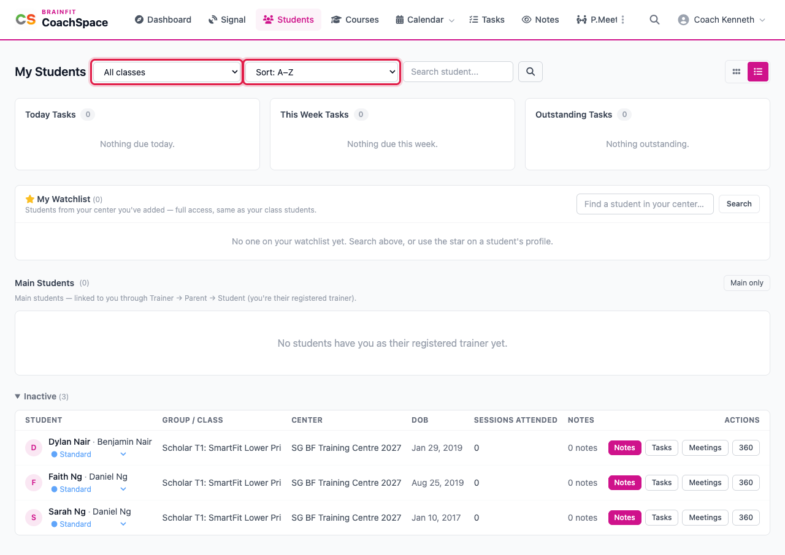
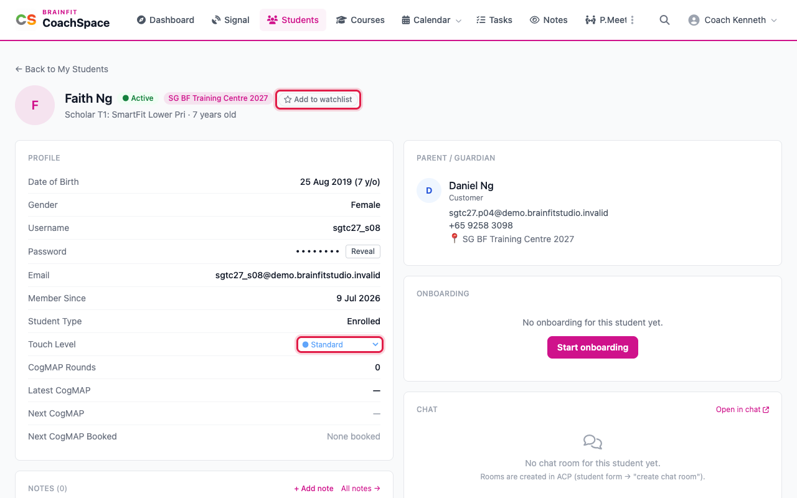
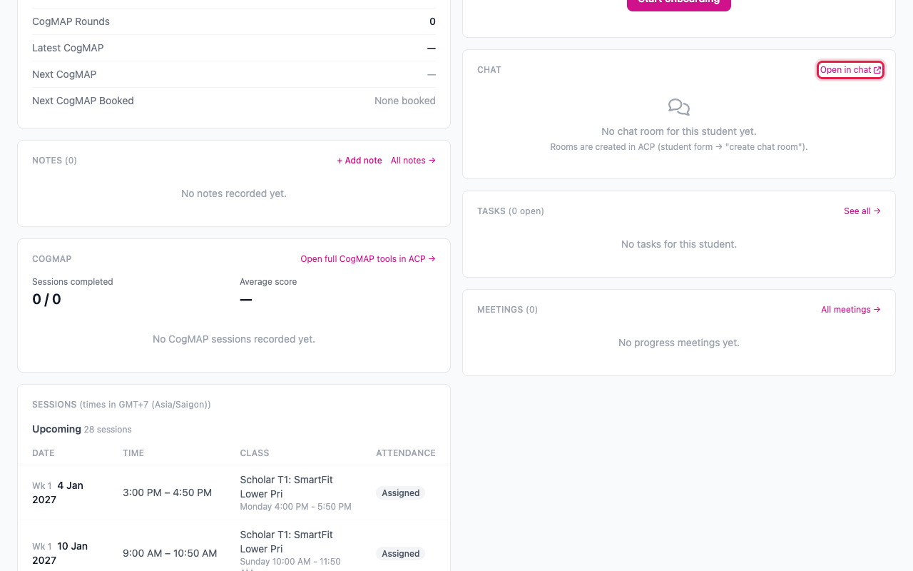
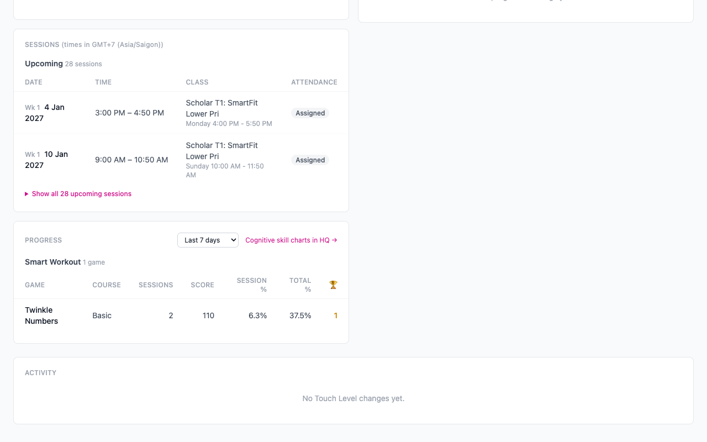

# Students and a student's page

**Students** lists everyone in your classes. Click a student to open their page, with their profile, parent, notes, tasks, meetings, CogMAP results, sessions and progress in one place.

**Watch (about 2½ minutes):**

<video controls preload="metadata" width="100%">
  <source src="/video/hq/cs-students.mp4" type="video/mp4" />
</video>

## 1. Find your students

Click **Students** in the menu. Use the class menu to pick one class, the sort menu to order the list (A to Z, recent notes first, most or fewest sessions attended), and the search box to find a name. The two buttons on the right switch between a list and a grid of cards.

## 2. Read the page

- **Today, This Week and Outstanding Tasks** count the tasks due across all your students.
- **My Watchlist** holds students outside your classes whom you want to keep an eye on. Search for a student in your centre, add them, and they get the same access as your class students.
- **Main Students** are the students who have you as their registered trainer.
- **Inactive** lists students who are not in a class group this term. Open it to see them.

## 3. Open a student

Click the student's name. The top of the page shows the name, whether they are active, their centre, and a star to **Add to watchlist**. The **Profile** card lists their date of birth, username, email, student type and CogMAP dates.

The **Touch Level** menu records how much attention a student needs: High, Medium or Standard. The change is written to the **Activity** log at the bottom of the page. The password stays hidden unless you click **Reveal**.

## 4. Parent, onboarding and chat

On the right you find the **Parent / Guardian** with email and phone, the **Onboarding** card (start the set-up steps for a new student), and the **Chat** card, where **Open in chat** opens the family's conversation in the chat app.

## 5. Notes, tasks, meetings, sessions and progress

Notes, Tasks and Meetings each have a card with a link to all of them (see the next guides). **Sessions** lists the classes the student is booked into, with date, time and attendance. **Show all** opens the full list. **Progress** shows the games the student played, with sessions, score and percentage, and the menu changes the period from the last 7 days to the last year.

