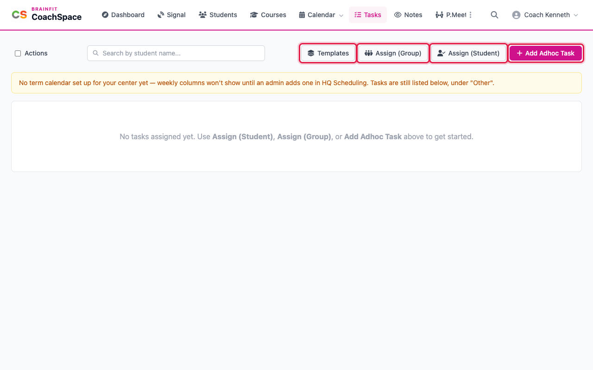
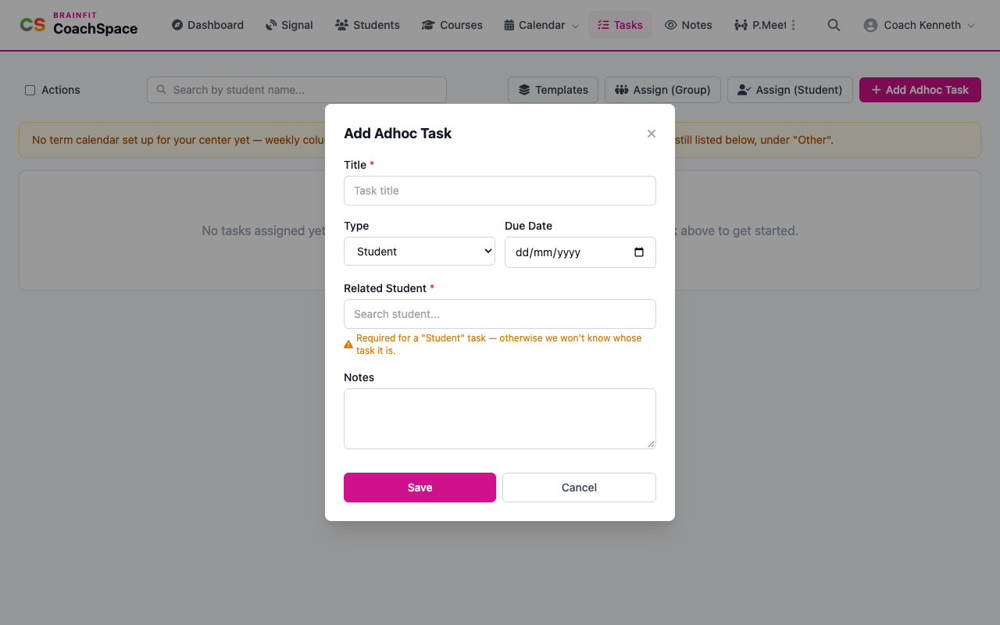
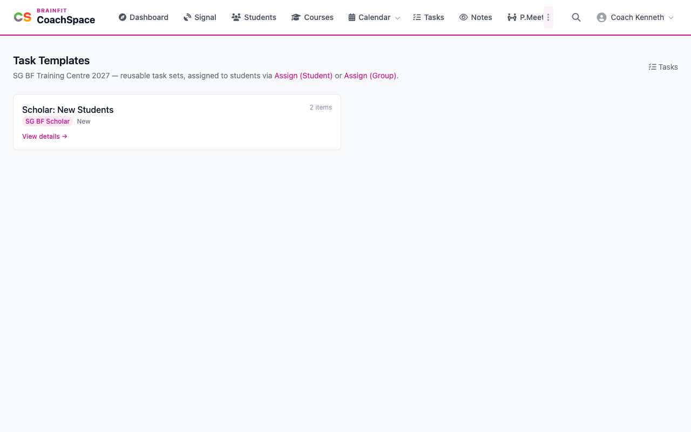
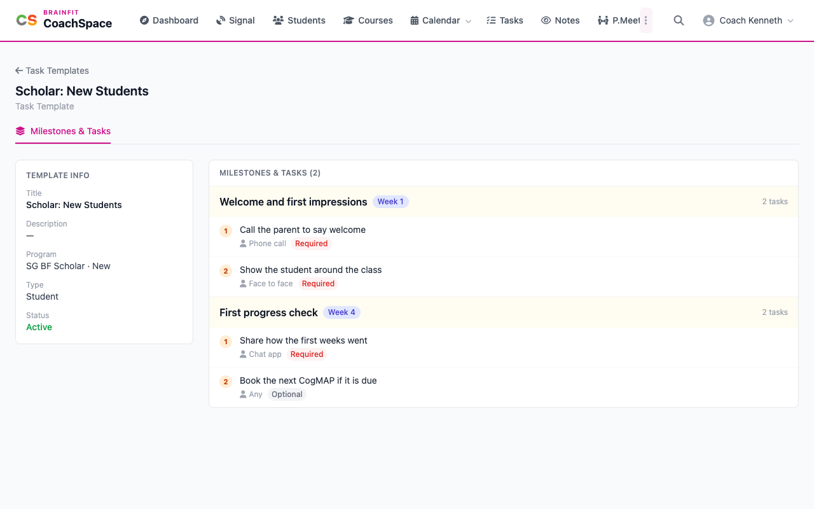
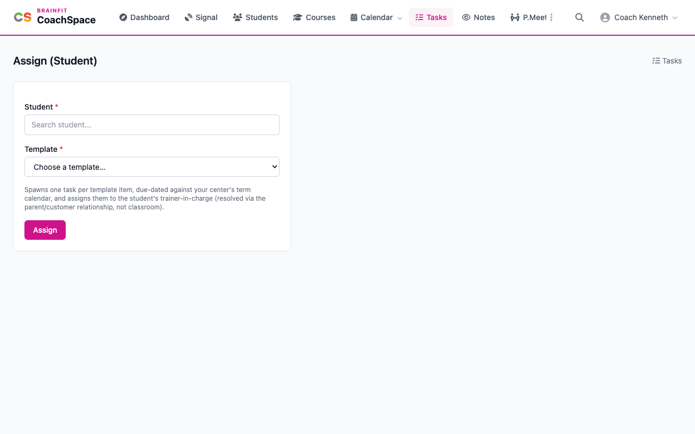

# Tasks and task templates

**Tasks** is your to-do list for students. A task can be a quick one-off, or part of a template that gives a whole class the same set of tasks.

**Watch (about 2½ minutes):**

<video controls preload="metadata" width="100%">
  <source src="/video/hq/cs-tasks.mp4" type="video/mp4" />
</video>

## 1. The Tasks page

Click **Tasks** in the menu. The search box filters the list by student name, and the buttons on the right are **Templates**, **Assign (Group)**, **Assign (Student)** and **Add Adhoc Task**.

## 2. Add a one-off task

Click **Add Adhoc Task**. Give it a **Title**. Choose the **Type**: **General**, **Student** or **Personal**. A Student task needs a student, so search for the name and click the match. Add a due date and any notes, and click **Save**.

After you save, you land on that student's own task list. Tick the box in front of a task to mark it done, and tick it again to bring it back.

## 3. Work a task

On the **Tasks** page, click a task to open its details: the title, the student and the due date. Under **Change Status**, mark it **In Progress** while you work on it, and **Done** when you finish. **Edit** changes the title, notes or due date, and **Delete Task** removes it for good. A task that comes from a template also has a checklist, which you tick off here.

## 4. Task templates

A template is a ready-made set of tasks, set up for your centre by an administrator. Click **Templates** to see them, with the program, whether it is for new or renewing students, and how many items it has.

Click **View details** to read one. It is split into milestones, one for each week of the term. Each milestone has a checklist, and each line shows how to do it (face to face, phone call, chat, any) and whether it is required or optional.

## 5. Use a template

Click **Assign (Student)**, pick the student and the template, and click **Assign**. CoachSpace creates one task for each item in the template, due on the right week of your term calendar. **Assign (Group)** does the same for a whole class: choose the class, then pick which students of its roster get the template.

**Good to know:** only a Super Admin can create or change a template. If your centre has no templates yet, ask your administrator. Weekly columns on the Tasks page need a term calendar, which an administrator sets up in HQ Scheduling.
