# Questionnaires and public links

The form builder is not only for CogMAP assessor notes. A form can also be a **general questionnaire** that is not about a student, and it can be opened by anyone with a link, without a BrainFit account. This guide covers the new form settings, the public link, and where the answers go.

**Watch (about 2 minutes):**

<video controls preload="metadata" width="100%">
  <source src="/video/hq/assessor-public.mp4" type="video/mp4" />
</video>

Open **Accounts → Assessor Notes → Forms**. How to build the questions themselves is in [Build and manage forms](./assessor-forms.md).

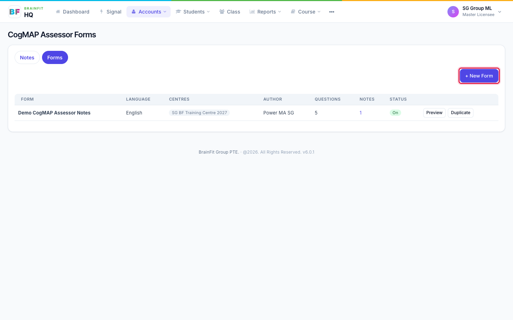

## The three new settings

At the top of the form editor, under the name and language, there are three settings.

**Author.** An existing form shows an Author picker to a Super Admin (any Master Licensee) and to the form's author when that is a Master Licensee (any other Master Licensee). Pick the new author and save. After saving, the new Master Licensee owns the form and the previous author can no longer edit it. Master Admins and Centre Admins can see the author but not change it.

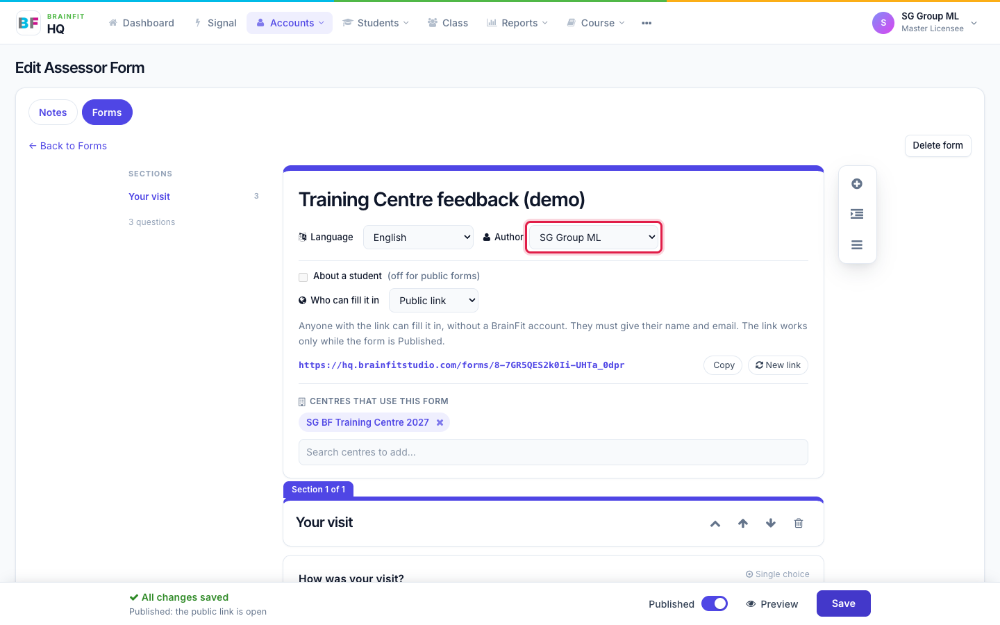

**About a student.** On (the default, and the setting of every form that existed before) means an assessor note about a student, exactly as before. Off makes it a general questionnaire: whoever fills it in does not pick a student.

**Who can fill it in.** Choose **BrainFit login** (the default) or **Public link**. Only a Super Admin, or a Master Licensee who is the form's author, can choose Public link. A public form is never about a student, so About a student switches off by itself.

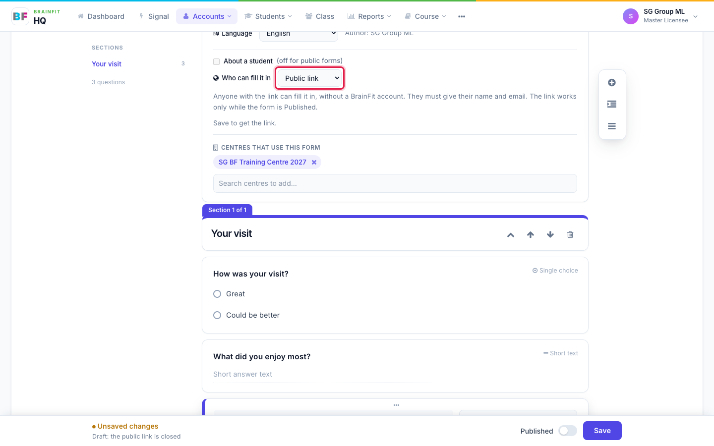

## Make a public questionnaire

1. Open **Forms** and click **+ New Form**.
2. Give the form a name, then add a section and your questions.
3. Untick **About a student**.
4. Set **Who can fill it in** to **Public link**.
5. Search for the centre that should receive the answers and add it.
6. Switch **Published** on and click **Save**.

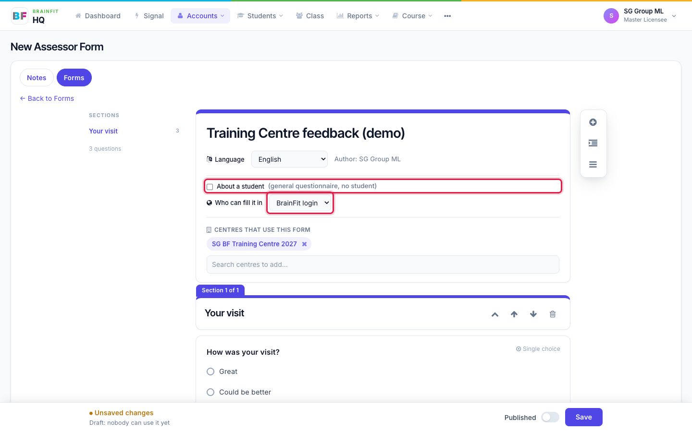

The public link now appears under the setting. It starts with `hq.brainfitstudio.com/forms/`, followed by a long random code.

- **Copy** copies the link so you can send it.
- **New link** makes a new link and the old one stops working at once. Use it if a link was shared by mistake.
- The link only works **while the form is Published**. Switch Published off and save, and the link shows "This form is closed".

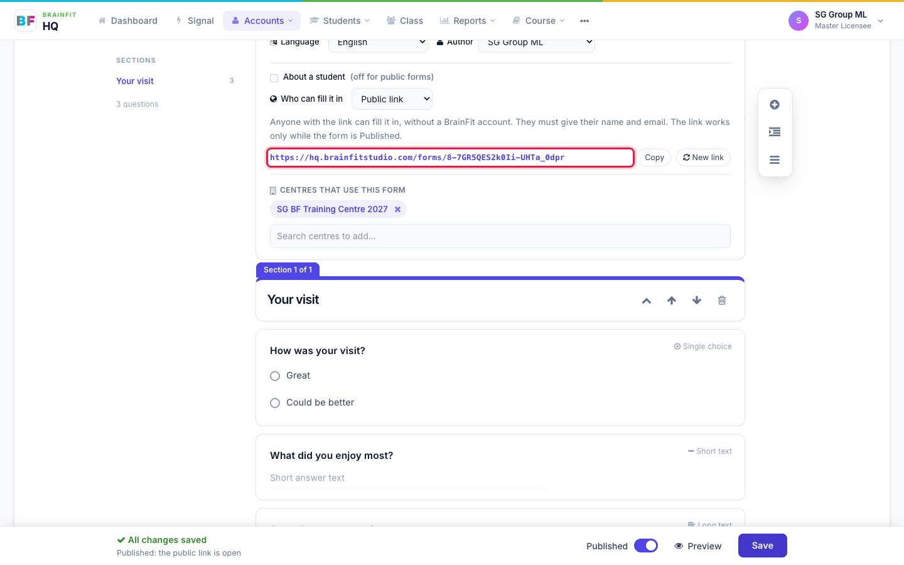

## What the person who opens the link sees

No login. The page asks for a **name** and an **email address**, both required, then the questions. They click **Submit** and see a thank-you message. They never see the answers or any score afterwards.

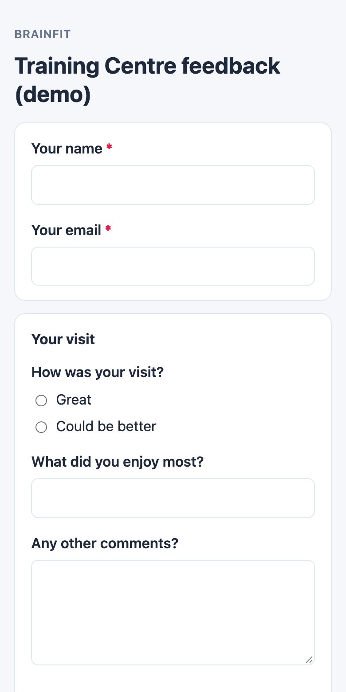
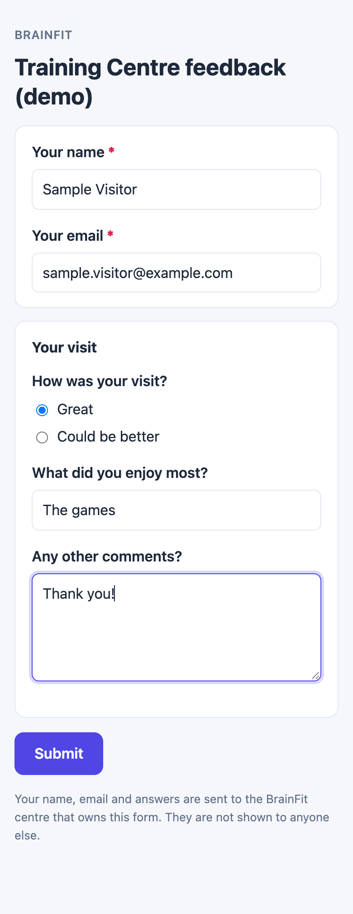
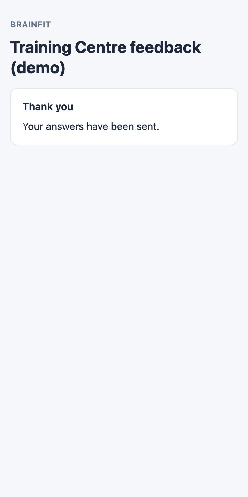

If the link is closed, switched off, or no longer correct, the page says **This form is closed**.

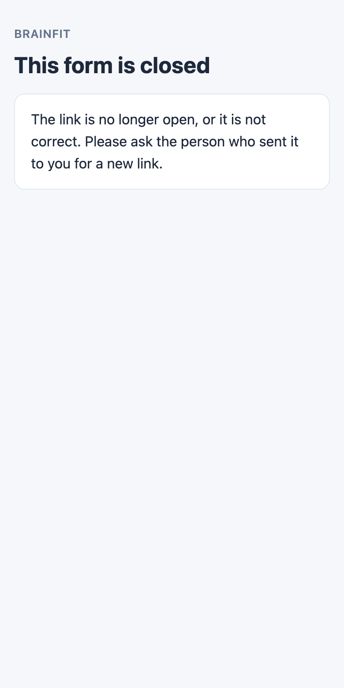

## Find the answers

Open **Accounts → Assessor Notes → Notes**. A public response shows the person's name and email with a **Public** tag, and the form's name.

- **Source** filter: All sources, Brain HQ, TeacherTools or Public link.
- **Search** matches a student's name, or a respondent's name or email.

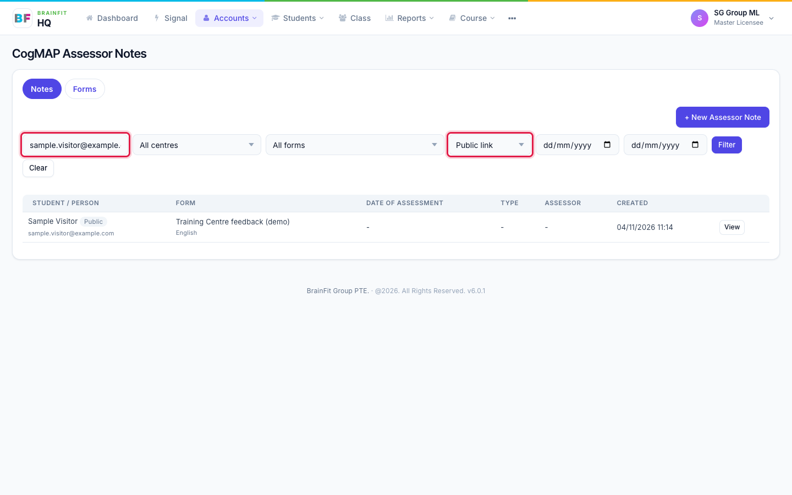

Who can see a response that is not about a student: the form's **author**, **Super Admin**, and the **staff of the centres the form is assigned to**. Nobody else. Responses are listed in Brain HQ only; no email is sent when someone submits.

## Fill in a general form as staff

Staff can also fill in a general (non-student) form from inside Brain HQ. Click **+ New Assessor Note**. Below the student search, **Or fill in a general form** lists the active general forms of your centres.

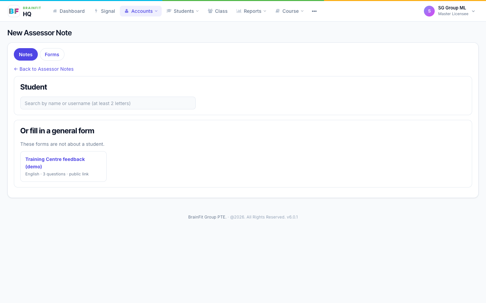

## Good to know

- Public forms ask for a name and an email only. Do not ask for sensitive personal data in the questions.
- Each public form is protected against spam (a hidden check and a limit on how often one device can submit).
- TeacherTools is not affected: its A. Note list still shows only forms that are about a student.
