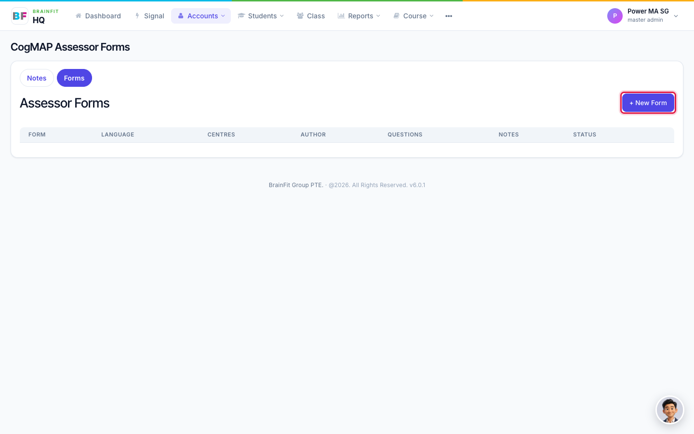
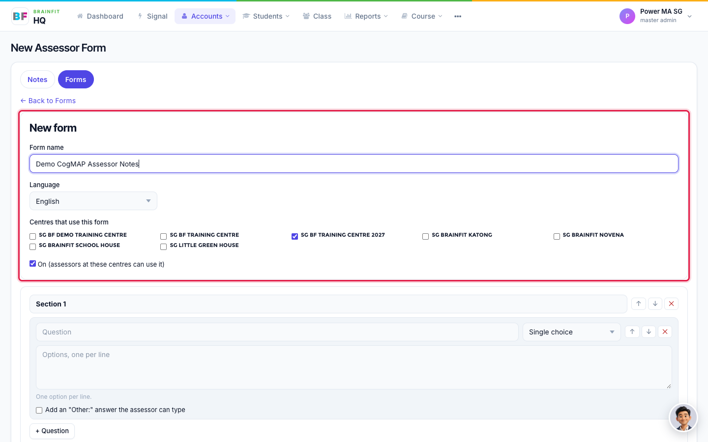
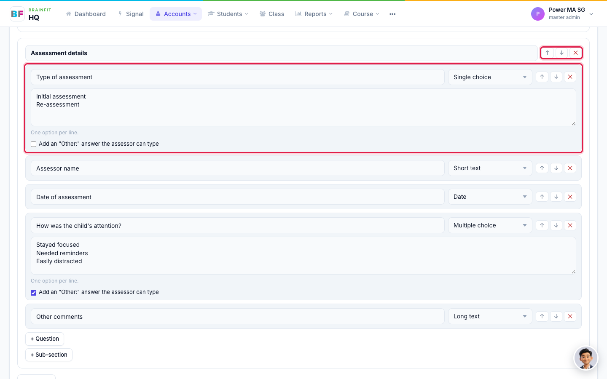
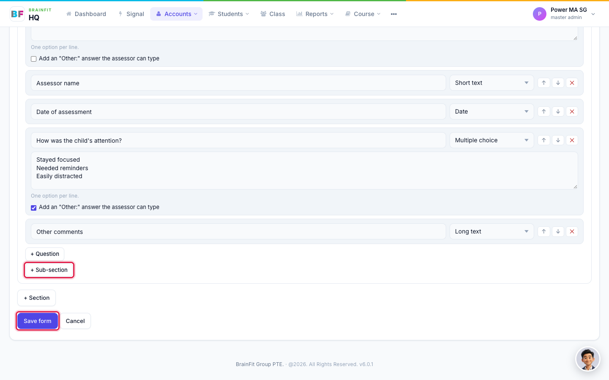
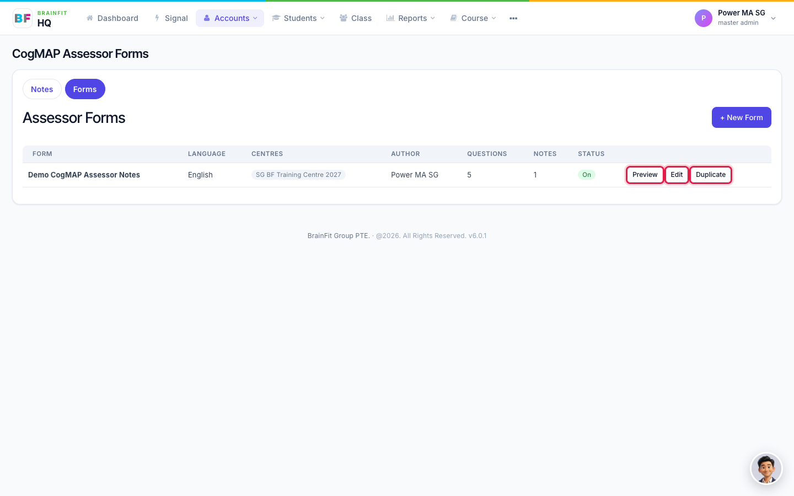
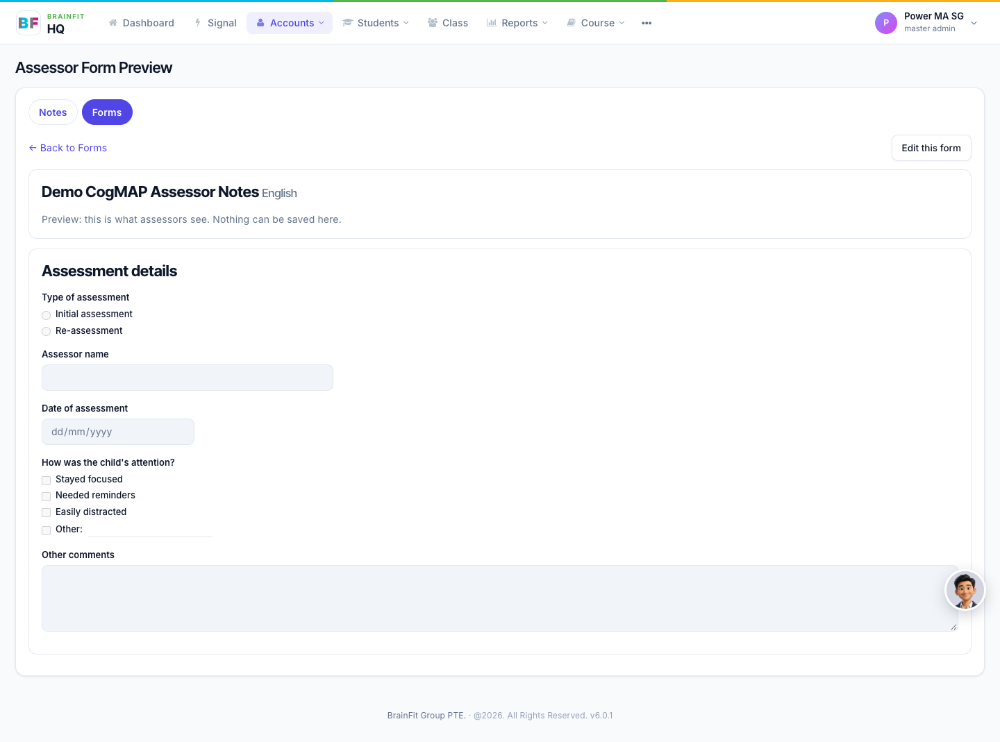
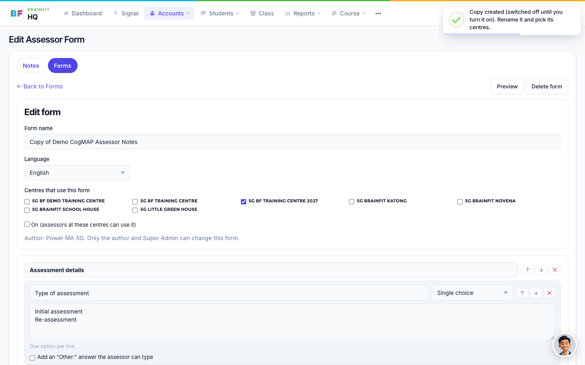
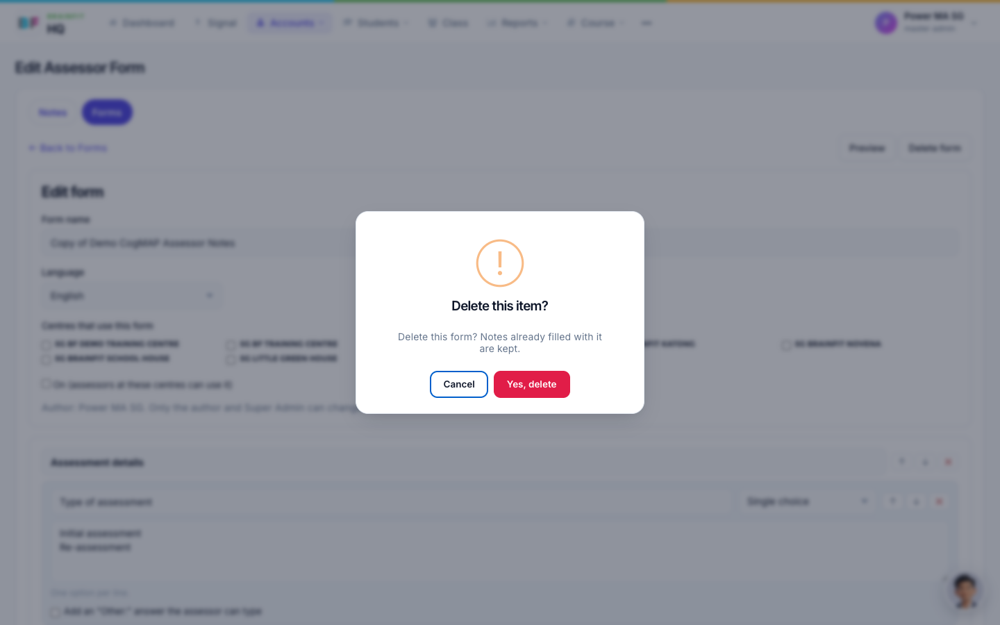

# Build and manage assessor forms
Every Assessor Note is filled in on a form. The **Forms** tab is where those forms are made and managed. Each form has an author, a language and the centres that use it.

**Watch (about 2 minutes):**

<video controls preload="metadata" width="100%">
  <source src="/video/hq/assessor-forms.mp4" type="video/mp4" />
</video>

**Who can do what:** Super Admin, Master Licensee, Master Admin and Centre Admin can create forms. Only the form's author and Super Admin can edit or delete it. You only see the forms of your own centres.

## 1. Open the Forms tab

Go to **Accounts → Assessor Notes** and click the **Forms** tab. The list shows each form's language, the centres that use it, its author, the number of questions, how many notes were written with it, and whether it is **On** or **Off**.

## 2. Create a form

Click **+ New Form**, then fill in:

- **Form name**
- **Language**: English, Bahasa Indonesia, Thai, Turkish, Myanmar or Chinese. This is a label for the form, so assessors can pick the right one. It does not translate anything: write the questions in that language.
- **Centres that use this form**: tick one or more centres.
- **On**: untick it to keep the form hidden from assessors for now.

## 3. Add sections and questions

A form is made of **sections**, and a section can have **sub-sections**. Each question has a label and a type: single choice, multiple choice, short text, long text, date, or grid. For choice questions, type the options one per line, and tick **Add an "Other:" answer the assessor can type** if you want an Other box. Use **↑** and **↓** to reorder, and **✕** to delete a question, sub-section or section.

Use **+ Question**, **+ Sub-section** and **+ Section** to add more. When you are done, click **Save form**.

## 4. Preview, edit or duplicate

Back in the list, each form has **Preview**, **Edit** and **Duplicate**.

**Preview** shows the form the way assessors will see it. Nothing can be saved there.

**Duplicate** is the quickest way to make another version, for example a Thai copy of an English form. The copy starts **Off**: rename it, pick its centres, translate the questions, then turn it **On**.

## 5. Delete a form

Open the form with **Edit** and click **Delete form**, then confirm. Notes already filled with the form are kept.

Editing a form never changes notes that were already filled in: each note keeps its own copy of the form.
