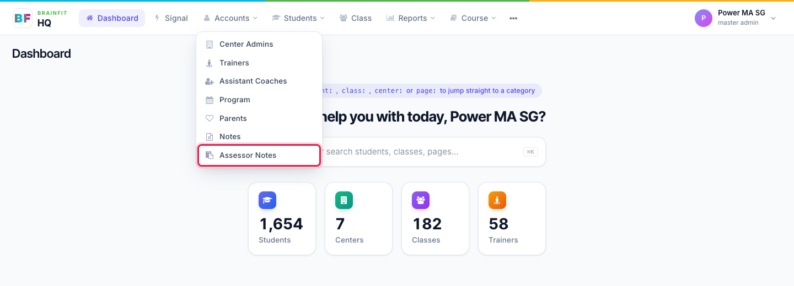
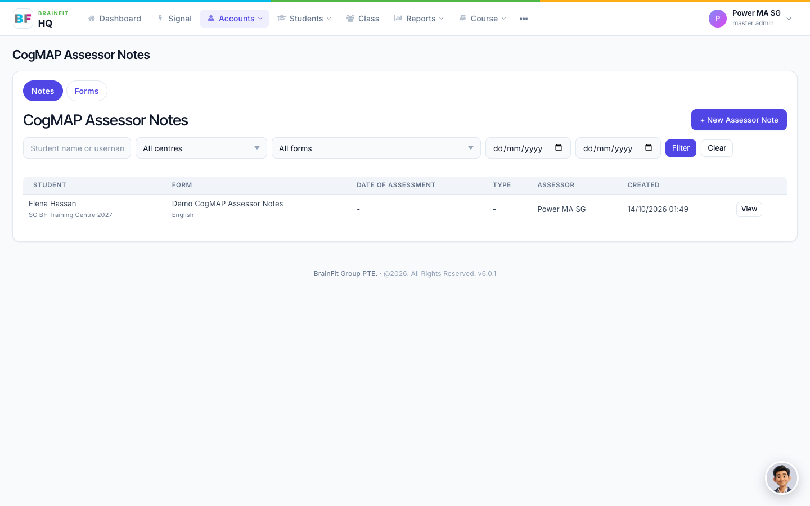
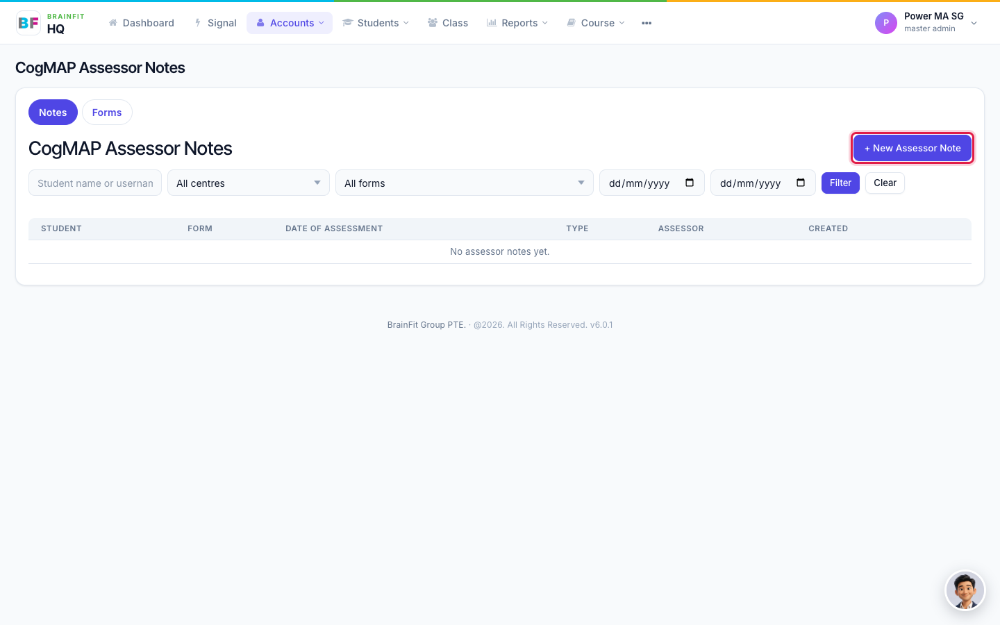
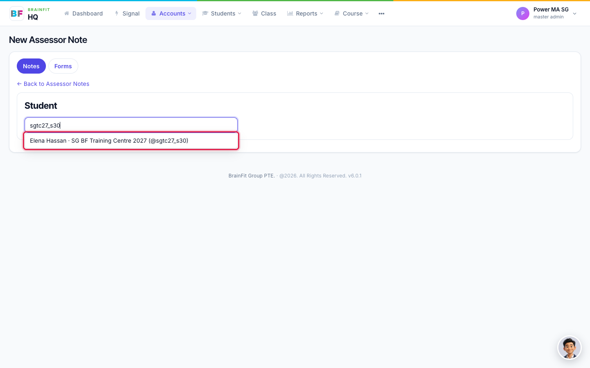
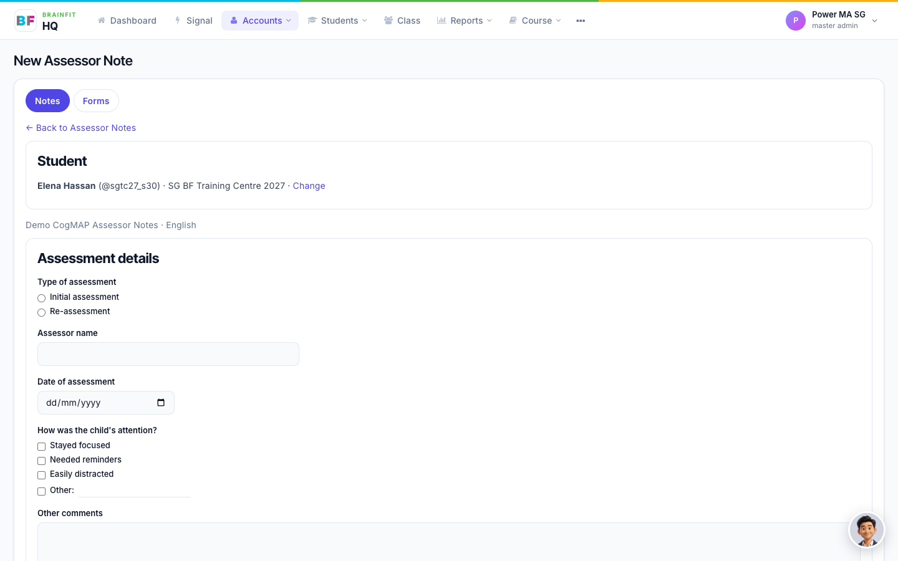
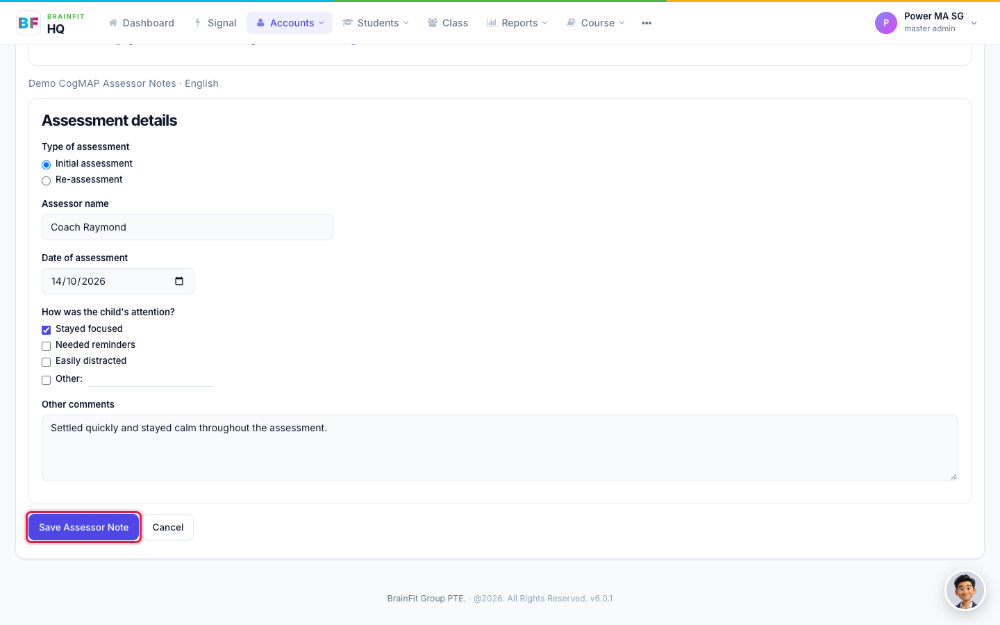
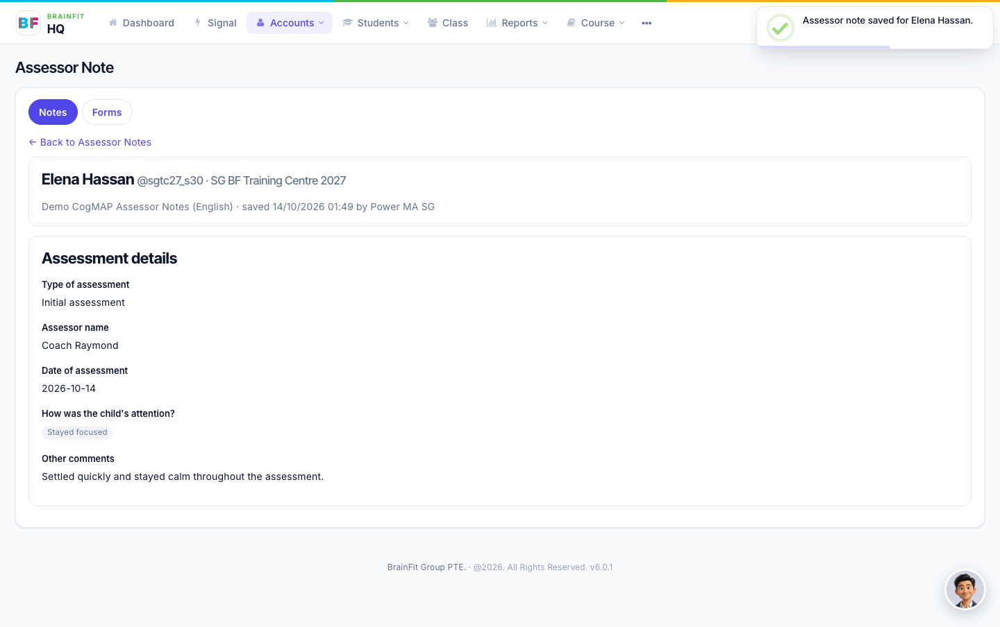

# Fill in an Assessor Note
An Assessor Note is where the assessor records what they saw during a student's CogMAP assessment. In Brain HQ, notes are kept per student, and each note is filled in on the form that was set up for the student's centre.

**Watch (about 2 minutes):**

<video controls preload="metadata" width="100%">
  <source src="/video/hq/assessor-notes.mp4" type="video/mp4" />
</video>

**Good to know:** you only see students and notes from your own centres.

## 1. Open Assessor Notes

In the top menu, open **Accounts** and click **Assessor Notes**, right under **Notes**.

The page has two tabs: **Notes** (this page) and **Forms** (see [Build and manage assessor forms](./assessor-forms.md)).

## 2. See the notes already written

The **Notes** tab lists the assessor notes, with the student and centre, the form used, the date of assessment, the type, the assessor and when the note was created. Narrow the list with the filters at the top: student name or username, **centre**, **form**, and a **from** and **to** date. Click **Clear** to start over.

Click **View** on a row to read the note.

## 3. Start a new note

Click **+ New Assessor Note**.

Search for the student by name or username (at least two letters) and click the student in the results.

## 4. Choose the form and fill it in

Each centre has its own forms. If the student's centre has more than one form, for example one in English and one in Thai, pick the one you need. If it has only one, it opens straight away.

Fill in the questions. Depending on the form, they can be single choice, multiple choice (some with an **Other** answer you can type), short text, long text, a date, or a grid. Then click **Save Assessor Note**.

If the student's centre has no form yet, the page says so. A Super Admin, Master Licensee, Master Admin or Centre Admin can create one under the **Forms** tab.

## 5. Read the saved note

After saving, the note opens in a read view, with the student, the form and who saved it and when.

A note keeps a copy of the form as it was when the note was filled in. If someone edits the form later, your old notes stay exactly as they were.
