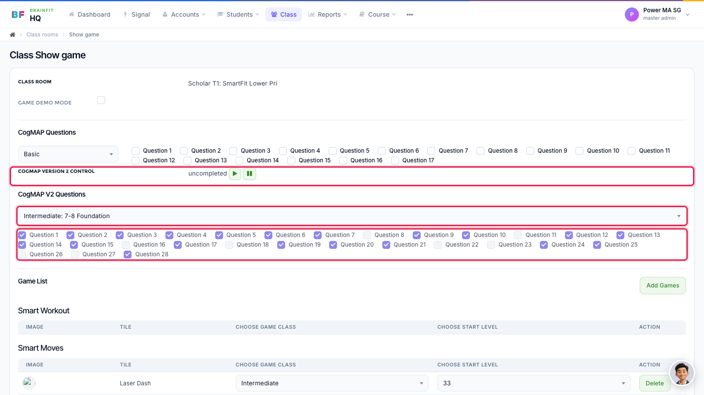
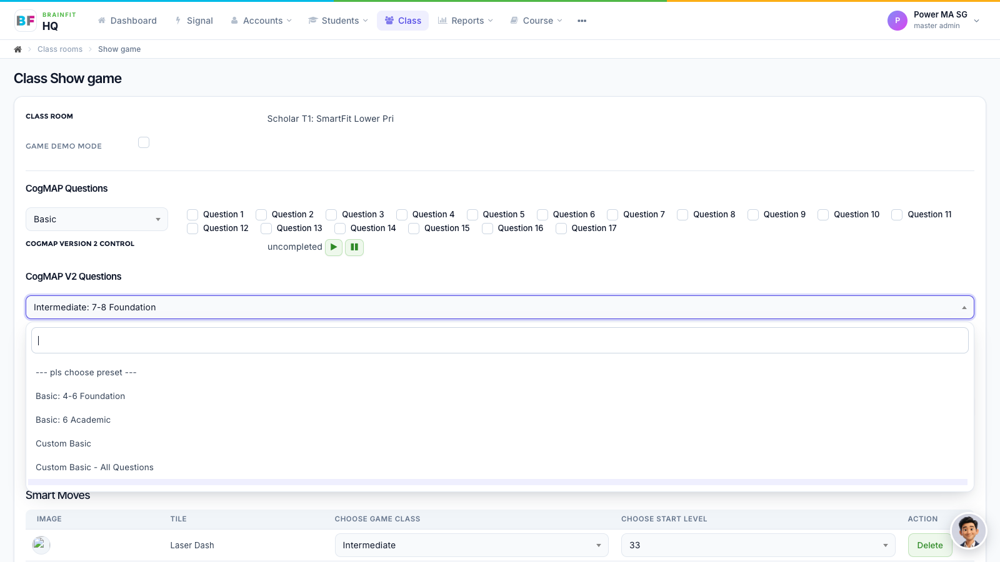

# Assign CogMAP V2 Levels and Questions to a Class
This feature is for SA, ML, MA, CA

**Watch (about 1 min):**

<video controls preload="metadata" width="100%">
  <source src="/video/hq/cogmap-class.mp4" type="video/mp4" />
</video>

The class setting decides which CogMAP V2 assessment (preset) and which questions every student in the class gets.

1. Open the class's **Game config** page: in **Class**, click the **gamepad** icon on the class (see [Assign Games to a Class](../Class%20Management/class-assign-games.md)). Under **CogMap V2 Questions**, the box shows the class's **preset**, and the ticks below show the questions in use. **CogMap version 2 control** starts (▶) or pauses (⏸) CogMAP for the class.

2. To change the preset, open the box and pick the one for the class's age group (for example *Basic: 4–6 Foundation*, *Intermediate: 7–8 Foundation*). The question ticks update to that preset; you can then tick or untick single questions.

**Note:**
- A change here applies to all students of the class. To change one student only, see [Set Up CogMAP for a Student](./cogmap-student-levels.md).
- The **CogMap Questions** section above it is the old CogMAP V1.
