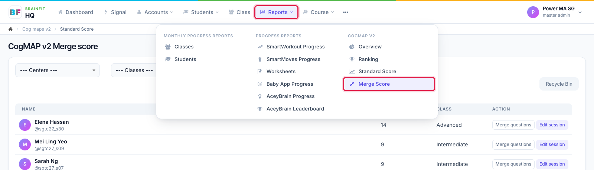
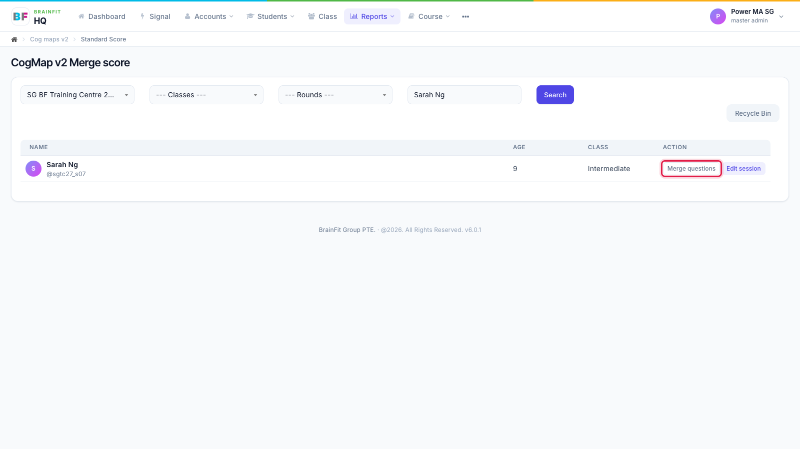
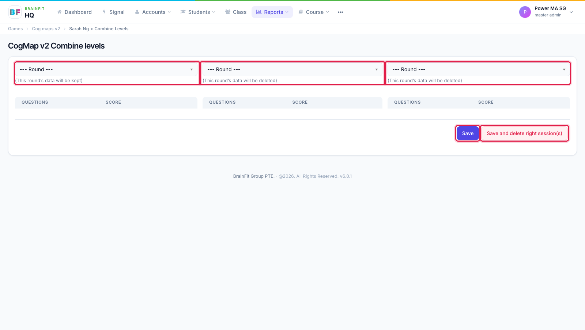

# Merge CogMAP V2 Scores
This feature is for SA, ML, MA

**Watch (about 50 s):**

<video controls preload="metadata" width="100%">
  <source src="/video/hq/cogmap-merge.mp4" type="video/mp4" />
</video>

Use this when a student's assessment was split over two or more sessions, to combine the scores into one round.

1. Open **Reports** and click **Merge Score** under **CogMAP V2**.

2. Search for the student and click **Merge questions** on their row.

3. In the first column, choose the **round to keep**. In the next column(s), choose the round(s) with the replacement scores. Tick the questions whose score you want to bring across.
   - **Save** merges the scores and keeps the other session(s).
   - **Save and delete right session(s)** merges and then deletes the session(s) in the right-hand columns.

:::caution
Deleted sessions can't be brought back. Check the rounds before you click **Save and delete right session(s)**.
:::
