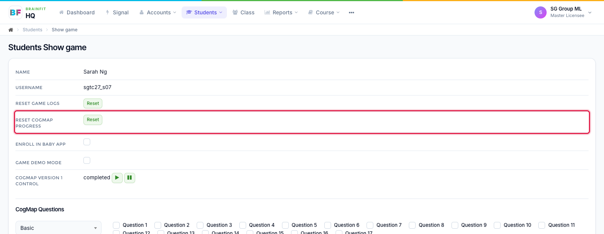
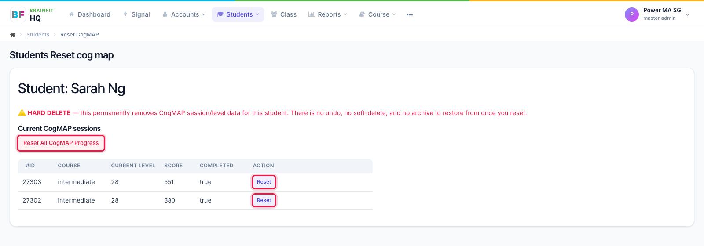

# Reset or Delete a Student's CogMAP Sessions
This feature is for SA, ML

**Watch (about 45 s):**

<video controls preload="metadata" width="100%">
  <source src="/video/hq/cogmap-reset.mp4" type="video/mp4" />
</video>

:::danger
This is a permanent delete. The session data can't be restored.
:::

1. Open the student's **Game config** page and click **Reset** next to **Reset CogMap Progress**.

2. The page lists the student's CogMAP sessions. Click **Reset** on one session to delete just that session, or **Reset All CogMap Progress** to delete all of them. The student's CogMAP setup (preset and questions) is switched off at the same time, so set it up again if they need to retake it.

