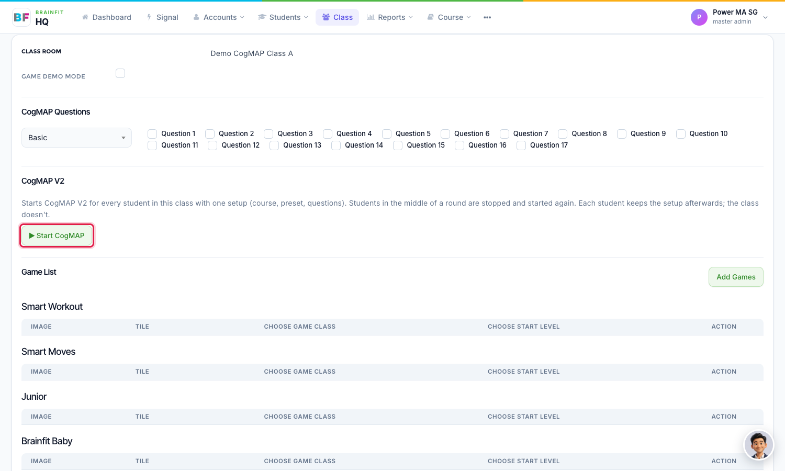
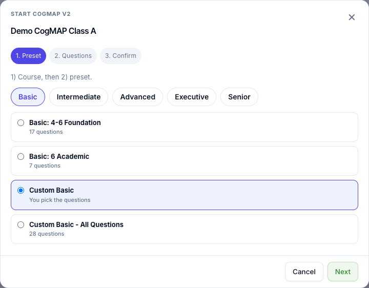
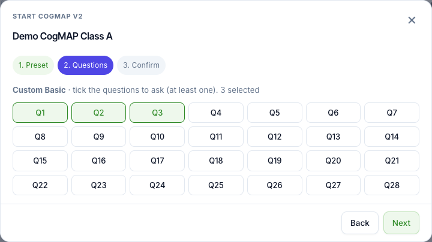
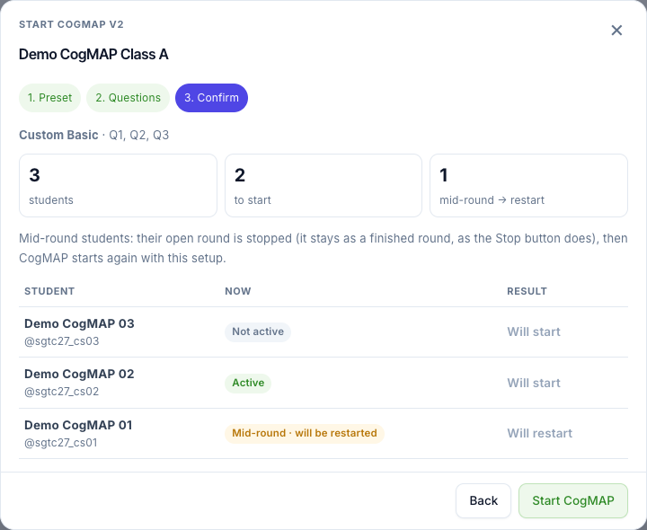
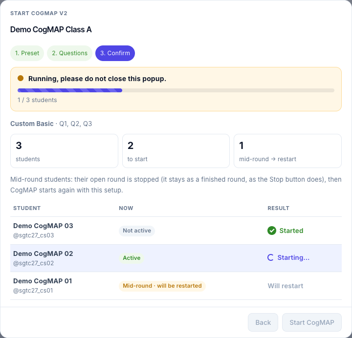
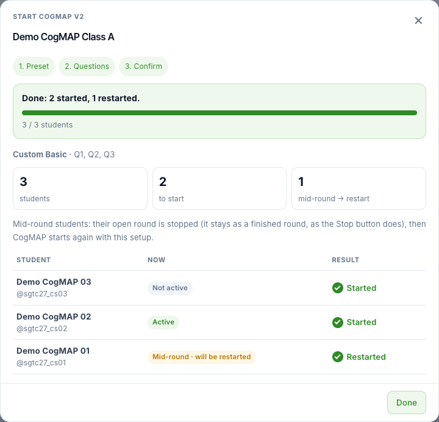
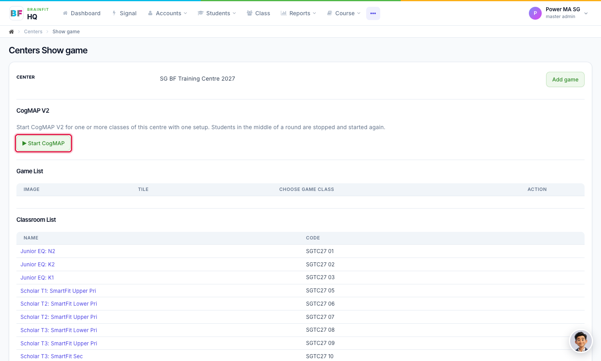
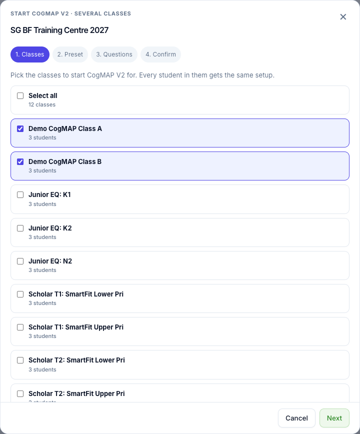
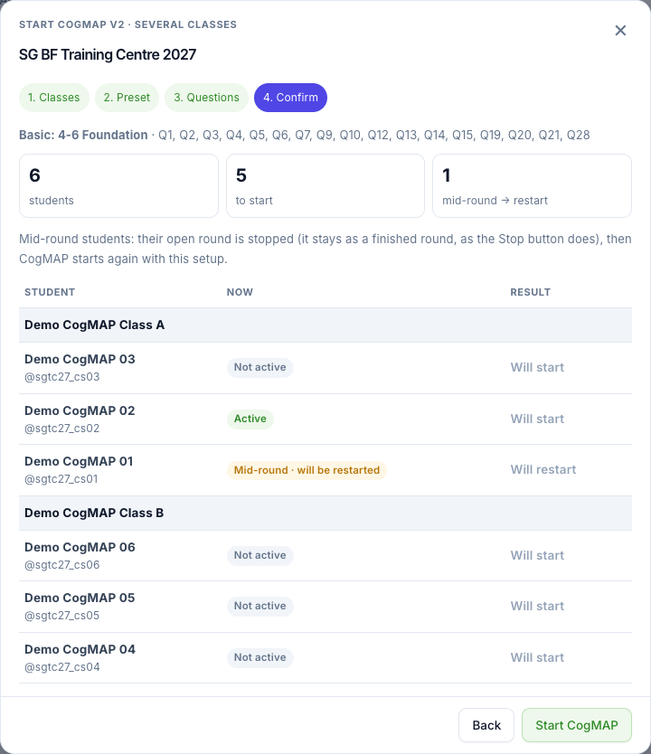
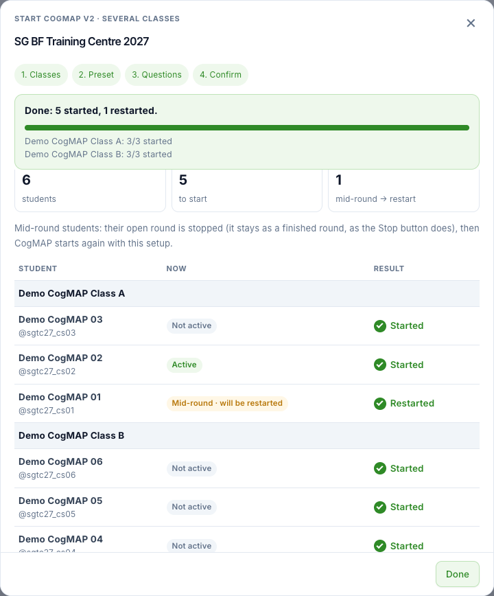

# Start CogMAP for a Class or a Centre
This feature is for SA, ML, MA, CA

**Watch (about 1 min 40 s):**

<video controls preload="metadata" width="100%">
  <source src="/video/hq/cogmap-start-class.mp4" type="video/mp4" />
</video>

**Start CogMAP** starts CogMAP V2 for every student in a class in one go. It is a one-off action: it writes the setup you choose (preset and questions) into each student, then starts them. The class does not keep a setup afterwards. To change a single student, see [Student CogMAP](./cogmap-student-setup.md).

## Start CogMAP for a class

1. Open the class's **Game config** page: in **Class**, click the **gamepad** icon on the class (see [Assign Games to a Class](../Class%20Management/class-assign-games.md)). Under **CogMAP V2**, click **Start CogMAP**.

2. **Step 1, Preset.** Choose the course (*Basic*, *Intermediate*, *Advanced*, *Executive* or *Senior*), then the preset. Click **Next**.

3. **Step 2, Questions.** A named preset shows its own questions (they cannot be changed). For a **Custom** preset, tick the questions to ask; you need at least one. Click **Next**.

4. **Step 3, Confirm.** Every student of the class is listed with their status: *Not active*, *Active*, or *Mid-round · will be restarted*. A student in the middle of a round has the unfinished round closed as finished, and starts again with the new setup. Check the list, then click **Start CogMAP**.

5. While it runs, the window is locked: there is no close button, **Esc** and clicking outside do nothing, and the page asks you to confirm if you try to leave. It shows *Running, please do not close this popup*, and each student changes to *Started* or *Restarted* one by one.

6. When it finishes you see a summary, for example *Done: 2 started, 1 restarted*. Click **Done**. Each student now has CogMAP active with the setup you chose. One entry for the class start is saved in the Activity Log (who, preset, questions, and how many students were started or restarted).

## Start CogMAP for several classes (centre)

Open the centre's **Game config** page and click **Start CogMAP**.

The window is the same, with one extra first step: tick the classes (or **Select all**). A student who is in two of the picked classes is started once.

On the confirm step the students are grouped by class.

When it finishes, the summary shows the total and a line for each class.

**Note:**
- **Start CogMAP** really starts CogMAP for those students. Check the class and the student list before you click it.
- It replaces each student's own preset and questions with the ones you chose.
- Neither a class nor a student can be started without a preset and at least one question.
- If a student cannot be started, that row shows the reason, and the others still go ahead.
