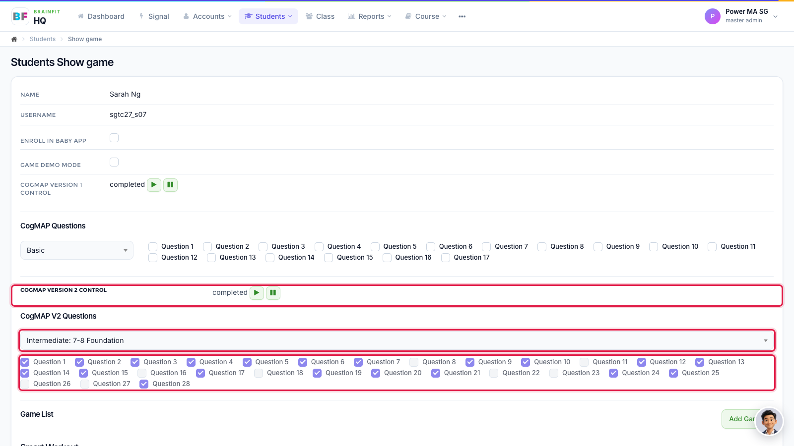

# Assign CogMAP V2 Levels and Questions to a Student
This feature is for SA, ML, MA, CA

**Watch (about 40 s):**

<video controls preload="metadata" width="100%">
  <source src="/video/hq/cogmap-student.mp4" type="video/mp4" />
</video>

Use this when one student needs a different CogMAP V2 setup from the rest of the class.

1. Open the student's **Game config** page: in **Students**, click the **gamepad** icon on the student (see [Assign Games to a Student](../Student%20Management/student-assign-games.md)). The **CogMAP V2 Questions** box and question ticks work the same way as for a class, but only for this student. **CogMAP Version 2 Control** shows the student's status (*completed* / *uncompleted*) and starts or pauses their CogMAP.

**Note:** a student starts with their class's setting; changing it here only affects this student.
