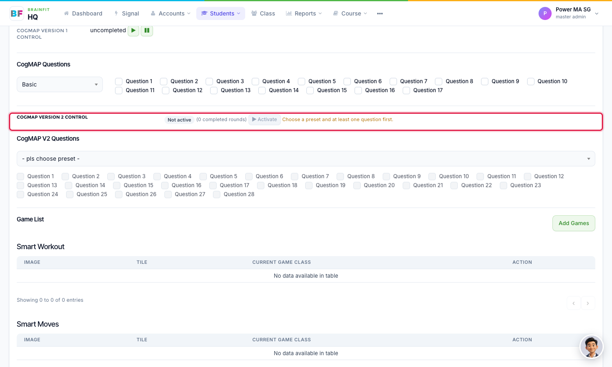
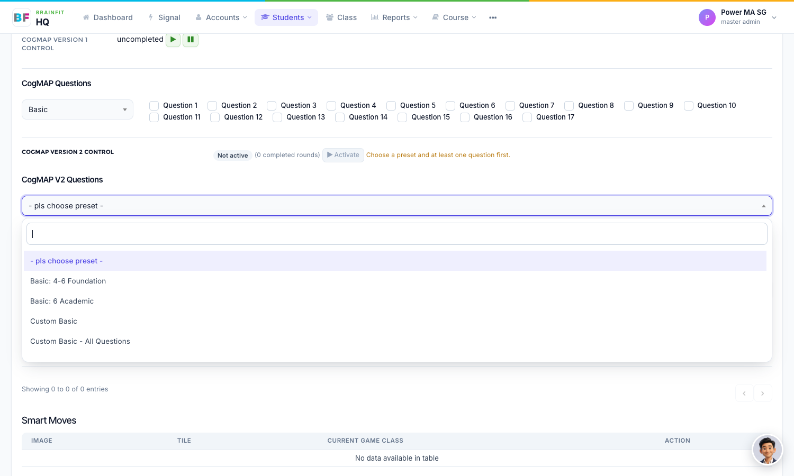
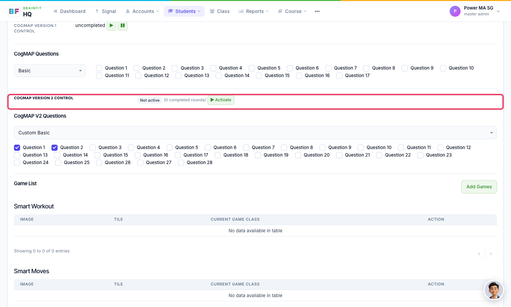
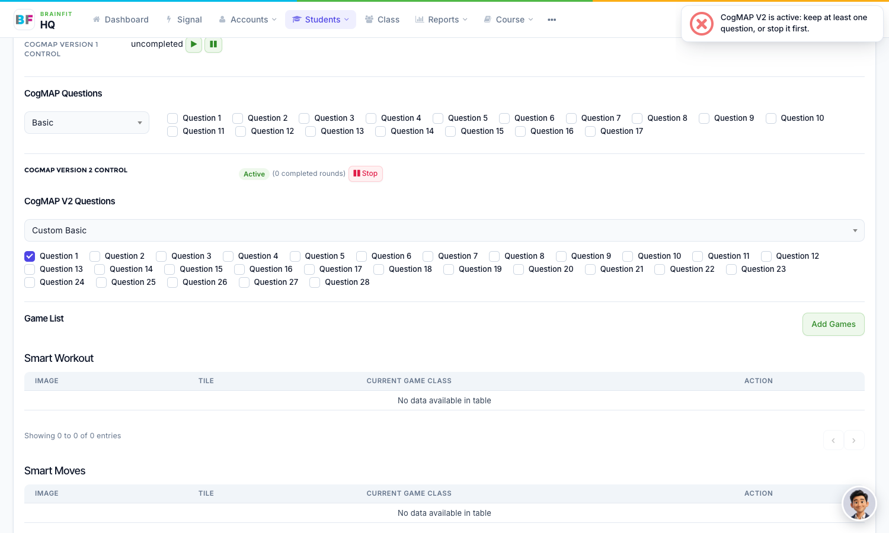
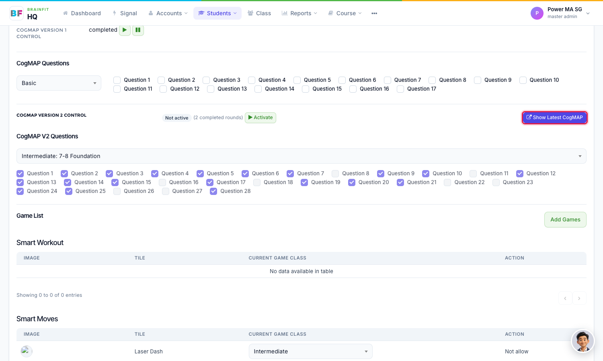

# Student CogMAP Setup and Activation
This feature is for SA, ML, MA, CA

**Watch (about 1 min 30 s):**

<video controls preload="metadata" width="100%">
  <source src="/video/hq/cogmap-start-student.mp4" type="video/mp4" />
</video>

CogMAP V2 now uses only the student's **own setup**: a preset and at least one question. Nothing is taken from the class or the centre. A student with no setup cannot be activated, and the app does not offer them CogMAP V2.

1. Open the student's **Game config** page: in **Students**, click the **gamepad** icon on the student (see [Assign Games to a Student](../Student%20Management/student-assign-games.md)). Find **CogMAP Version 2 Control**. For a student with no setup it shows *Not active*, **Activate** is greyed out, and the note *Choose a preset and at least one question first* appears next to it.

2. Under **CogMAP V2 Questions**, open the preset box and choose a preset (for example *Basic: 4-6 Foundation*, or *Custom Basic*). A named preset ticks its own questions. A **Custom** preset starts with nothing ticked.

3. For a Custom preset, tick the questions the student should do. Reload the page: with a preset and at least one question, **Activate** is now available. Click it, and the status changes to *Active*.

4. While CogMAP is *Active* you cannot untick the last question. The tick stays and the page shows *CogMAP V2 is active: keep at least one question, or stop it first*. To change everything, click **Stop** first.

5. Once the student has finished at least one round, **Show Latest CogMAP** appears next to the control. It opens the latest result in a new tab.

**Note:**
- A **Custom** preset with nothing ticked counts as no setup.
- Changing to another Custom preset while CogMAP is active keeps the questions already ticked.
- To set up many students at once, use [Class Start CogMAP](./cogmap-start-class.md).
