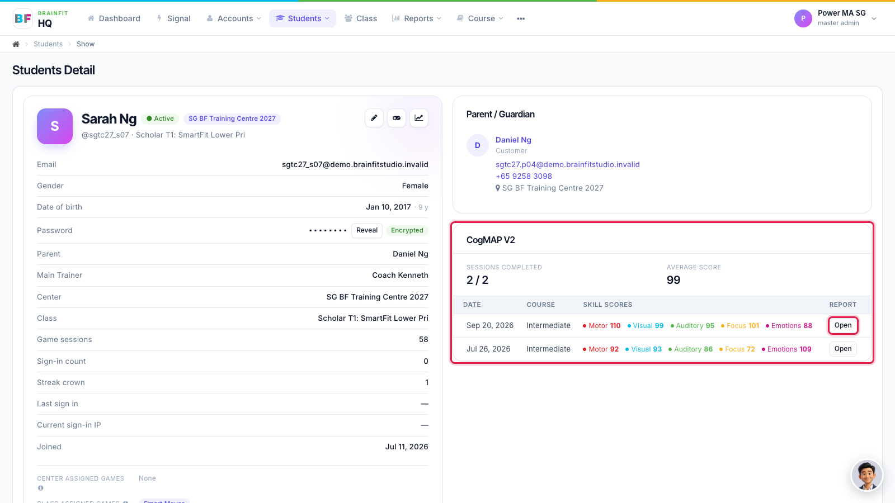
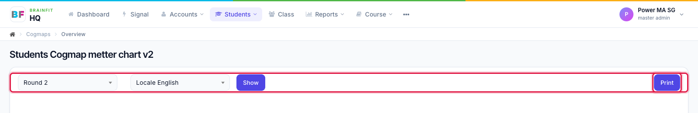
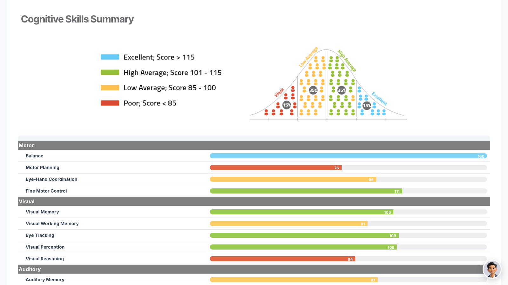
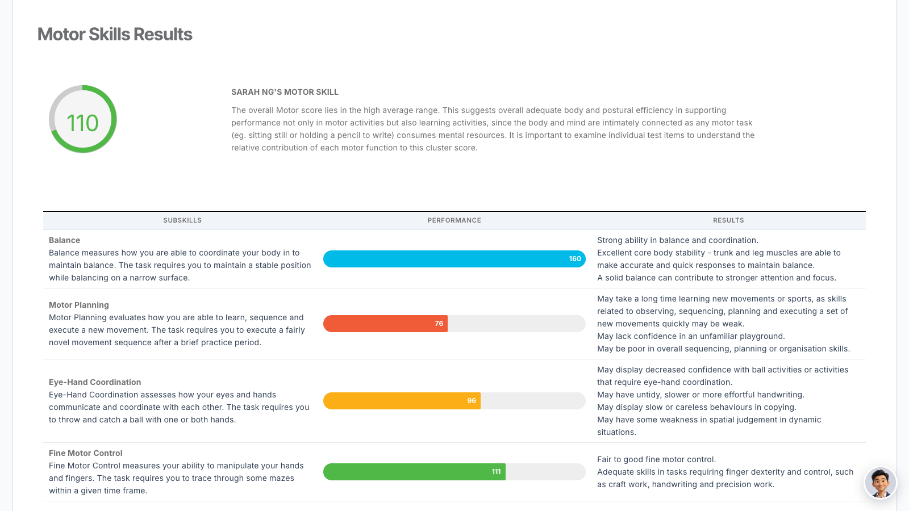
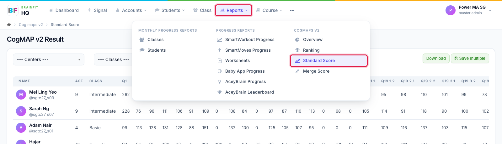
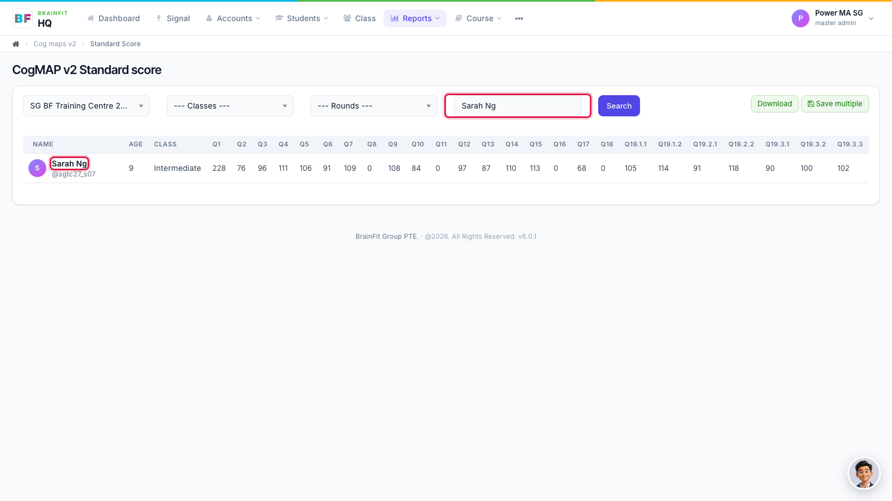
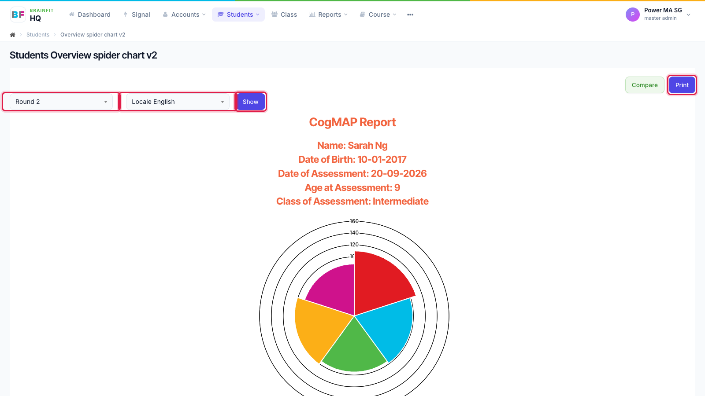

# View CogMAP V2 Results
This feature is for SA, ML, MA, CA, Trainer

**Watch (about 1 min 30 s):**

<video controls preload="metadata" width="100%">
  <source src="/video/hq/cogmap-results.mp4" type="video/mp4" />
</video>

There are two ways to a student's CogMAP V2 results: from the student's own page, or from the CogMAP list under **Reports**.

## Way 1: from the student's page

1. Open the student's page (in **Students**, click the **magnifier** icon). The **CogMAP V2** card shows how many sessions are completed, the average score, and each skill's score (Motor, Visual, Auditory, Focus, Emotions) for every round. Click **Open** on a round to see its full report.

2. The report opens for that round. Change **Round** or the report language, then click **Show**. **Print** prints the report or saves it as a PDF.

3. The report includes the **Cognitive Skills Summary**: every skill with its score and band (Excellent, High Average, Low Average, Poor).

4. Each area then has its own page, for example **Motor Skills Results**, with the score, what it means and what to work on.

## Way 2: from the CogMAP list (Standard Score)

Use this to find any student's results, including students you don't have open.

1. Open **Reports** in the top menu and click **Standard Score** under **CogMAP V2**.

2. Choose the centre (and the class or round if you like), type the student's name and click **Search**. The table shows each question's score. Click the student's **name** to open their report.

3. The student's CogMAP report opens, with the spider chart and each skill's scores. Choose the **Round** and the report **language**, click **Show**, then **Print** to print it or save it as a PDF.

**Note:** the page opened from the list is the student's overview chart. The full report with the Cognitive Skills Summary and a page for each area (Way 1) opens from **Open** on the student's page. To print from the list, see [Find and Print a Report](./cogmap-print-report.md).
