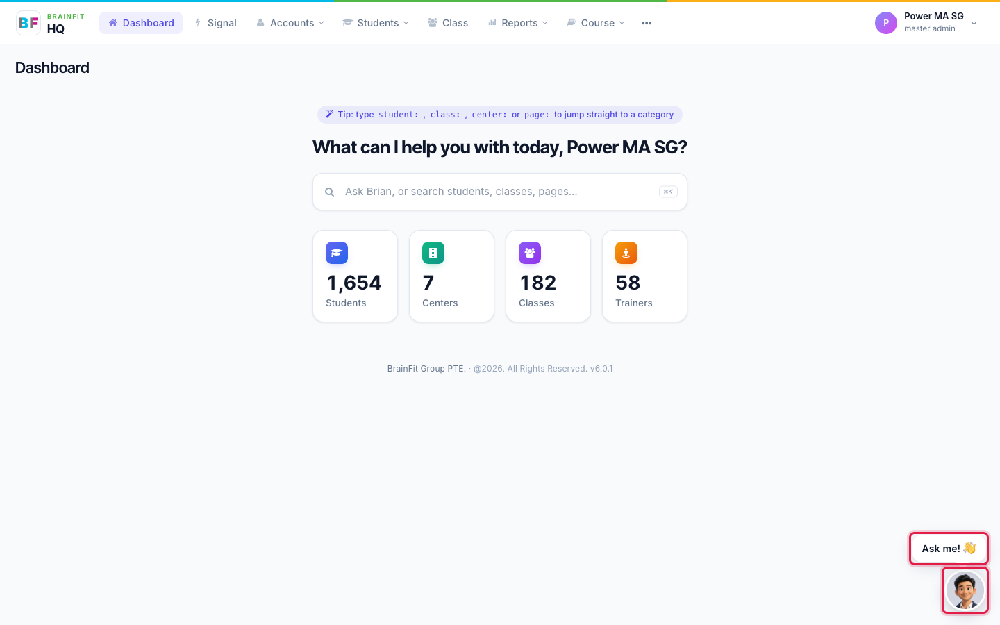
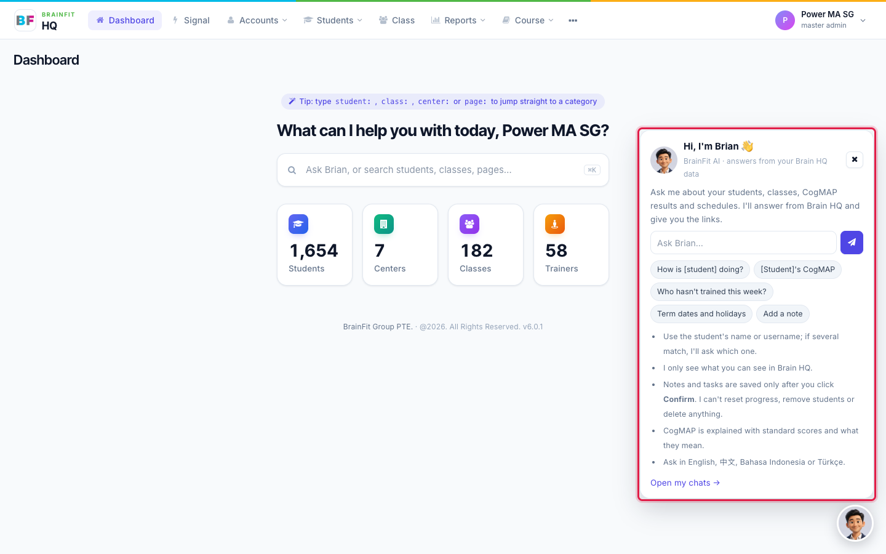
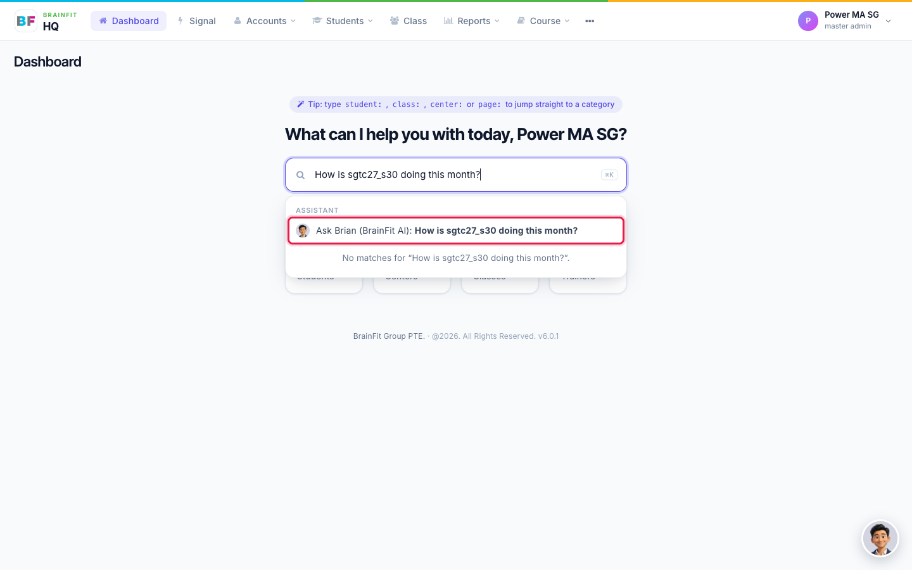
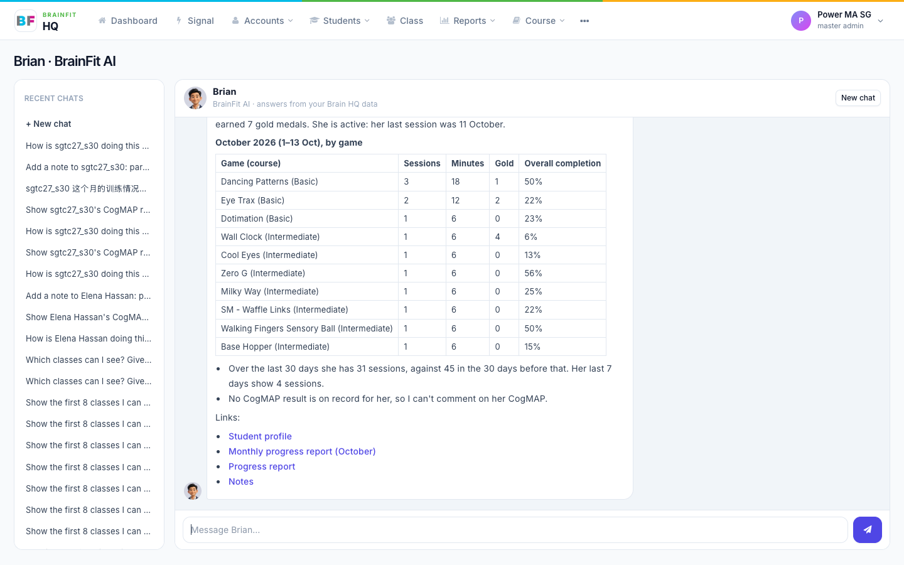
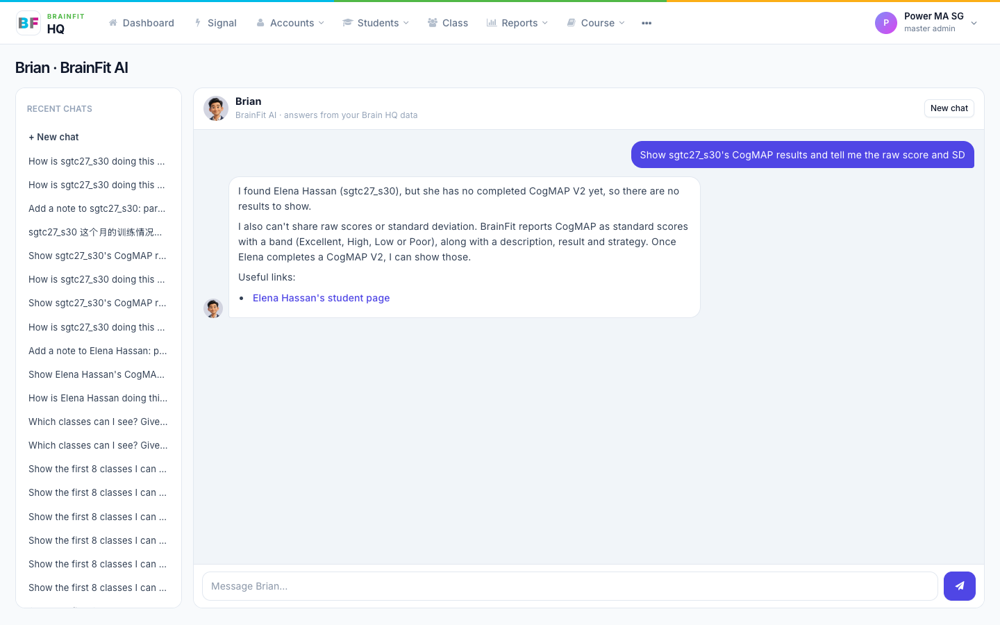
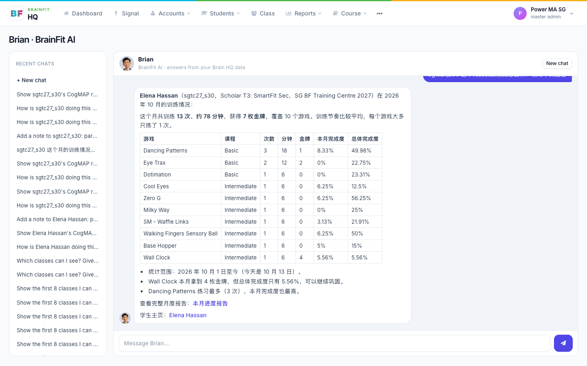
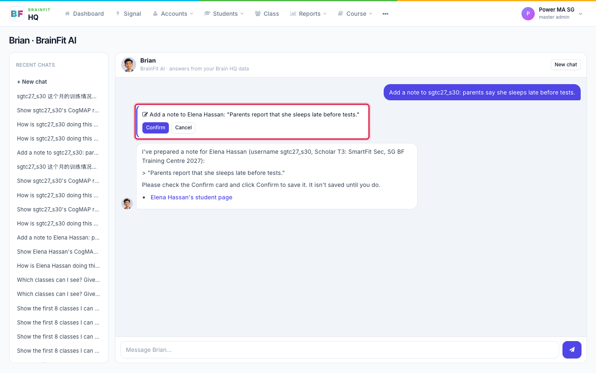
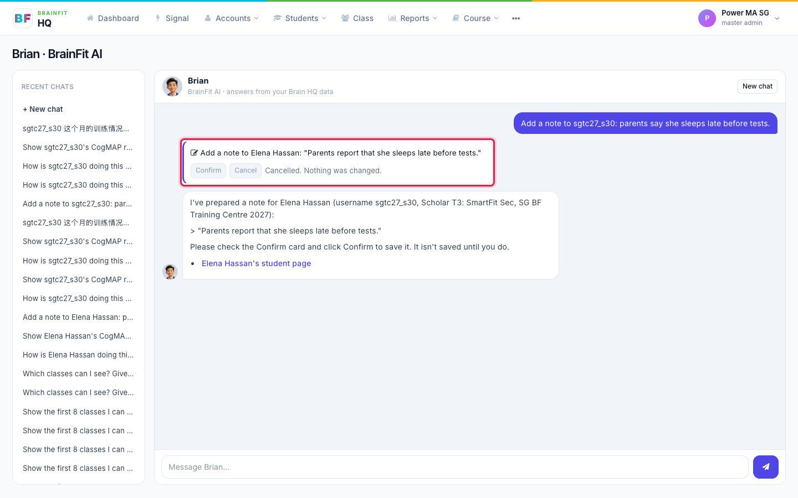
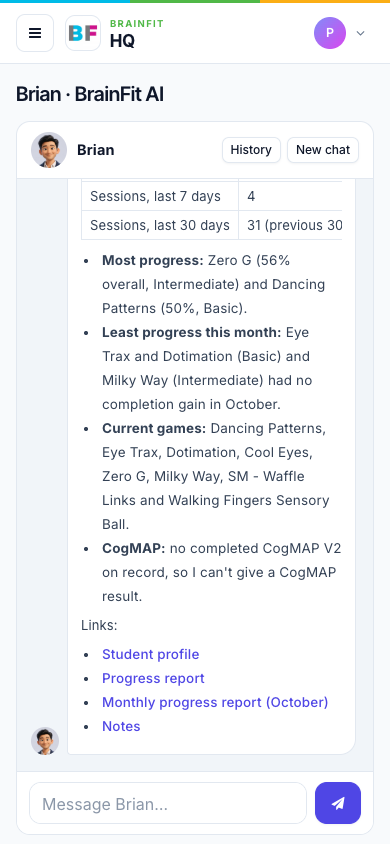
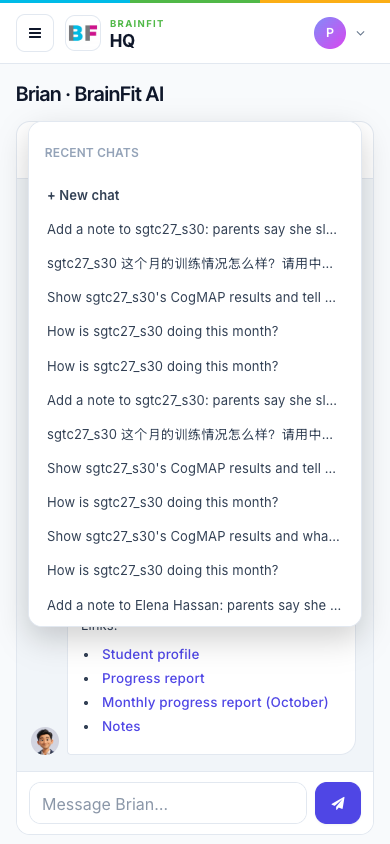

# Ask Brian, the BrainFit AI assistant
Brian is BrainFit's AI assistant inside Brain HQ. Ask him in plain words, such as *"How is Minh doing this month?"*, and he answers from your Brain HQ data, with links to the real pages. Brian is being tried out with a small group first: Super Admin and the Master Admins of SG Group ML.

**Watch (about 2 minutes):**

<video controls preload="metadata" width="100%">
  <source src="/video/hq/brian.mp4" type="video/mp4" />
</video>

**Good to know:** Brian only sees what you can already see in Brain HQ, never more. Check anything important on the page he links to.

## 1. Open Brian from any page

On every Brain HQ page there is a round **Brian** picture at the bottom right. On the dashboard it also shows an **Ask me!** speech bubble. Click either to open the Brian card.

The card has an ask box, a few example questions you can click, and short tips. Type your question and press Enter to open the chat.

## 2. Ask from the dashboard

You can also type a question into the search box on the dashboard. When it looks like a question, an **Ask Brian (BrainFit AI)** row appears at the top of the results. Press Enter, or click the row, to open the chat.

## 3. The chat page

The chat page works like a chat app: your messages are on the right and Brian's answers are on the left. Answers appear word by word, and they include links to the student profile, the progress report and other pages, so you can open the real screen.

- **Recent chats** on the left lists your earlier conversations. Click one to carry on, or click **New chat** to start fresh. On a phone, tap **History**.
- Use the student's **name or username**. If two students share a name, Brian lists them with their class and centre and asks which one you mean.

## 4. What Brian can answer

- A student's progress: sessions, minutes, games and levels, and monthly figures
- A student's CogMAP results
- Class information
- Your own coaching sessions, and a student's schedule
- Term dates and holidays

## 5. CogMAP: standard scores only

For CogMAP, Brian always gives the **standard score** and what it means: the band, the description, and the strategy or recommendation. He never gives the raw score, SD or mean, even if you ask. He tells you so, and explains the standard score instead.

## 6. Your language

Ask in **English, 中文, Bahasa Indonesia or Türkçe**, and Brian replies in the same language.

## 7. Notes and reminders: you always confirm

Brian can prepare a note ("Add a note to …") or a reminder ("Remind me to …") for you. He shows a **Confirm card** with exactly what he will save. **Nothing is saved until you click Confirm.** Click **Cancel** and nothing changes.

Brian can't reset progress, remove students or delete anything.

## 8. On your phone

The chat page works on a phone too. Tap **History** to see your recent chats.

