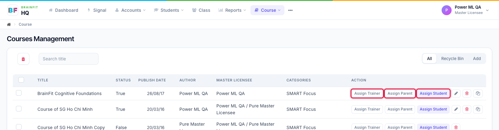
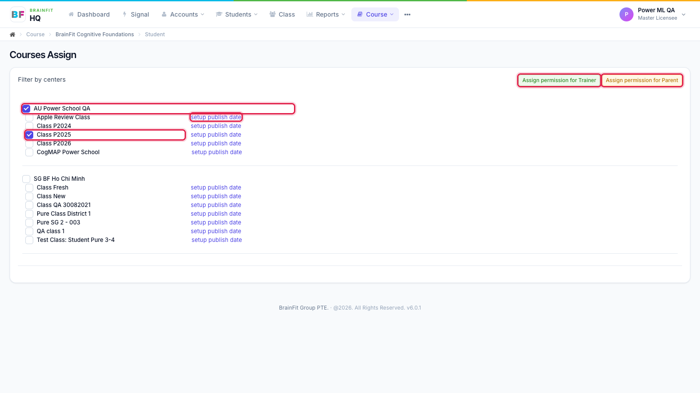

# Assign a Course
This feature is for SA, ML, MA

**Watch (about 30 s):**

<video controls preload="metadata" width="100%">
  <source src="/video/hq/course-assign.mp4" type="video/mp4" />
</video>

1. In the course list, click **Assign Trainer**, **Assign Parent** or **Assign Student** on the course's row.

2. Tick the centre or the classes that should get the course (the list shows the centres of the course's master licensee). Each class has **setup publish date** to release the topics on a schedule. The buttons at the top right switch to assigning for trainers or parents.

