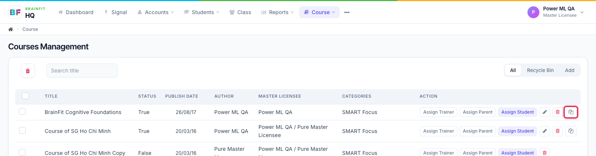
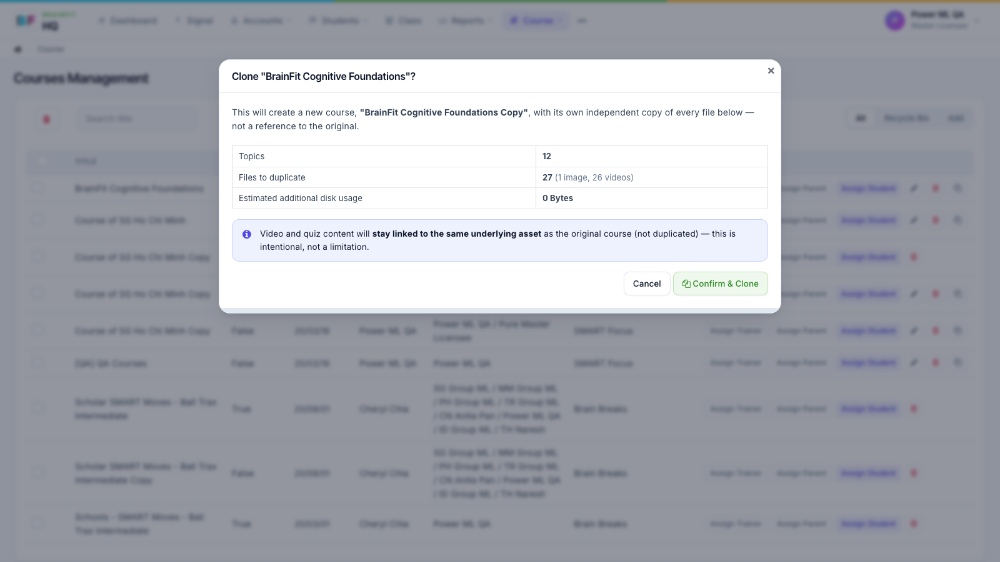

# Clone a Course
This feature is for SA and whoever the course's **Access Control** allows to clone

1. In the course list, click **Duplicate** on the course's row (or **Clone Course** at the top of its edit page).

2. The pop-up shows what will be copied (topics, files) and the extra storage it needs. Click **Confirm & Clone**. The copy is created as "*… Copy*", with its own copy of every file.

**Note:** videos and quizzes in the copy still point to the same video and quiz as the original. Super Admins can see the clone history at the bottom of the course's edit page.
