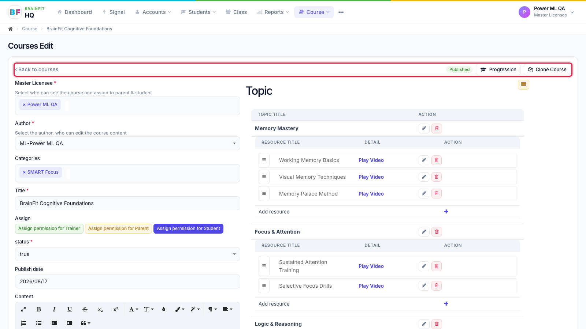
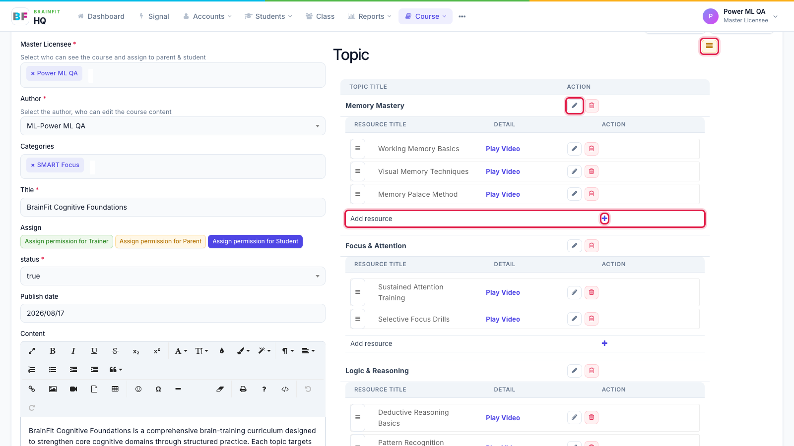
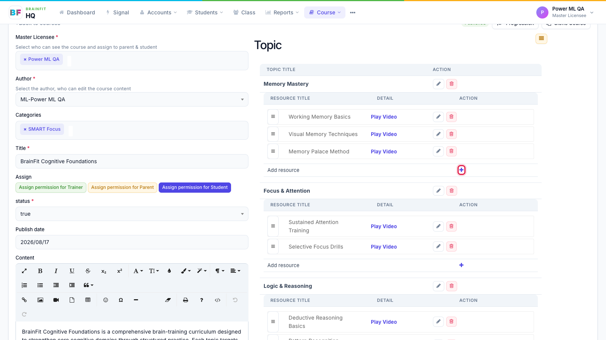
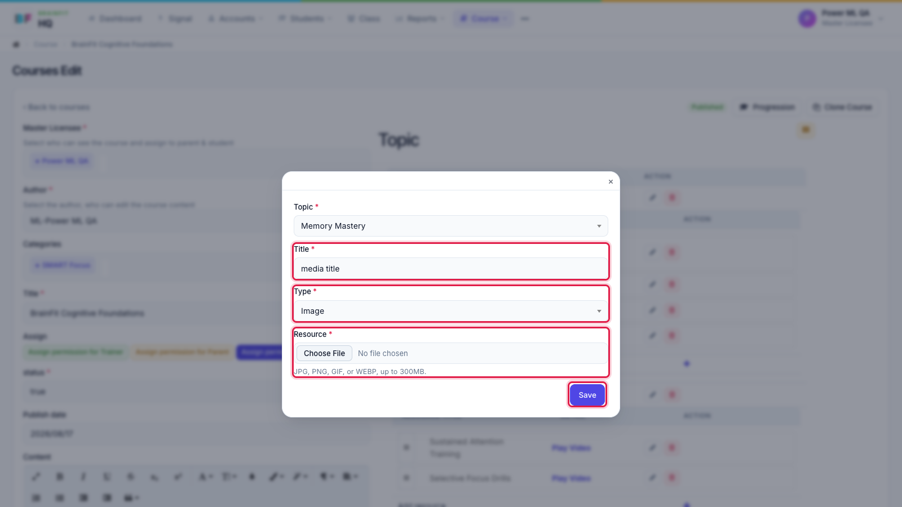

# Edit a Course, Topics and Resources
This feature is for SA and whoever the course's **Access Control** allows to edit (by default the author)

1. Open the course from the list (pencil). The top row has **Back to courses**, the **Published / Draft** status, **Progression** (when it's turned on) and **Clone Course**. The course details are on the left; the topics on the right.

2. In **Topic**: the yellow button sorts the topics; the **pencil** renames a topic; drag the **≡** handle to reorder resources (or move them to another topic). Click a resource's pencil to edit it, or the red button to remove it. Images and PDFs open in a preview pop-up; **Play Video** plays a video.

3. To add a resource, click **+** on the **Add resource** row of the topic.

4. Fill in **Title**, choose the **Type** (video, image, document, link or quiz) and upload the file (or paste the link / pick the quiz), then click **Save**.

:::caution
Clicking **+** creates the new resource straight away (named *media title*). If you close the pop-up without saving, delete that empty resource with its red button.
:::
