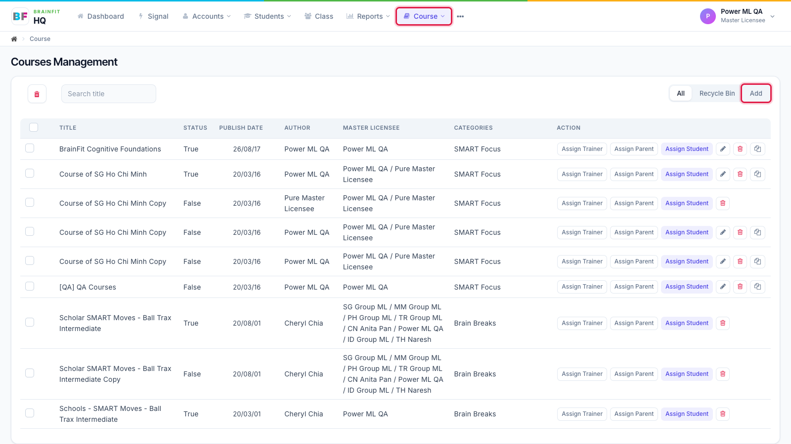
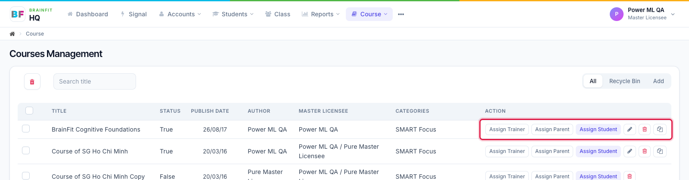
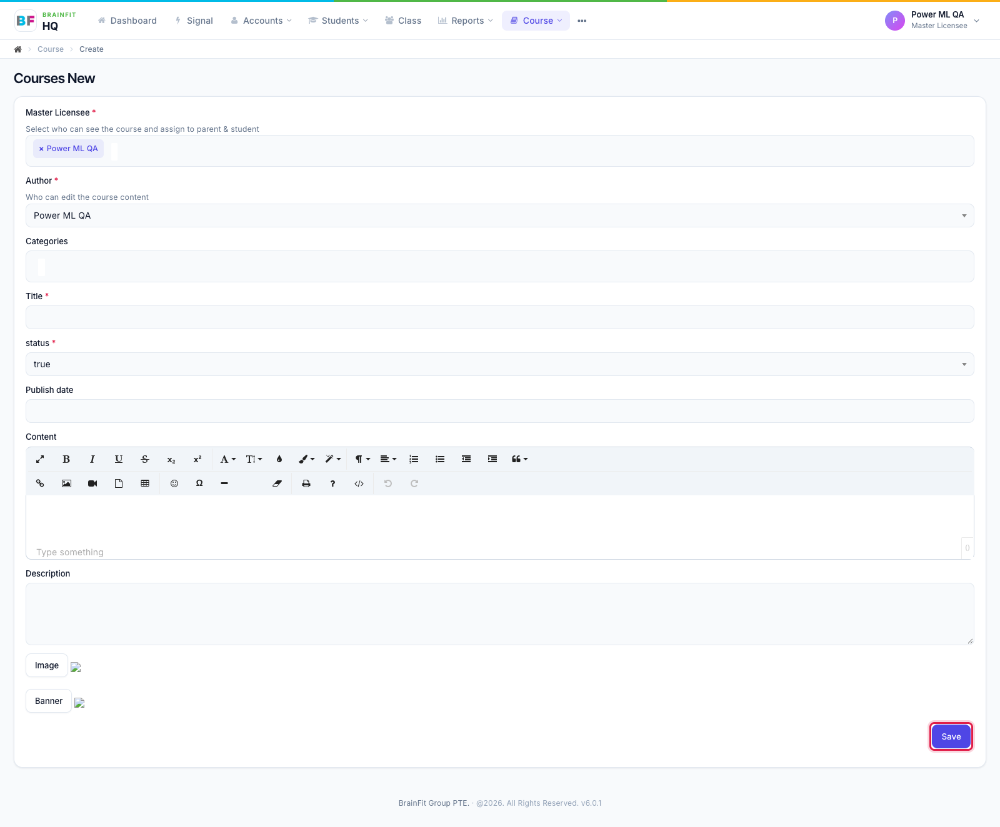

# Course List and Create a Course
This feature is for SA, ML, MA

**Watch (about 50 s):**

<video controls preload="metadata" width="100%">
  <source src="/video/hq/course-list.mp4" type="video/mp4" />
</video>

1. Open **Course** in the top menu. The list shows each course's status, publish date, author, master licensee(s) and categories. Click **Add** at the top right to create a new course.

2. Each row has its actions: **Assign Trainer / Parent / Student**, **Edit** (pencil), **Delete**, and **Duplicate** (clone).

3. In the new course form, choose the **Master Licensee** (who can see the course and assign it), the **Author** (who can edit its content), categories, title, status, publish date, content, description, image and banner, then click **Save**. Topics and resources are added after the course is saved, on its edit page.

