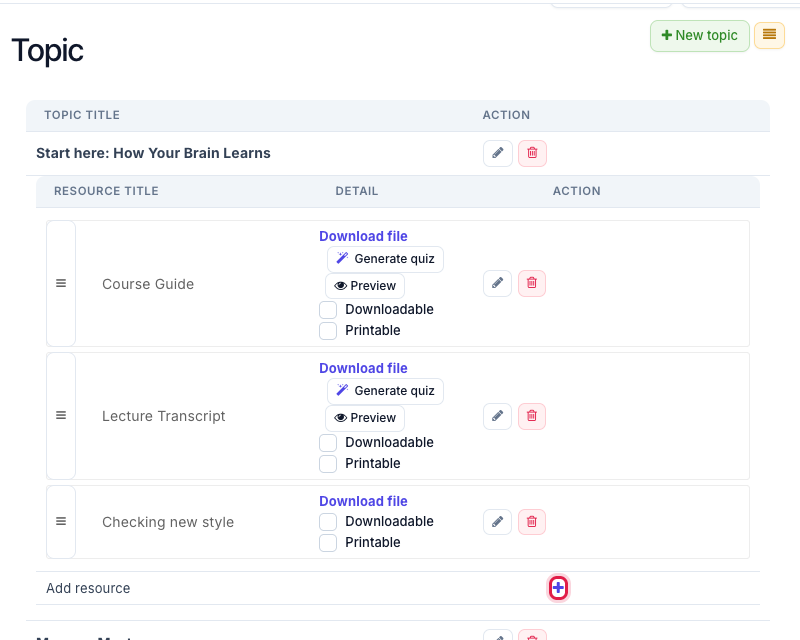
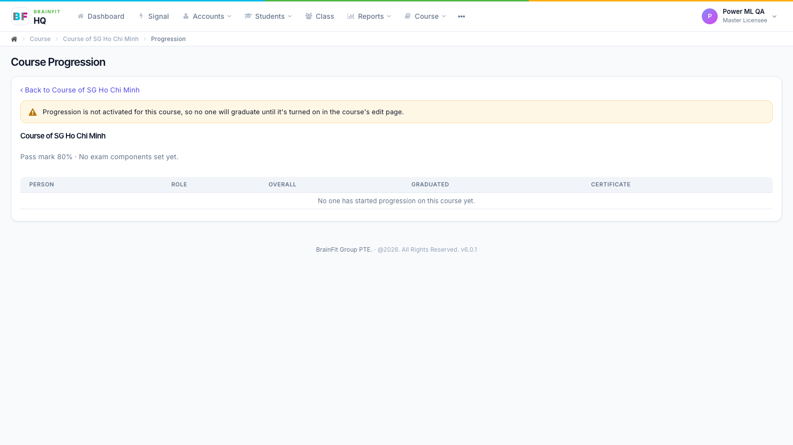
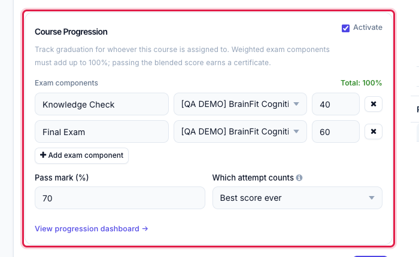
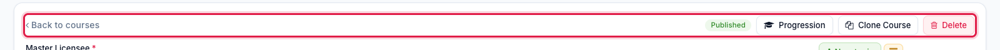
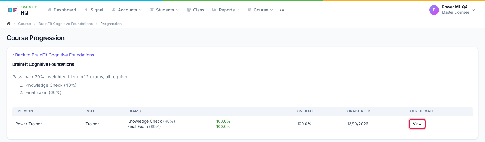
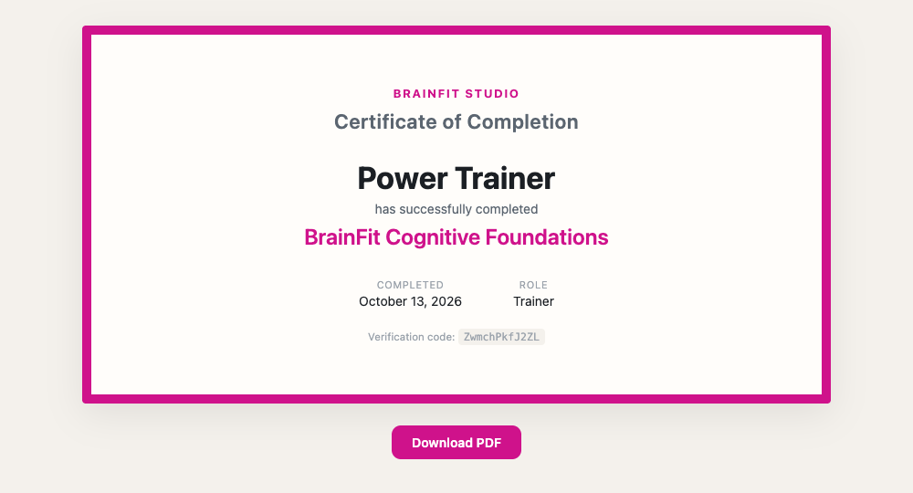

# Course Progression and Graduation
This feature is for Super Admin and the course's author.

**Watch (about 2 minutes):**

<video controls preload="metadata" width="100%">
  <source src="/video/hq/course-progression.mp4" type="video/mp4" />
</video>

Course Progression decides when someone **graduates** from a course, based on their quiz scores. Trainers, parents and students take the course's quizzes in the app; once their weighted score reaches the pass mark, they graduate and get a certificate.

## 1. Before you start: the course needs quizzes

Progression only works with quizzes. Each exam must be a **Quiz resource inside a topic** of the course:

1. On the course's edit page, find the topic and click **+** next to **Add resource**.
2. Set **Type** to **Quiz**, choose the quiz (or click **Create new quiz**), and **Save**.

If the course has no quizzes yet, the Progression box shows *"This course has no quizzes attached to its topics yet. Add a Quiz resource before setting exam components."* and no exam can be picked.

**Who can see and change it:** only Super Admin and the course's author see the Course Progression box.

## 2. Turn it on

On the course's edit page, find the **Course Progression** box in the left column and tick **Activate**. The settings open below it.

## 3. Add the exam components

Click **Add exam component** for each exam, and fill in:

- **Label**: the name people will see, for example *Final Exam*.
- **Quiz**: pick one of the course's quizzes.
- **Weight (%)**: how much this exam counts.

You can add as many exams as you need (5 is fine). The weights must add up to **exactly 100%**: the **Total** on the right turns green at 100%. If it isn't 100, **Save** is rejected with *"Exam component weights must add up to 100%"*.

## 4. Pass mark and which attempt counts

- **Pass mark (%)**: the overall score someone needs to graduate.
- **Which attempt counts**, when someone takes a quiz more than once:
  - **Best score ever**: their highest score counts.
  - **Most recent attempt**: only the latest attempt counts.
  - **First attempt only**: retries don't count.

Click **Save** at the bottom of the course page when you're done.

## 5. How people graduate

The trainer, parent or student takes the quizzes in the app. Scores update on the dashboard within about a minute.

- The **overall score** is the weighted blend of all exams.
- **All exams are required**: someone has to take every exam before they can graduate.
- **Overall score ≥ pass mark** means graduated.
- If someone changes an answer before submitting, the last answer counts.

## 6. The Progression dashboard

Click **Progression** in the top bar of the course edit page (or **View progression dashboard →** in the Course Progression box).

The page lists the pass mark and exams, then one row per person:

| Column | What it shows |
|---|---|
| Person | Name |
| Role | Trainer, Parent or Student |
| Exams | One line per exam with the score, or **Not yet** |
| Overall | The weighted score |
| Graduated | The date they passed |
| Certificate | **View** once they've graduated |

## 7. Certificate

Click **View** to open the person's certificate page. It shows the BrainFit logo, the course, the person's average exam mark, the date, a seal and a verification code, with a **Verified** badge and a details box underneath. Anyone with the link can view it, so it can be used to verify the certificate.

From this page you can **Print** or **Copy link**. Click **Download PDF** to open the BrainFit certificate copy, where you can download or print it. The copy is issued only when someone clicks Download PDF (nothing is created automatically).
