# Create or import a quiz with AI

On the **Quizzes** page, the **Add** button now offers three ways to make a quiz: write it by hand, let the AI assistant write one from a PDF lesson, or import a quiz you already have, for example a Google Form. This guide covers the second and third ways. Nothing is saved until you have read the questions and clicked **Save quiz**.

**Watch (about 3 minutes):**

<video controls preload="metadata" width="100%">
  <source src="/video/hq/quiz-ai.mp4" type="video/mp4" />
</video>

This feature is for Super Admin, Master Licensee and Master Admin. Centre Admin and Trainer do not have a Quizzes menu.

## Open the Add window

Open **Course → Quiz** and click **Add** at the top right of the table.

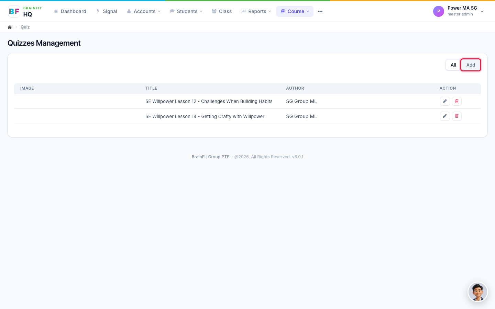

A window opens with three choices.

- **Add Quiz Manually** is the same as before: you create an empty quiz and type the questions yourself.
- **Create quiz with AI Assistant** writes new questions from a PDF lesson.
- **Import an existing quiz** copies the questions of a quiz you already have.

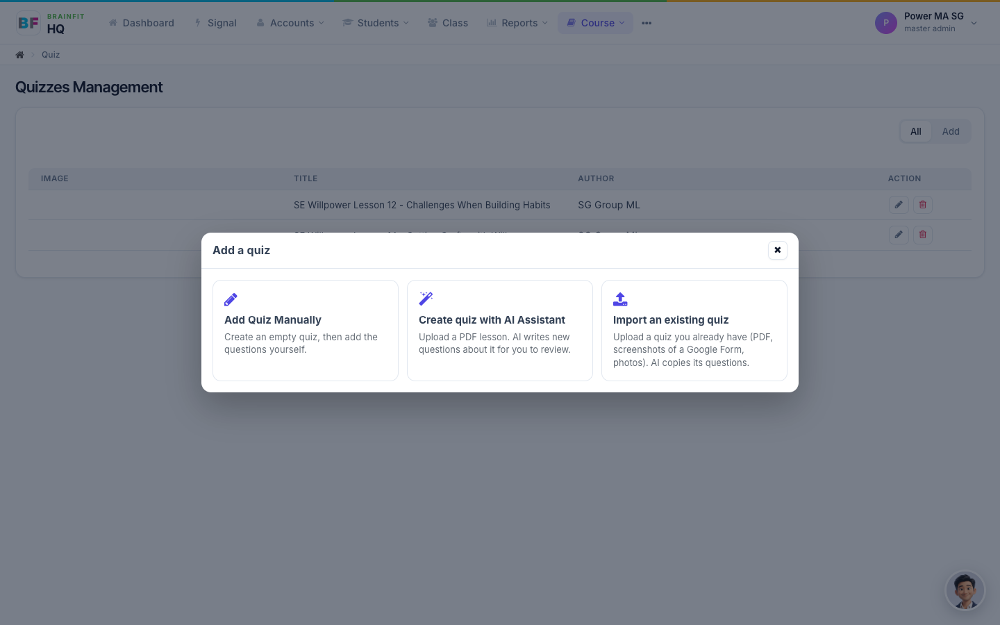

## Way 1: Create a quiz with the AI assistant

Use this when you have a lesson and want new questions about it.

1. Choose **Create quiz with AI Assistant**.
2. Click **Choose File** and pick the PDF lesson. It must be a PDF, up to 20 MB.
3. Set **Number of questions**. The default is 5.
4. Choose the **Question type**: **Single answer** or **Multiple choice**.
5. Click **Generate**.

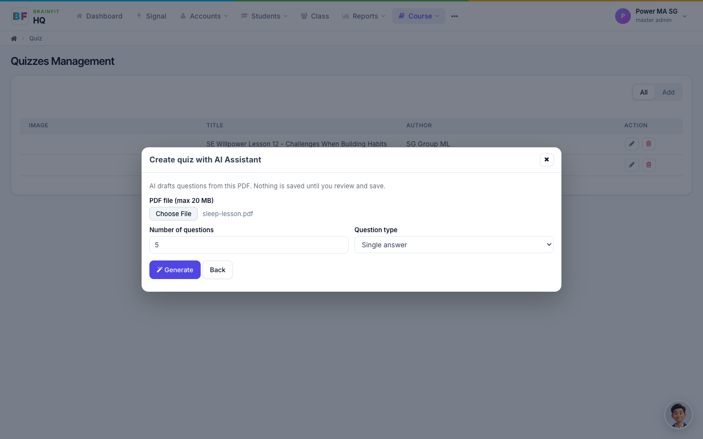

The window says **Generating… this can take up to a minute.** Keep it open. If it shows an error, click **Generate** again.

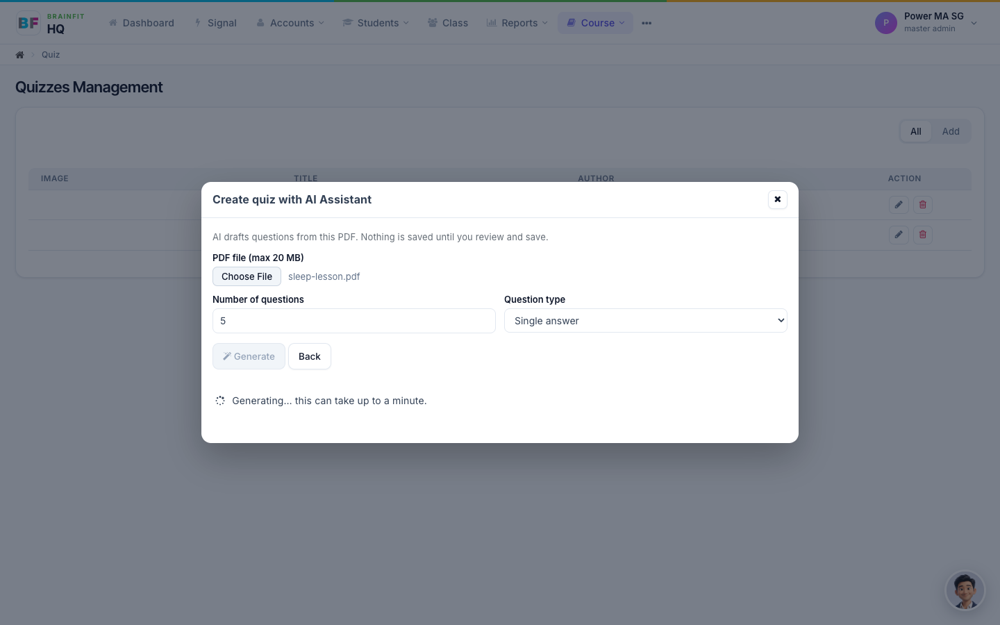

When it finishes, the **Review before saving** window opens. The assistant has written a title, a description and the questions, and it has already chosen the answer it thinks is correct. **Read every question and check every answer.** The AI can be wrong, and you are responsible for what students see.

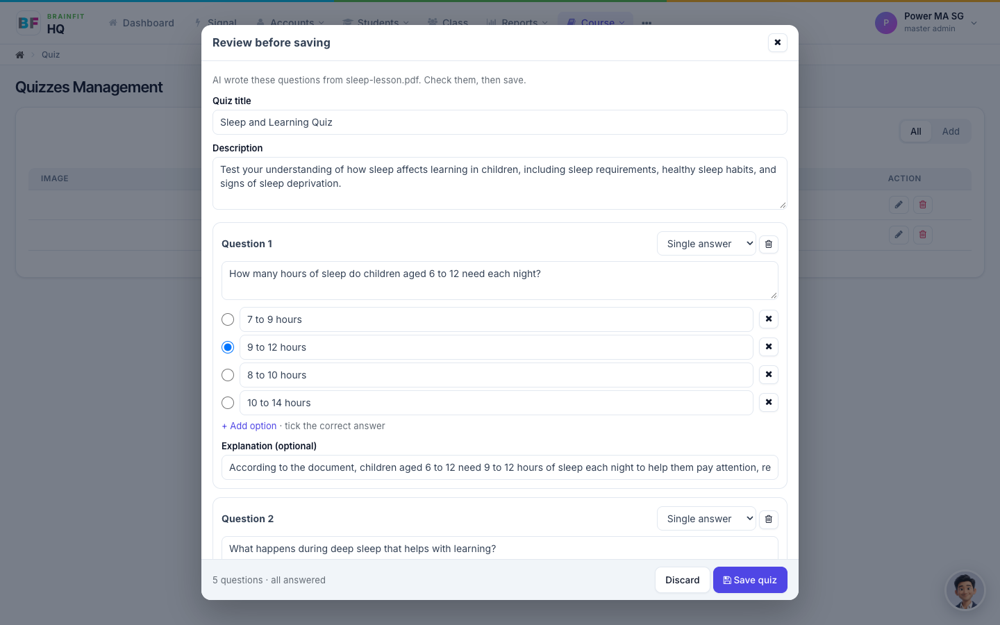

- **Single answer** questions have exactly one correct answer.
- **Multiple choice** questions have at least two correct answers.

Go to [Review, fix and save](#review-fix-and-save) to finish.

## Way 2: Import an existing quiz

Use this when the quiz already exists and you do not want to retype it. The questions are copied as they are, with their pictures. The assistant does not write new questions.

Choose **Import an existing quiz**. There are two ways to bring the quiz in. Use one of them, not both.

### From a Google Form link (best for Google Forms)

Paste the form's link in **Google Form link** and click **Import**. This gives the best result: the text is exactly the same as the form, video links are real links, and the pictures are the original pictures.

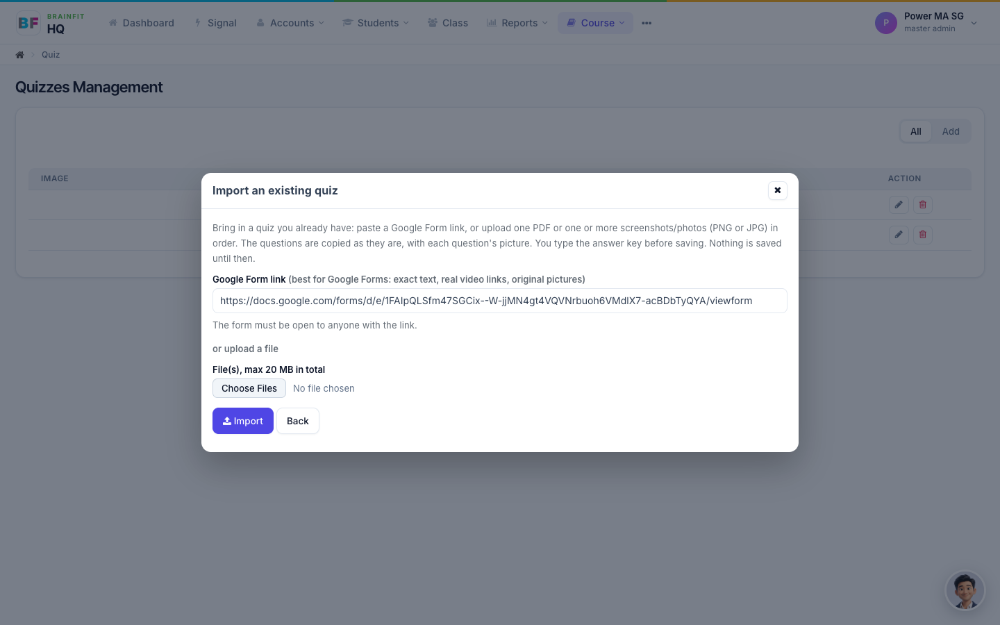

- The form must be open to **anyone with the link**. A form that asks people to sign in to Google cannot be read.
- Both `docs.google.com/forms/…` links and short `forms.gle/…` links work.
- Reading a form takes about half a minute.

### From files

Under **or upload a file**, choose one PDF, or one or more screenshots or photos (PNG or JPG) in the right order. The total size can be up to 20 MB. For a long Google Form, take a full-page screenshot and upload all the parts together. The assistant reads the pages and copies the questions. This takes about a minute.

### Wait for the copy to finish

A progress window shows a clock and what is happening. You can leave it open, it updates by itself. If you close the page, that import is dropped and nothing is created.

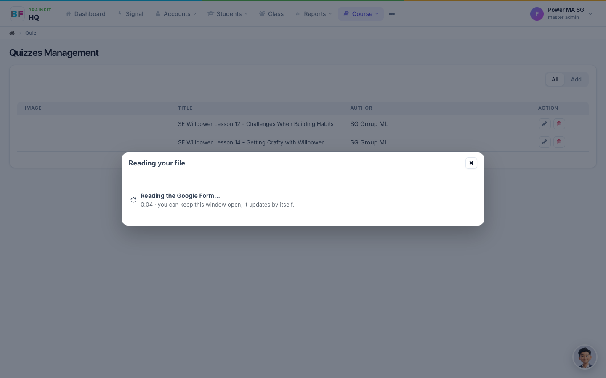

## Review, fix and save

Both ways end in the same **Review before saving** window. Nothing has been saved yet.

**Title and description.** Change them if you want. The title is required.

**Skipped (not questions).** When you import, headings, instructions, and personal-detail questions such as Name are not copied as questions. They are listed here, so you can see that nothing was lost by mistake. Click the line to open it.

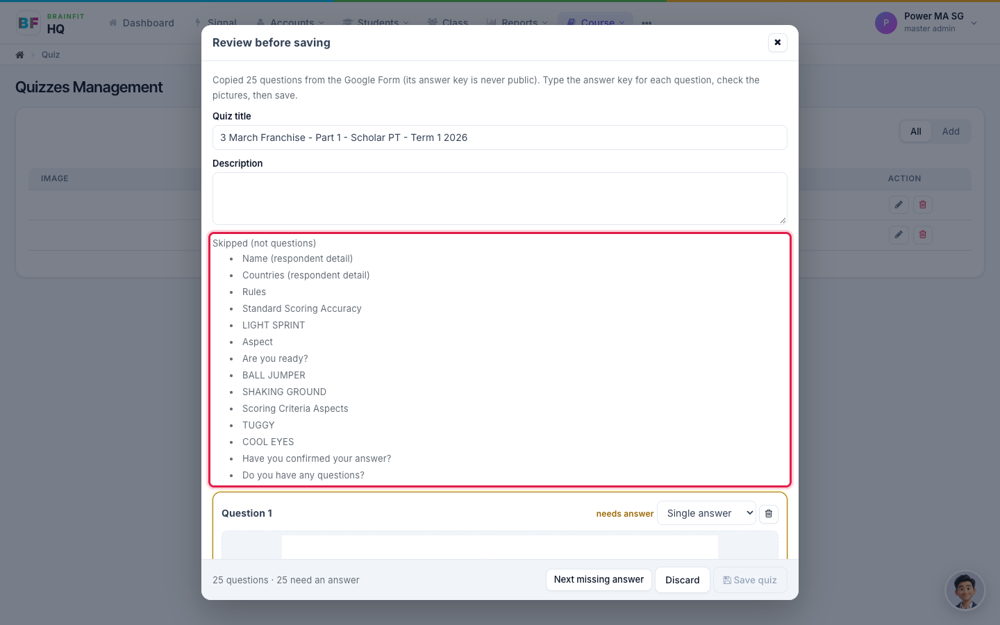

**Each question.** You can:

- Change the **type**: Single answer, Multiple choice, or Fill in the blank. For Fill in the blank, type the **Correct answer** the learner must type.
- Edit the question text and the options, click **+ Add option**, or click the **X** next to an option to remove it.
- Type an **Explanation** if you want one.
- On an imported question, click **Remove picture**, or **Replace…** to use another PNG or JPG. Use **Add a picture…** if a question has none. A picture can be up to 5 MB.
- Click the bin button to remove the whole question, or **Add question** at the bottom to write one yourself.

**Type the answer key.** A Google Form never shares its answers, so after an import every question is marked **needs answer** and **Save quiz** is locked. Tick the correct answer for each question. The footer counts how many are left, and **Next missing answer** jumps to the next one.

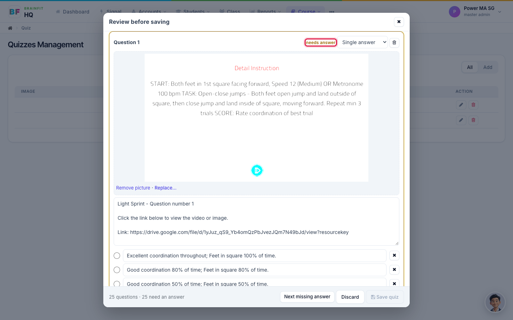
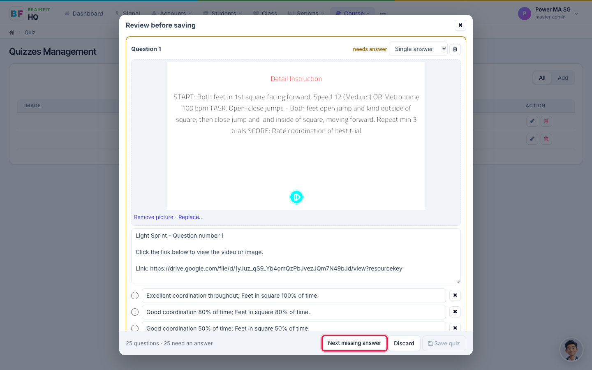

When every question has an answer, the footer says **all answered** and **Save quiz** unlocks. Click it. **Discard** throws the draft away.

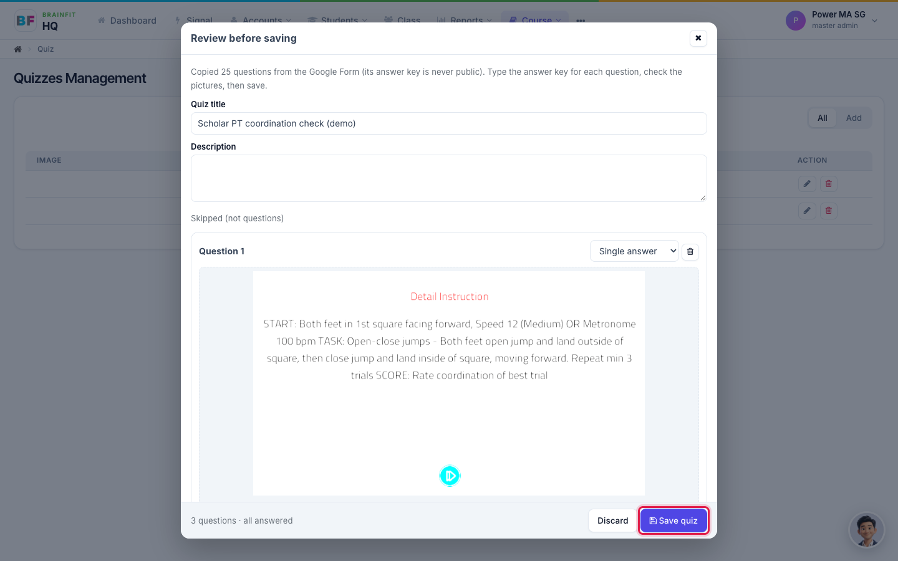

The quiz is created and its edit page opens. From here it is an ordinary quiz: add it to a course, reorder or edit the questions.

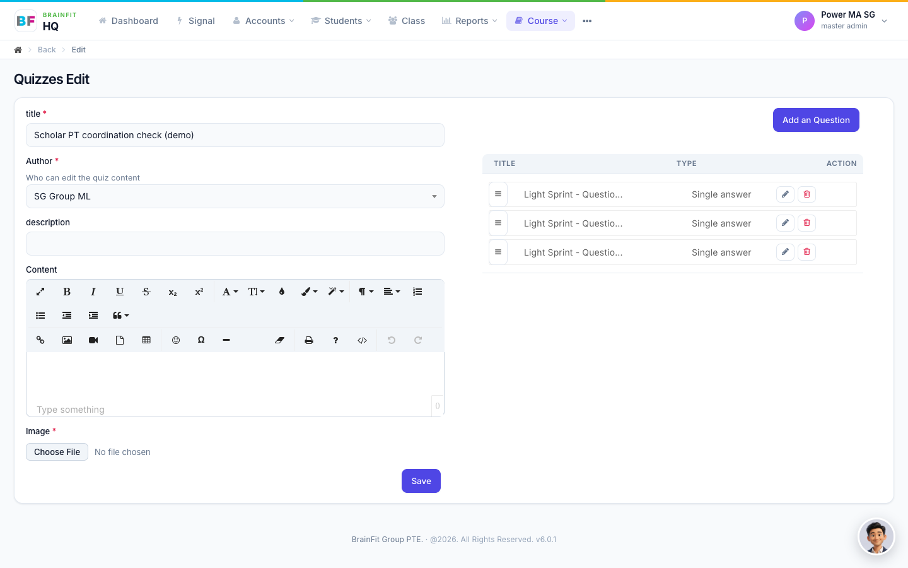

## Good to know

- **Check the AI's work.** The assistant can misread a page or choose a wrong answer. Always read the questions and the pictures before you save.
- **Do not put real student information in a file you upload.** The file is read by an AI service.
- **Test quizzes.** Start the title with **[QA]** so a test quiz is easy to find and delete, and do not add a test quiz to a course with real students.
- **Student apps.** At the time of writing, the BrainFit Chat app and Smart Workout do not yet show the pictures inside questions and do not yet support **Fill in the blank** questions. They are planned for a later update. Pictures and Fill in the blank questions work in Brain HQ.
