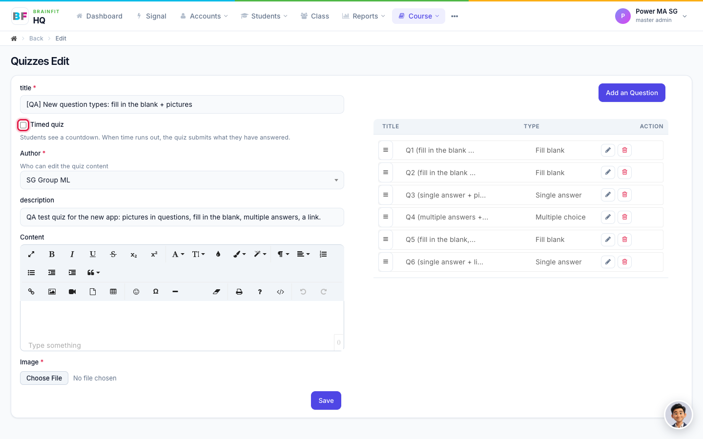
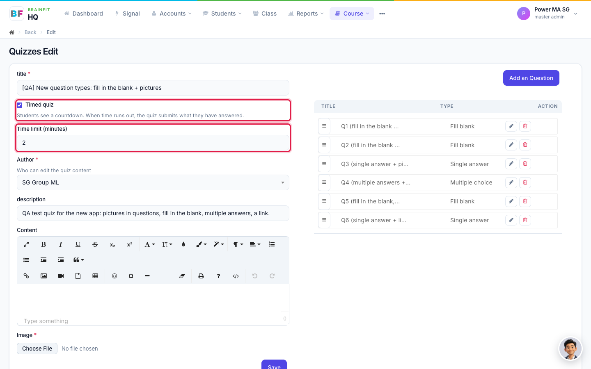
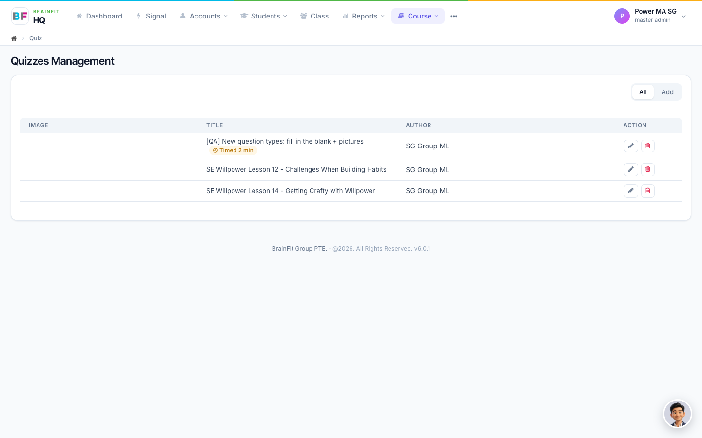
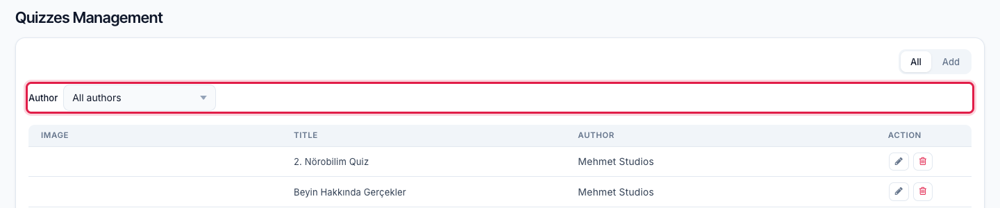
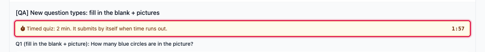
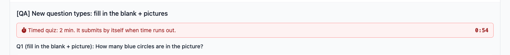
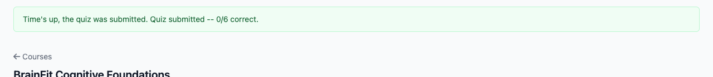

# Timed quizzes

A quiz can have a **time limit**. Learners see a countdown, and when the time runs out the quiz is submitted by itself with the answers given so far. Timing is **off** for every quiz by default, and every quiz that existed before this feature is still untimed.

## 1. Turn a time limit on or off

Open **Course → Quiz**, then click the edit (pencil) button of the quiz. Under the title there is a **Timed quiz** checkbox with a short explanation. It is unticked by default.

Tick **Timed quiz**. A **Time limit (minutes)** box appears. Enter a whole number from **1 to 180** and click **Save**. The browser does not accept a number outside that range.

To go back to an untimed quiz, untick **Timed quiz** and Save. The quiz is untimed again everywhere.

The time limit belongs to the whole quiz, not to single questions. Only the quiz's author or a Super Admin can edit a quiz.

## 2. In the quiz list

A timed quiz shows an orange **Timed N min** badge next to its title. Quizzes without a time limit have no badge.

Who sees which quizzes:

- **Super Admin** sees every quiz and gets an **Author** filter above the table: **All authors**, **SA (no ML author)**, or one Master Licensee. The filter is kept when you change page.
- **Everyone else** (Master Licensee, Master Admin) sees only the quizzes whose author is their own Master Licensee, and there is no Author filter.

## 3. What learners see

When a learner opens a timed quiz, the countdown starts. It turns **red in the last minute**. When it reaches **0:00**, the quiz is submitted with whatever has been answered. **Unanswered questions count as wrong**, and the learner is told **Time's up**. If a confirmation box such as "Are you sure?" is open at that moment, it closes by itself. A learner who submits before the time runs out sees the normal result with no "Time's up".

An untimed quiz looks exactly as before: no timer.

**CoachSpace.** A yellow bar at the top of the quiz says **Timed quiz: N min. It submits by itself when time runs out.** with the countdown on the right. It turns red in the last minute.

At 0:00 the page shows **Time's up, the quiz was submitted** with the score.

If the learner reloads the page while the clock is running, the quiz reopens and the countdown continues from where it was. It does not start again.

**Chat.** A large countdown appears at the bottom right of a timed quiz, red in the last minute. Chat used to show a countdown on every quiz. Now it shows one **only** on timed quizzes. At 0:00 the quiz is submitted and the result says **Time's up**, with the score and the time spent.

**BrainFit Chat app (PBC), from version 4.5.5.** A ⏱ chip with the countdown appears on the right of the app bar, red in the last minute. At 0:00 the app submits the quiz and a box says **Time's up** with **Your quiz was submitted.** and the percentage. Going back out of a timed quiz drops that attempt, as for any quiz. Opening it again starts the clock again.

**Older app versions** do not know about time limits. A timed quiz opens without a timer and can be taken normally.

## 4. Time spent

Every submission now records the **real time spent** on the quiz. Before, the BrainFit Chat app always recorded 60 seconds.

## Tips

- Pick a limit that fits the number of questions. A learner on a phone needs more time than someone on a computer.
- To try a time limit, use a QA quiz with a 1 or 2 minute limit, then untick **Timed quiz** when you have finished.
