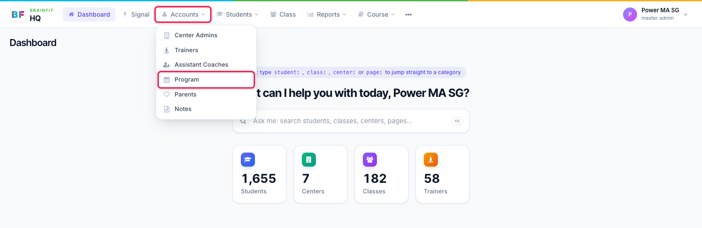

# What is a Program?
This feature is for SA, ML, MA, CA

A **Program** is a product your organisation sells, for example **SG BF Scholar**, **SG BF Junior** or **BF Scholar Trial Class**. Each Program belongs to one Master Licensee, and you only ever see your own organisation's Programs.

Every Program has a **Type**: Junior, Scholar, Baby, Premium, Assessment or Camp. The Type is the fixed category used for reporting across centres, whatever the Program is called. It is also what prints in the header of the Assessment Report Card ("BrainFit Junior", "BrainFit Scholar"…).

Students join a Program through their **class**. When a class is assigned to a Program, every student in that class is enrolled in it. After that, enrolment follows the class:

- A student who **joins** the class is enrolled in the class's Programs.
- A student who **leaves** the class has their enrolment ended (unless another of their classes is in the same Program).
- Removing the class from the Program ends its students' enrolments. The history is kept, with an end date.

A class can belong to more than one Program, and a student can be in several Programs at once.

A Program can also have **Subprograms** (for example levels or terms inside it), added from the Program's page.

## Where to find it

Open **Accounts** in the top menu and click **Program**.

