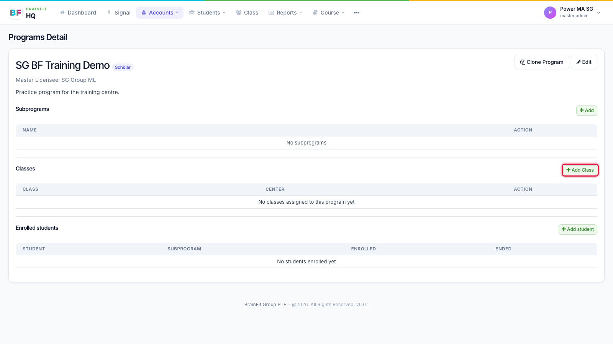
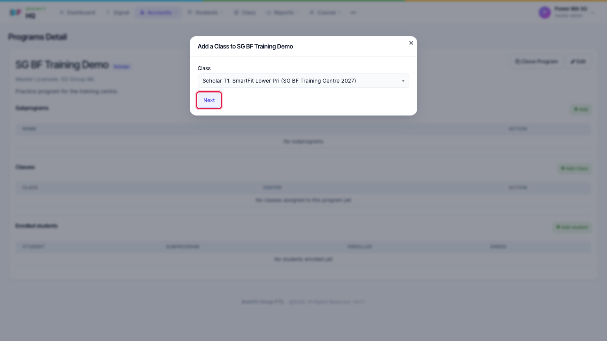
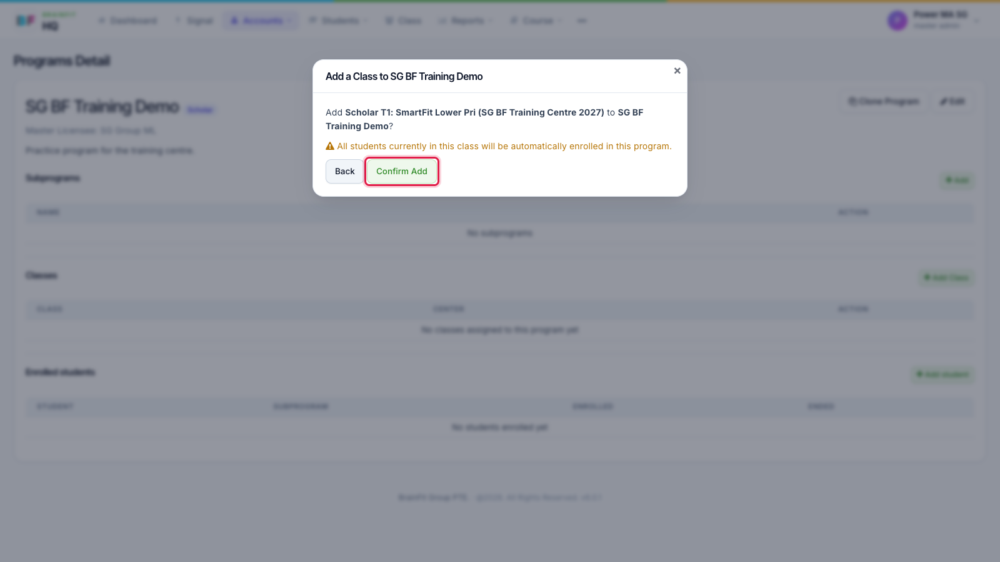
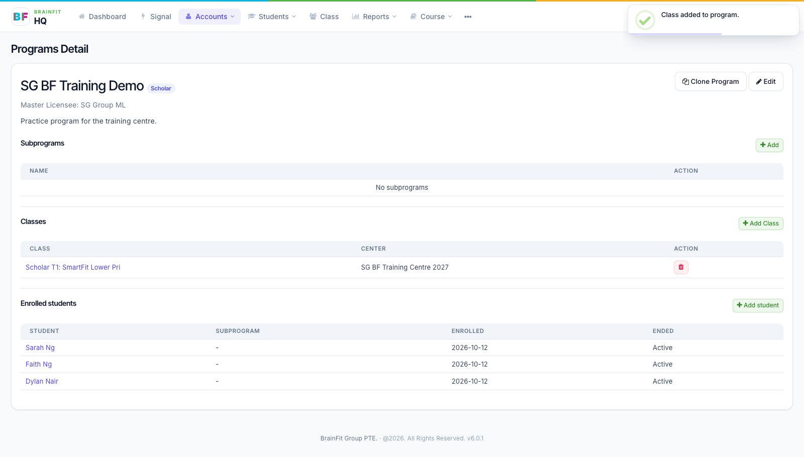
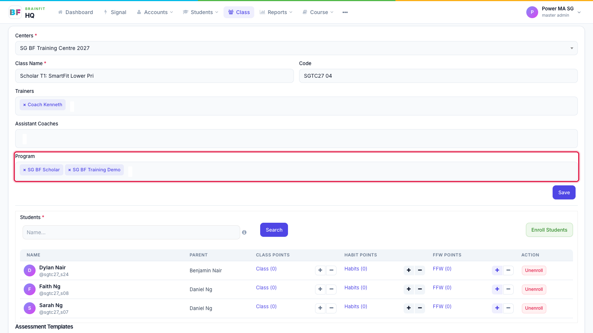

# Assign a Program to a Class
This feature is for SA, ML, MA, CA

There are two ways to do it. Both do the same thing: the class's students are enrolled in the Program straight away.

## From the Program

1. Open the Program and click **Add Class** in the **Classes** section.

2. Choose the class (type to search; the list shows each class with its centre), then click **Next**.

3. Check the class and Program names and click **Confirm Add**.

4. The class appears under **Classes**, and its students appear under **Enrolled students** with today's date.

To take a class off the Program, click the red bin on its row under **Classes**.

## From the Class

1. In **Class**, open the class and click **Edit**.
2. In the **Program** box, add (or remove with **×**) the Programs this class belongs to, then click **Save** and confirm.

:::caution
Removing a Program here, or removing the class on the Program page, **ends** the enrolment of every student in that class (unless they are in the Program through another class). Their history is kept.
:::

:::tip
Students who need to be in a Program without their class (for example a one-off trial) can be added one at a time with **Add student** on the Program page.
:::
