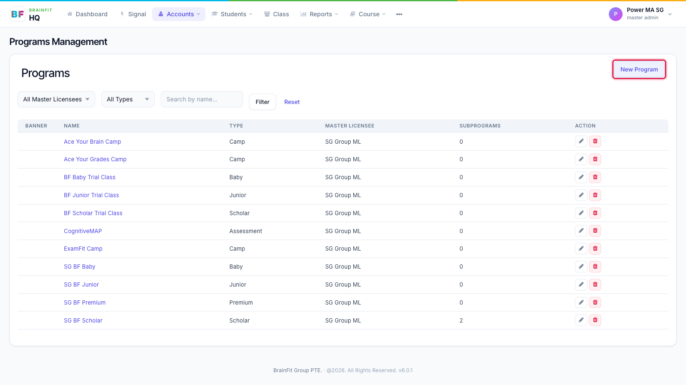
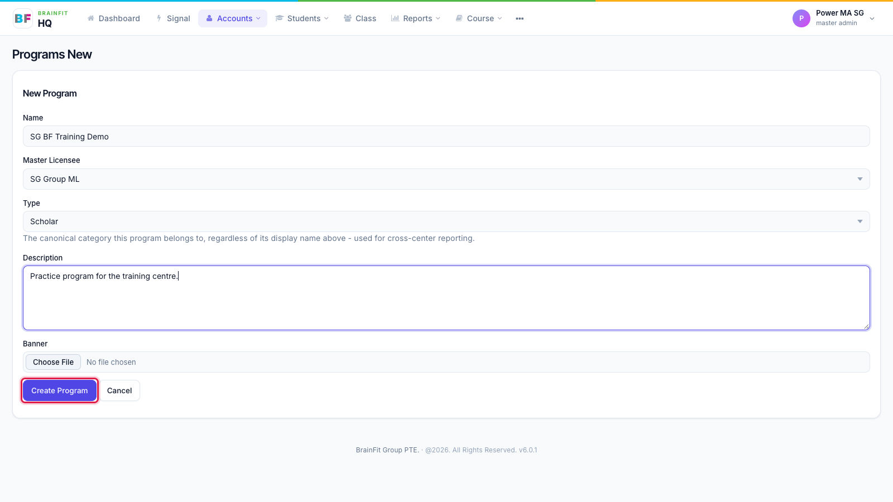

# Create a Program
This feature is for SA, ML, MA, CA

1. In **Accounts → Program**, click **New Program**.

2. Fill in the form, then click **Create Program**.
   * **Name**: what staff see, e.g. "SG BF Scholar".
   * **Master Licensee**: your organisation (you can only pick your own).
   * **Type**: Junior, Scholar, Baby, Premium, Assessment or Camp.
   * **Description** and **Banner** are optional.

3. The new Program appears in the list. Click its name to open it: from there you can **Edit** it, add **Subprograms**, and assign classes (next page).

To archive a Program you no longer use, click the red bin on its row in the list.
