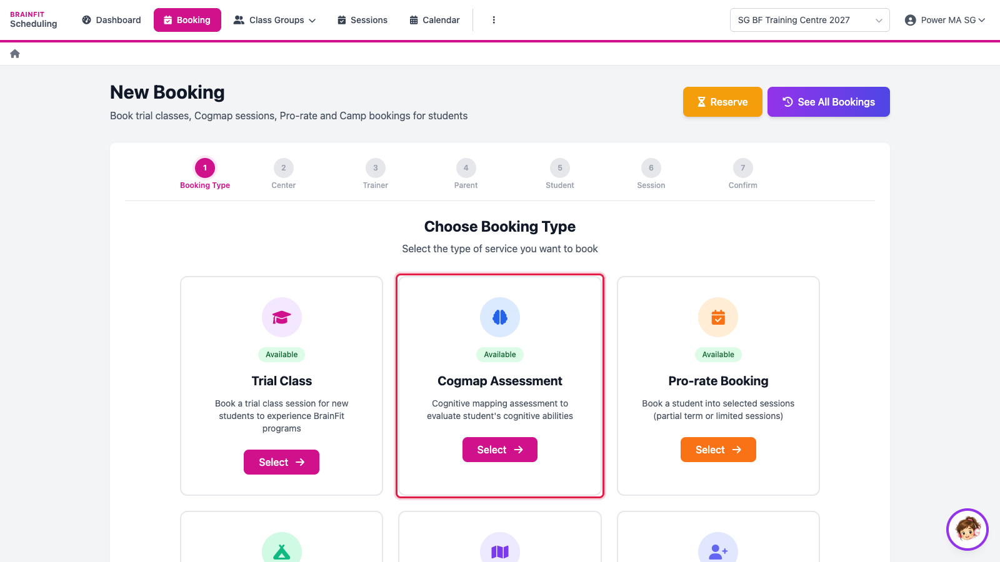
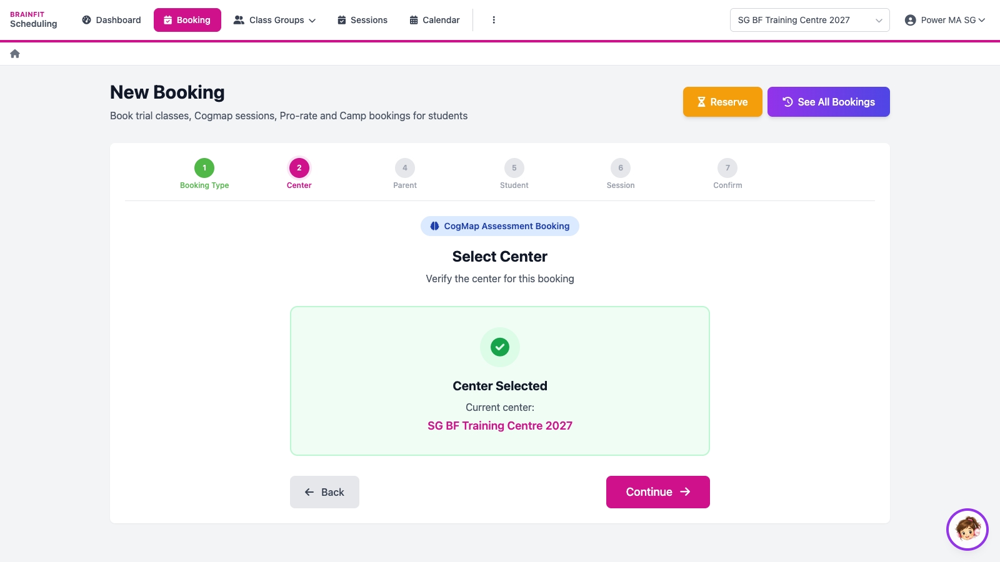
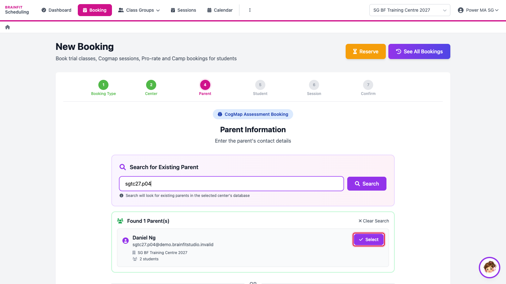
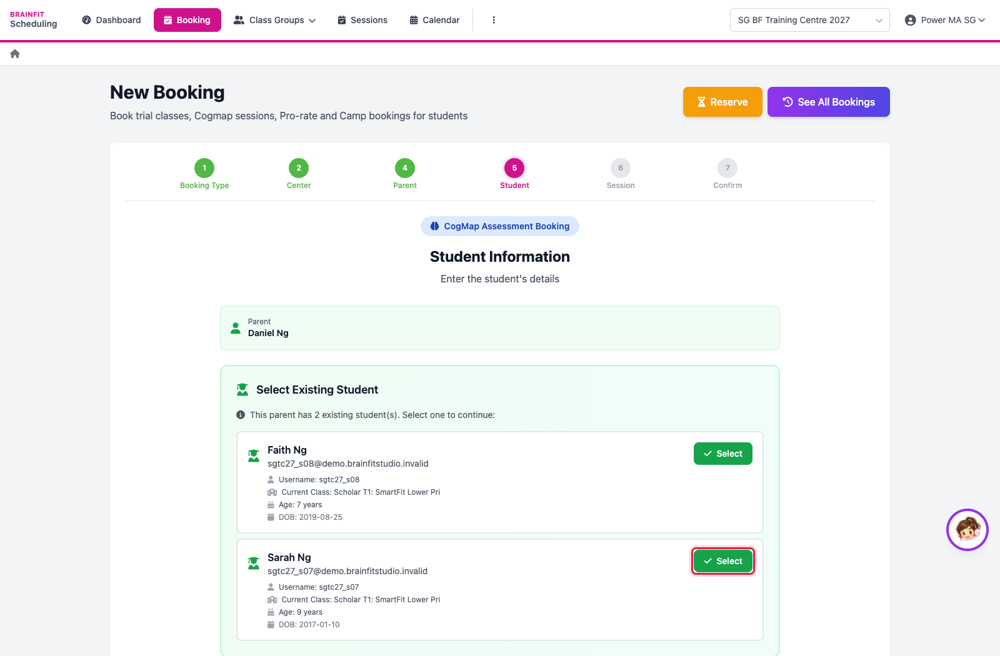
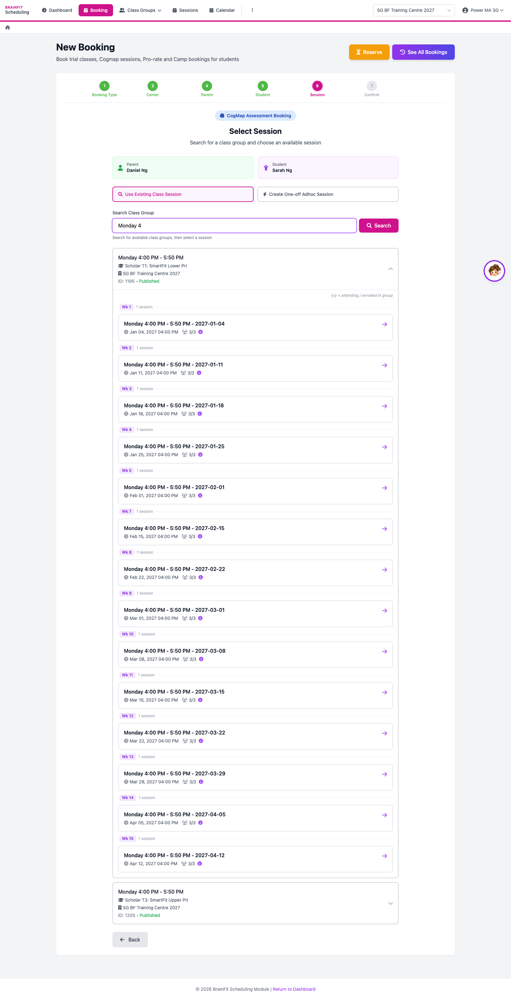
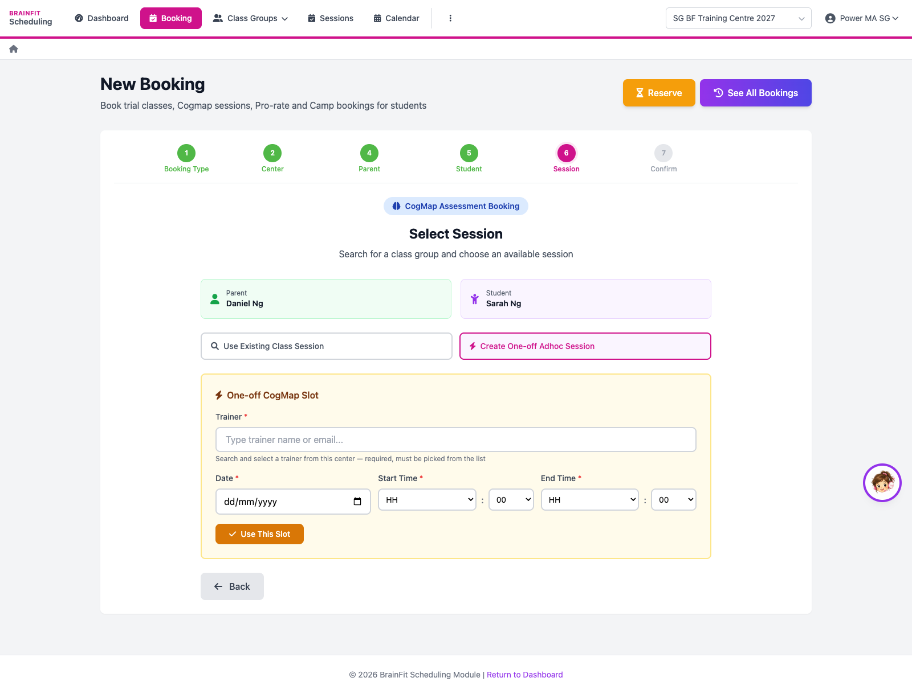
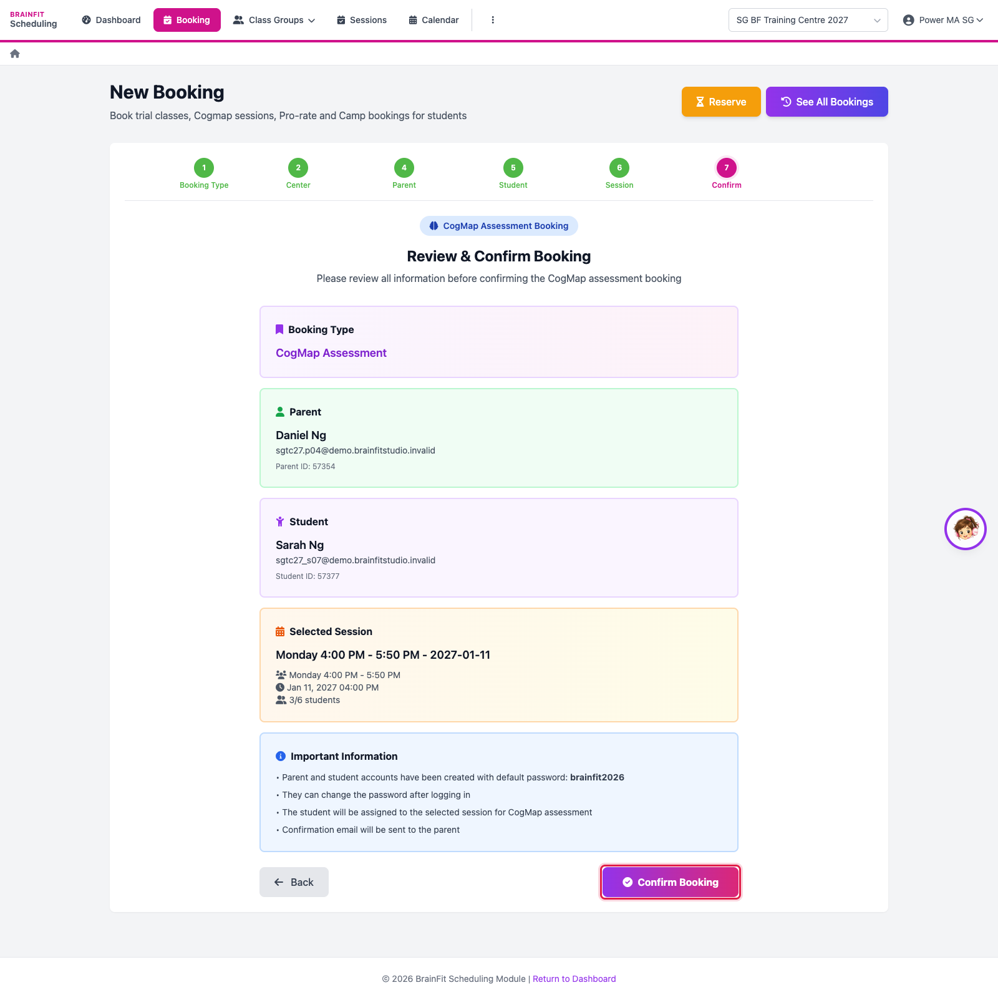

# Book a CogMAP Assessment
This feature is for SA, ML, MA, CA, Front Desk

1. Open **Booking** and click **Select** on **Cogmap Assessment**.

2. Check the **centre** (the one selected at the top right) and click **Continue**.

3. Search for the **parent** by name or email and click **Select** (or fill in the form below to create a new parent).

4. Pick the **student** (or add a new one), then continue.

5. Choose the **session**: search a class group and pick one of its sessions…

6. …or click **Create One-off Adhoc Session** to book a slot outside the class timetable: pick the **trainer**, the **date** and the **time**, then **Use This Slot**.

7. Check the summary and click **Confirm Booking**. The booking shows in **See All Bookings** and on the calendar.

