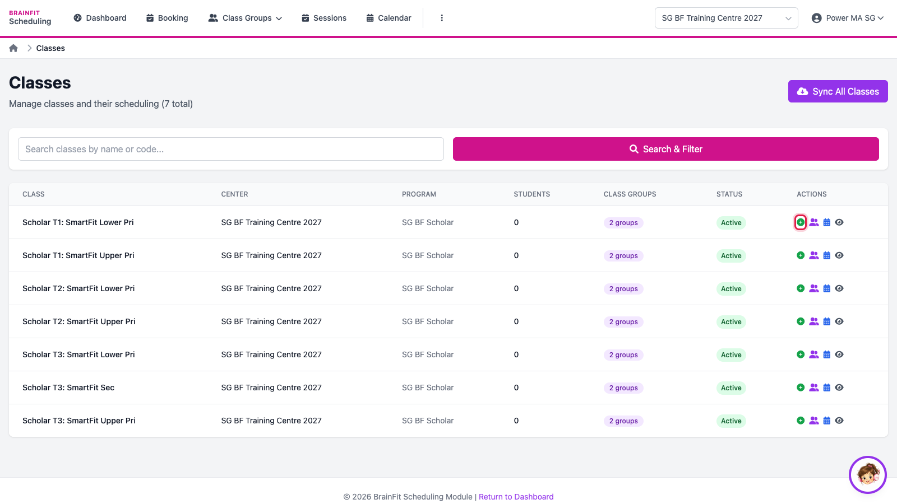
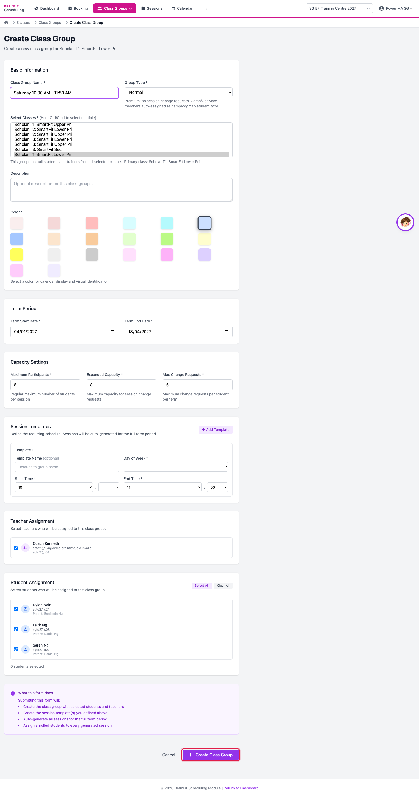
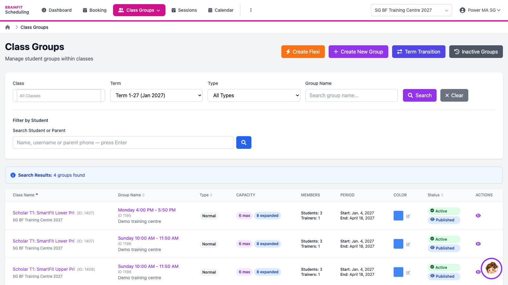

# Create a Class Group
This feature is for SA, ML, MA, CA

**Watch (about 1 min):**

<video controls preload="metadata" width="100%">
  <source src="/video/hq/sch-group.mp4" type="video/mp4" />
</video>

A class group is one weekly slot of a class (for example *Monday 4:00 PM - 5:50 PM*) for one term. A class can have several groups.

1. Open **⋮ → Classes** and click the **+** (create group) icon on the class's row.

2. Fill in the form, then click **Create Class Group**:
   - **Class Group Name** (usually the day and time) and **Group Type** (*Normal* for regular classes).
   - **Term Start / End Date**.
   - **Maximum Participants**, **Expanded Capacity** (extra seats for change requests) and **Max Change Requests** per student per term.
   - **Session Templates**: the day and start/end time; sessions are created every week of the term, skipping the holiday template's dates.
   - The **teachers** and **students** of the group.

3. The group appears in **Class Groups** (pick the term in the filter), with its capacity, members, period and status. Click the eye to open it.

