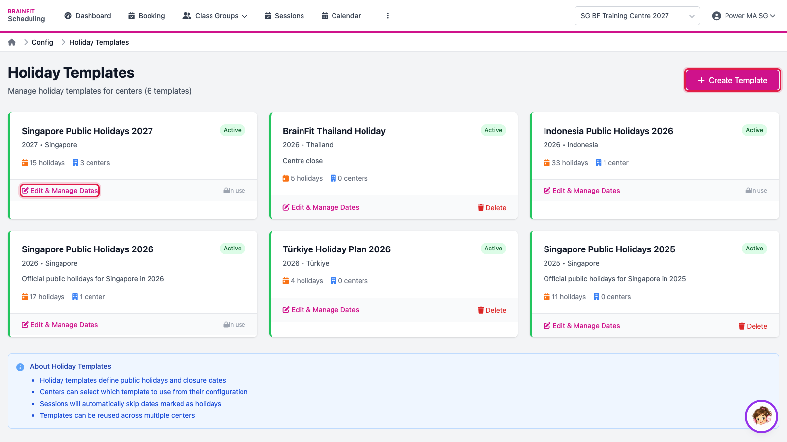
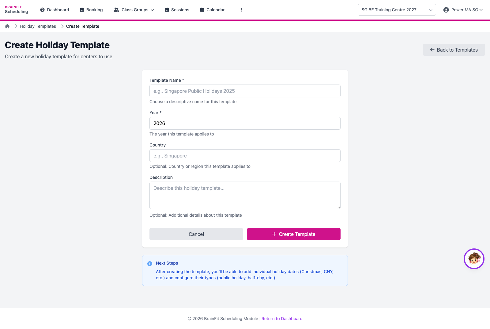
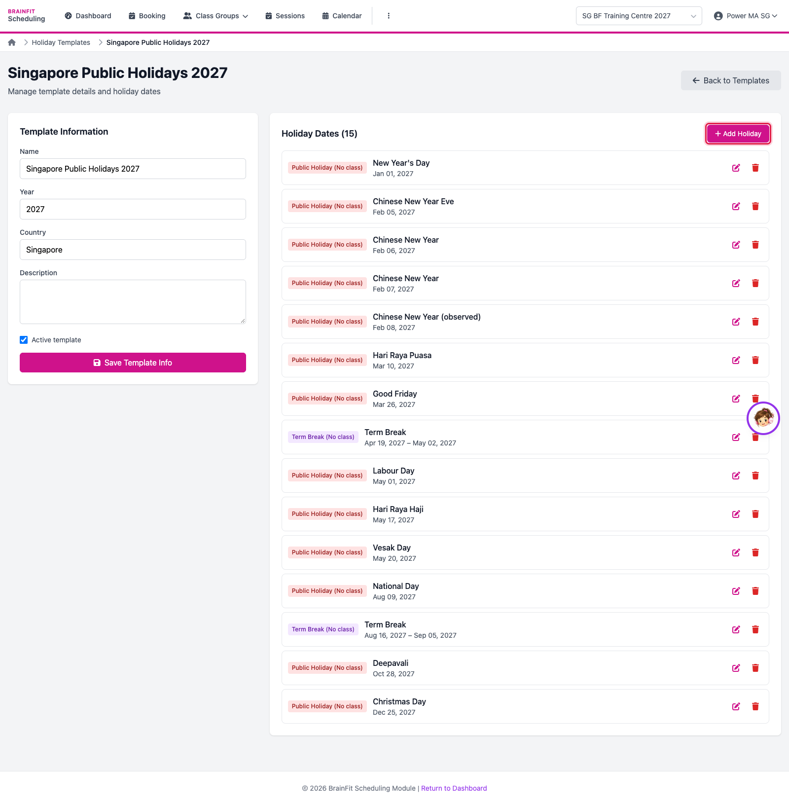
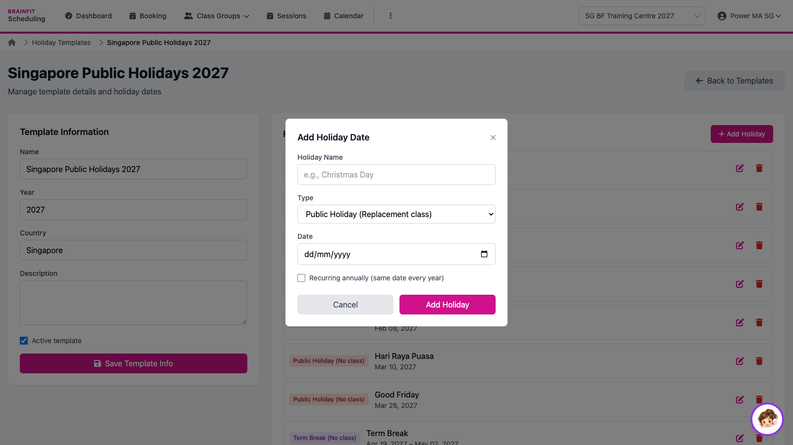

# Create and Edit a Holiday Template
This feature is for SA, ML, MA, CA

A holiday template is the list of public holidays and term breaks for a country and year. Sessions are never created on those dates, and every centre that uses the template follows it.

1. In BrainFit Scheduling, open **⋮ → Holiday Templates**. Each card shows a template, how many holidays it has and how many centres use it. Click **Create Template** for a new one, or **Edit & Manage Dates** to change one.

2. For a new template, enter the **Name** (for example *Singapore Public Holidays 2028*), **Year**, **Country** and a description, then **Create Template**.

3. The template page lists its dates: public holidays (no class) and term breaks (a date range). Click **Add Holiday** to add one; the pencil and bin edit or remove a date.

4. Enter the holiday's **Name**, **Type** (public holiday, replacement class, term break…) and **Date** (tick *Recurring* for a fixed date every year), then **Add Holiday**.

**Note:** the training centre uses *Singapore Public Holidays 2027*. Adding a date to a template affects every centre that uses it, so practise only on a template made for practice.
