# Public class availability page, enrolment requests and Brian

Each centre can have a **public link** to a page that shows which weekly classes still have space. Nobody has to log in to open it. A parent can tap a class and send an **enrolment request**, or ask **Brian**, a small assistant on the page, to help. The centre gets the request by email and on a screen in Scheduling. This guide covers the link, what parents see, the emails, how staff handle requests, and what Brian can and cannot do.

**Watch (about 3 minutes):**

<video controls preload="metadata" width="100%">
  <source src="/video/hq/sch-public.mp4" type="video/mp4" />
</video>

The address looks like `scheduling.brainfitstudio.com/public/availability/` followed by a long secret code. The code is different for every centre.

## 1. Staff: the Public Link button

Open **Class Groups → Class Availability** and select the centre at the top. Click **Public Link** at the top right of the page. Super Admin, Master Licensee, Master Admin and Centre Admin can use it.

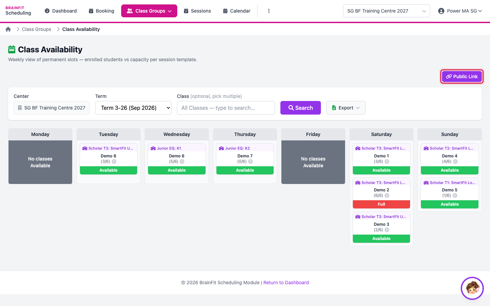

A window opens with the link for the selected centre. Close it with the X, by clicking outside it, or with Esc.

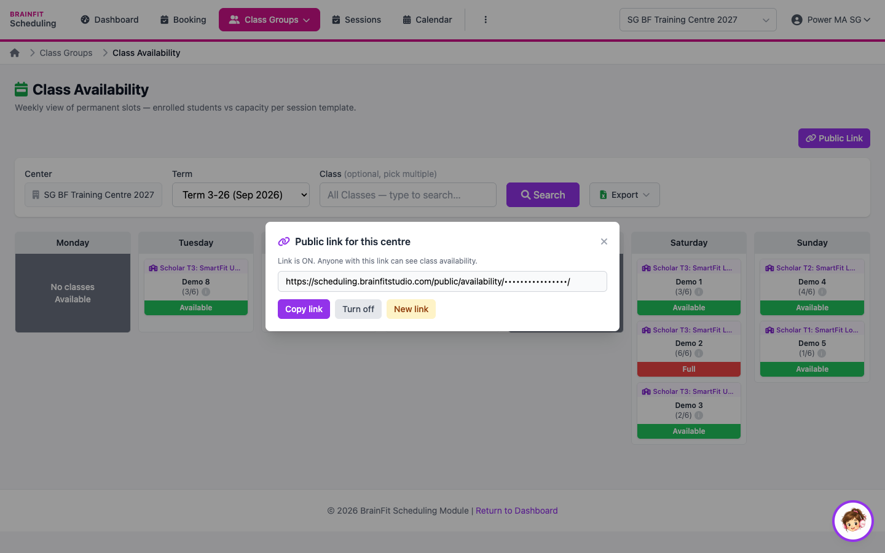

- **Create link** appears if the centre has no link yet.
- **Copy link** copies the address to post on your website, QR codes, flyers, WhatsApp or Google Business.
- **Turn off** stops the page showing anything. **Turn on** opens it again with the same address. Use this to pause the page.
- **New link** makes a new address. **The old address stops working at once**, so every place it was posted must be updated. Use it only if the link has been compromised: it was shared where it should not be, it is being spammed or abused, or someone who had it has left.

The link does **not** change when classes, terms or numbers change. You never need a new link just because the timetable changed.

Super Admin sees two more controls in the same window, covered in [Super Admin only](#super-admin-only-brian-onoff-and-the-conversations-log).

## 2. What parents see

Anyone who has the link can open the page. There is no login. Treat the link like a password and send it only to the people who should see it.

- The page lists the centre's **Normal and Premium** classes. Camp, CogMAP, Flexi and Replacement classes are not shown.
- Each class shows the day, the time, and **Available** or **Full** (in red). It does not show numbers.
- The **term** list shows only the current and future terms.
- **Timezone:** times are shown in the visitor's own timezone, so a class can appear on the neighbouring day for someone far away.
- **No personal data:** no student names, no teacher names and no ids appear on the page.
- On a computer the page is a weekly calendar. On a phone it is a list by day.
- Under the centre name the page says: **Click on a preferred class and send us a message to book a spot.**

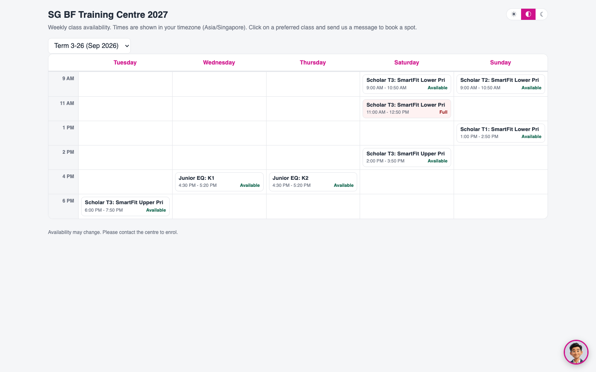
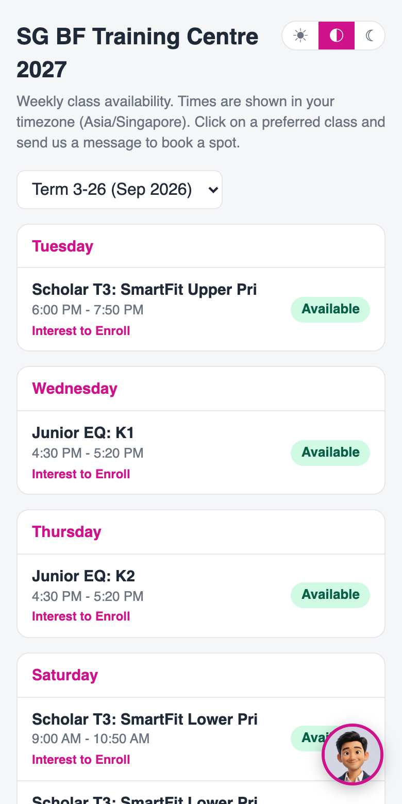

At the top right there is a **theme** switch: ☀ light, ◐ system (the default) and ☾ dark. The choice is remembered after the page is reloaded.

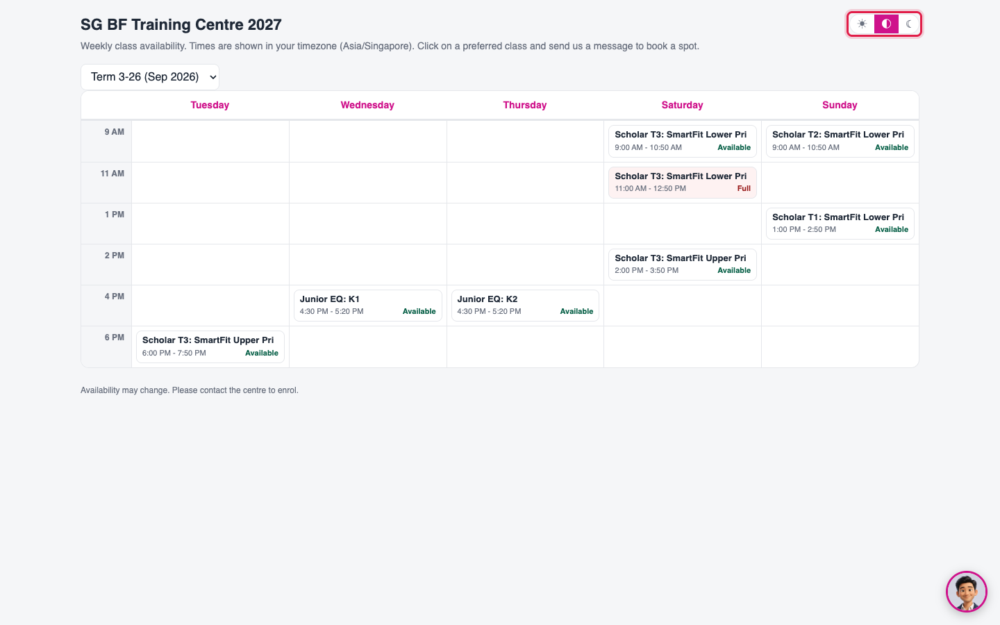
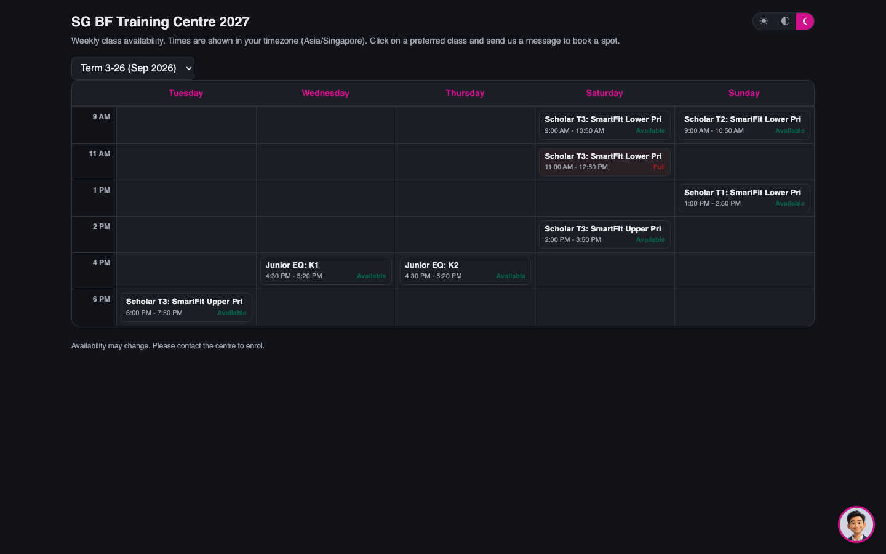

The page tells visitors to contact the centre to enrol. Nothing on it reserves a place.

## 3. An enrolment request

A parent taps any class, including a Full one. A pop-up titled **Interest to Enroll** opens. They fill in:

- **Your name** and **Email**
- **Phone**, with a country picker: Singapore +65, Malaysia +60, Turkey +90, Thailand +66, Indonesia +62 or Vietnam +84
- **Child's name** and **Age**
- **Preferred start date** (optional): a date from today up to 12 months ahead
- **Message** (optional)

and click **Submit**.

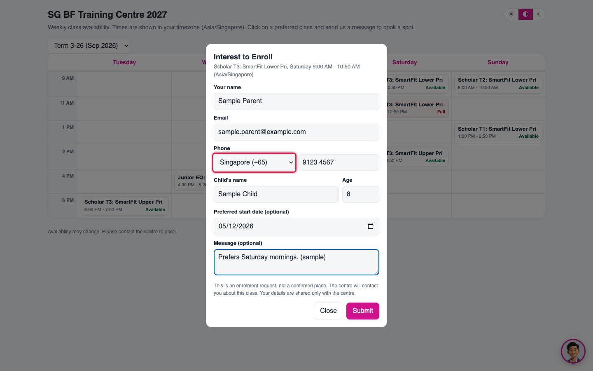

The small print says **This is an enrolment request, not a confirmed place.** Nothing is held for the child and nothing is created in HQ. The centre follows up with the parent and enrols them in the usual way. After Submit, the parent sees **Thank you for your interest. Someone from the centre will be contacting you soon.**

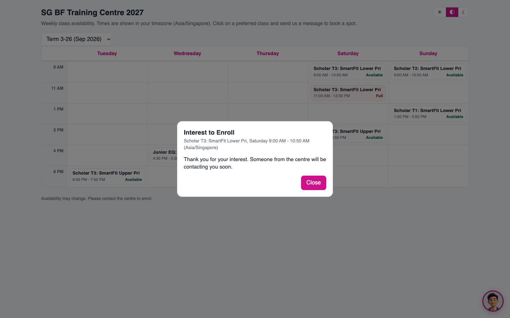

## 4. The emails

Every request sends two emails.

**To the parent:** a thank-you email. It has an orange header and the BrainFit logo, repeats the class, centre, child and phone (and the preferred start date, when given), and says it is a request, not a confirmed place. If the parent did not make the request they can ignore it.

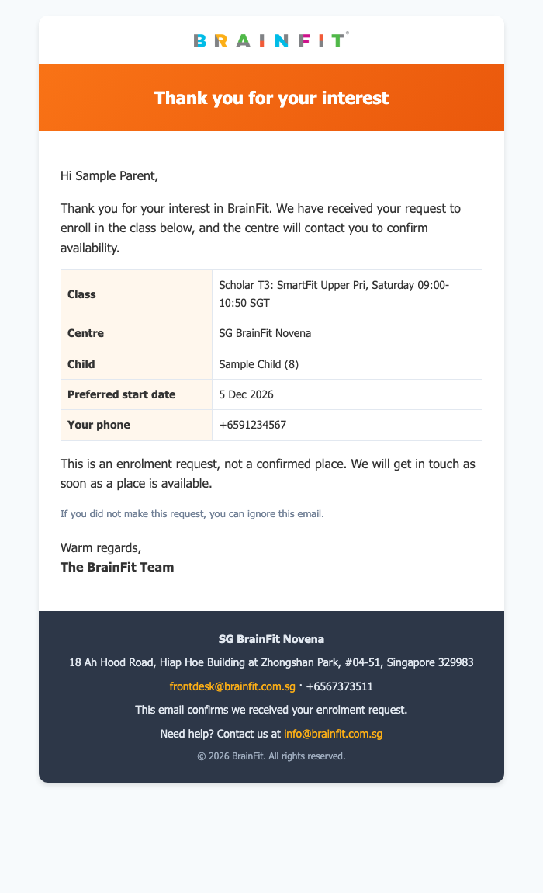

**To the centre:** an email titled **New enrolment enquiry - (class, time)**. It goes to the class group's **trainers** and to the centre's **contact email** (the front desk) from HQ, once it is filled in. Centre admins are **not** copied. It lists the class, parent, phone, email, child, preferred start date and message, and asks the team to follow up with the parent. If the centre has no contact email in HQ and the class has no trainer email, **nobody is emailed**. The request is still saved, and the Enrolment Request screen says no email was sent, so someone must check that screen.

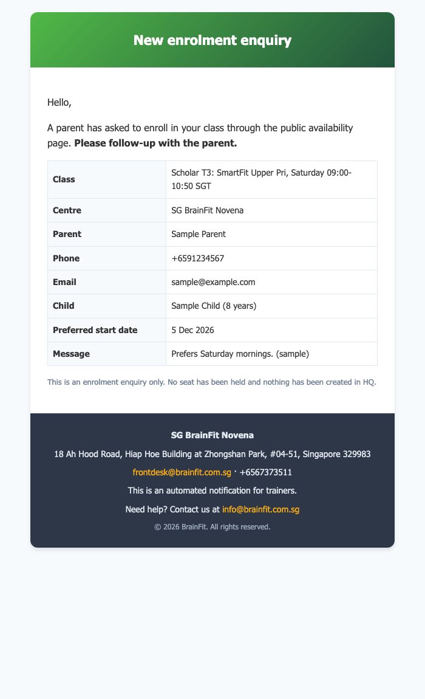

Both emails end with a footer that shows the centre name, address, email and phone **when HQ has them**. Centre admins fill these in on the Brain HQ **Centre contact** page. Until a centre has filled them in, its emails show only what exists, and the front desk gets no enquiry email. Most centres are still empty, so ask your centre admin to fill in **Centre contact** first.

## 5. Staff: the Enrolment Request screen

Open **Class Groups → Enrolment Request** (the globe icon). It is shown only to Super Admin, Master Licensee, Master Admin and Centre Admin. Trainers and Front Desk do not see it. You can also reach it from the **Waitlist** page: both pages share a tab bar with **Student waitlist** and **Public enrolment requests**, and the second tab shows a badge with the number of new requests.

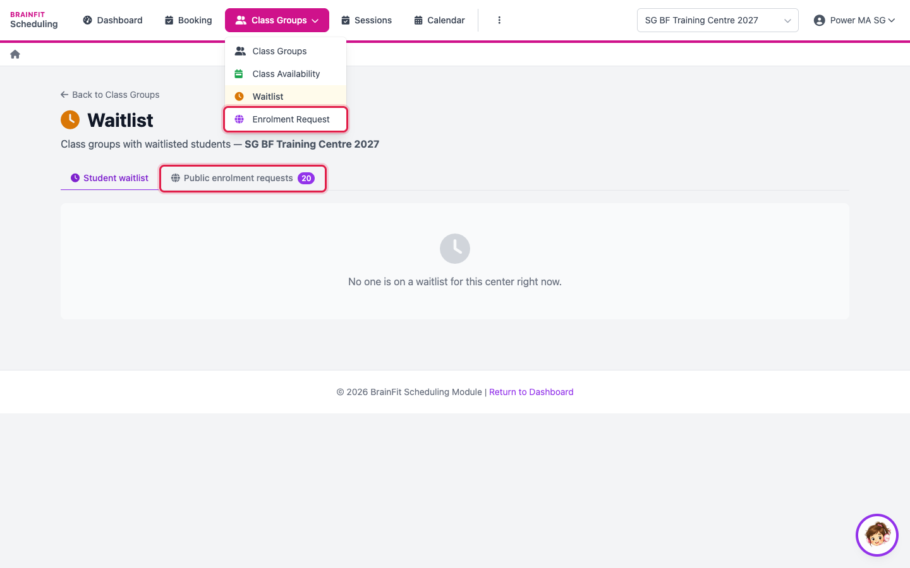

The **Public enrolment requests** page lists every request for the selected centre: when it came in and whether it came from the **Form** or from **Brian**, the class, the parent's contact, the child (with the preferred start date and message, if any), and a status. Use the filters **All, New, Contacted, Converted** and **Dismissed** to focus.

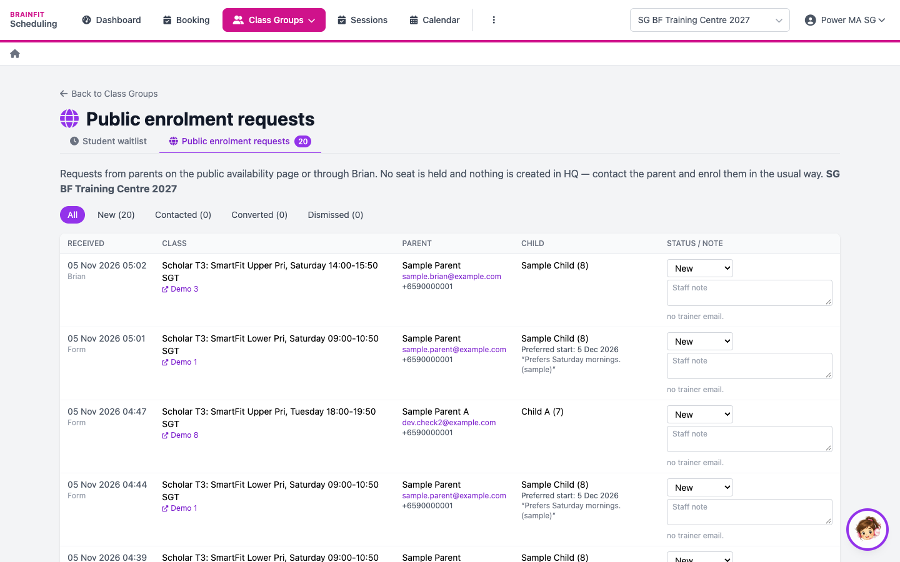

The class on each row is a link to its class group. Each row also says whether the trainer was emailed.

For each request:

1. Contact the parent by email or phone.
2. Change the **status**: **New** until someone has acted, **Contacted** after you reach the parent, **Converted** once the child is enrolled, **Dismissed** if it will not go ahead.
3. Write a **staff note** for the team, for example what the parent said.

Enrolling the child still happens in the usual way. The page does not enrol anyone.

## 6. Brian, the assistant on the page

Visitors open Brian with the round button at the bottom right of the page.

- Brian only knows **this centre's classes for the current term and the next term**. He talks about **Available** or **Full** only, never numbers. He cannot see names and cannot promise a place. He tells the visitor to contact the centre.
- Brian answers in **English, Vietnamese, Bahasa Indonesia, Thai or Simplified Chinese**, in the language the visitor writes in.
- A question can be up to **300 characters**. There are limits on how many questions one visitor can ask in a short time.
- The chat tells visitors that **chats are recorded** and not to share personal details unless they want to send an enrolment request.

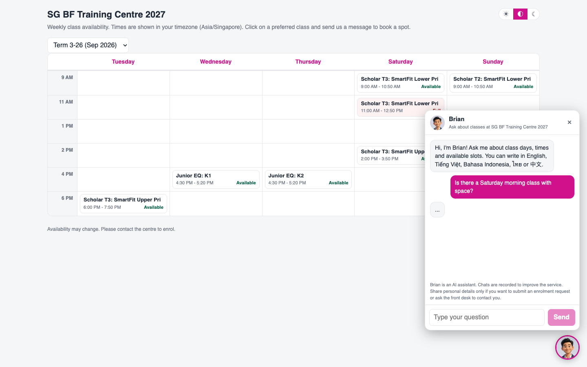
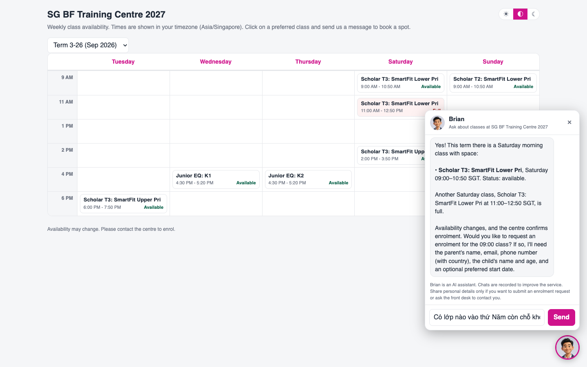

**Brian can also help a parent send an enrolment request.** Brian asks for the parent's name, email, phone, the child's name and age, and an optional preferred start date. He then **reads the details back** and sends the request **only after the parent says yes**. The request appears on the Enrolment Request screen with the source **Brian**, and the same two emails are sent.

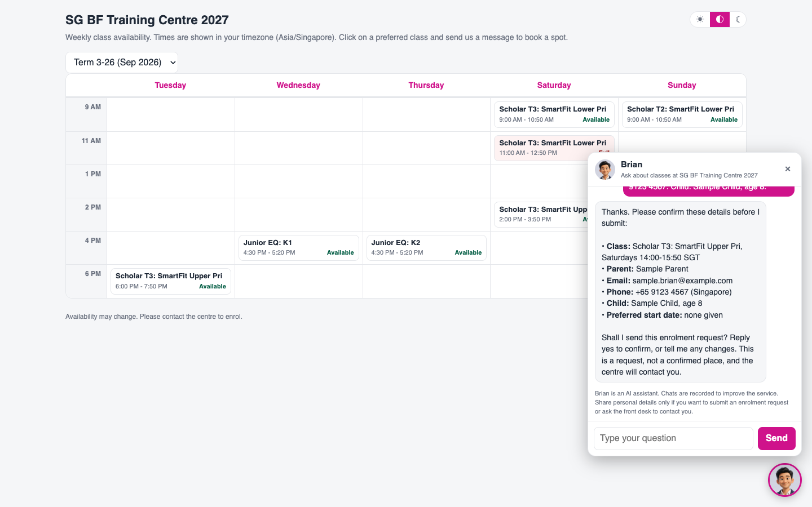

**Brian can pass a visitor to the front desk.** If a visitor asks to talk to a person, for example "Can I talk to a real person? I have a question about prices.", Brian asks for their name, an email or phone, and what they need. He reads it back and, after the visitor says yes, tells them the front desk has been notified. The centre's contact email gets an email. Brian does not promise when someone will reply.

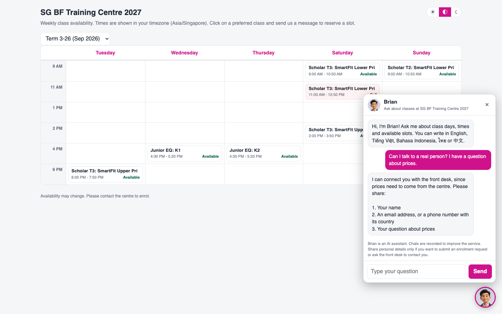
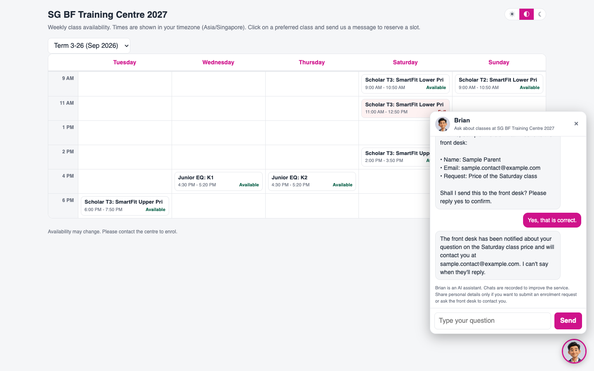

These appear at the bottom of the Enrolment Request screen, under **Contact requests from Brian**. Each has the visitor's contact details, what they asked, a status (**New**, **Handled** or **Dismissed**) and a staff note. If the centre has no contact email in HQ, no email is sent, and the entry says **Email not sent**.

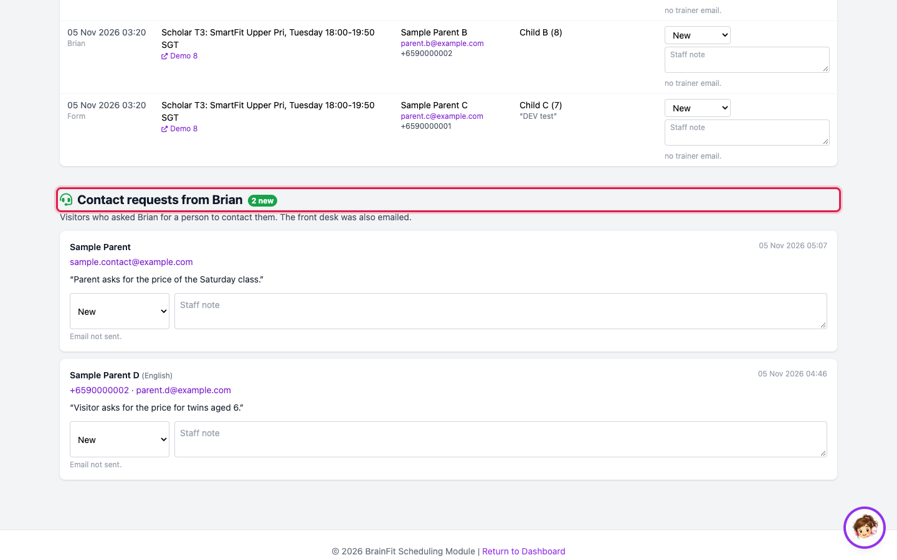

If Brian cannot answer (for example it is switched off, or the monthly limit is reached), the page still shows the availability.

## Super Admin only: Brian ON/OFF and the conversations log

Two more controls appear in the Public link window for a Super Admin:

- **Brian chat: ON / OFF** switches Brian for the selected centre. The page itself keeps working when Brian is off.
- **Brian conversations** opens the log of every conversation: the centre, the date, and each question and answer. It also shows this month's spend against the **30 USD monthly cap**. When the cap is reached, Brian stops answering until the next month and the availability page keeps working.

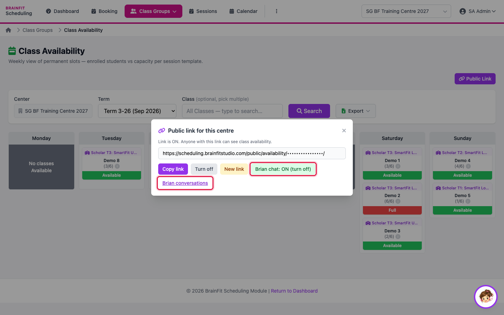
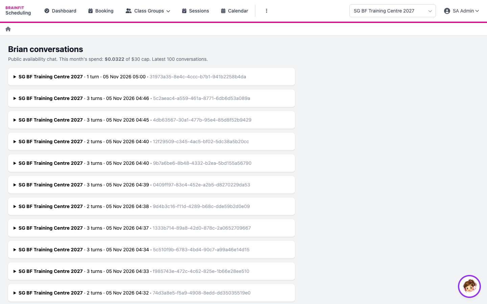

## A related small change: date of birth in attendance

The attendance lists (the calendar session pop-up and the class group attendance window) now show each child's **date of birth and age** under the name.

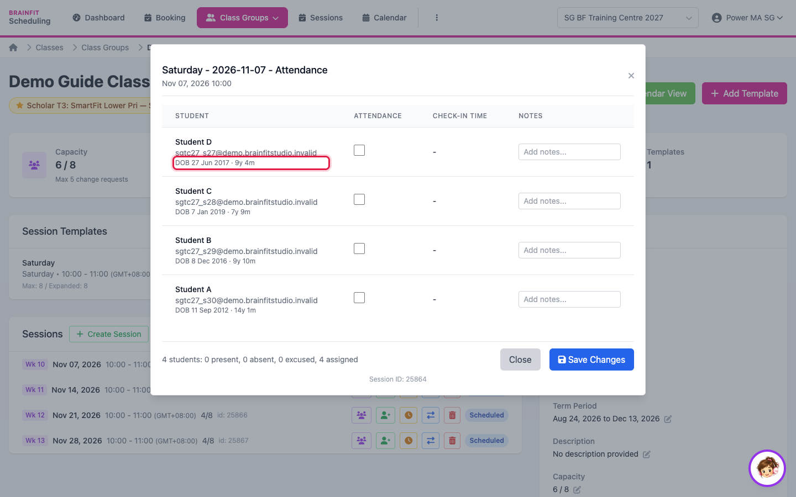

## Safety

- The link is a secret address, not a login. Anyone who has it can see the page. If it spreads further than you wanted, use **New link** and update every place it was posted.
- The page shows only class names, times and Available or Full. Never put personal details in a class name.
- A request holds a parent's name, email, phone and child's name. Only staff who need to follow it up should open the Enrolment Request screen, and the emails should be handled like any other parent contact. Make sure the centre's **contact email** in HQ is filled in and watched by someone, because it is what the front desk receives.
- Brian's chats are recorded. Tell visitors not to type personal details into the chat unless they are sending an enrolment request.
