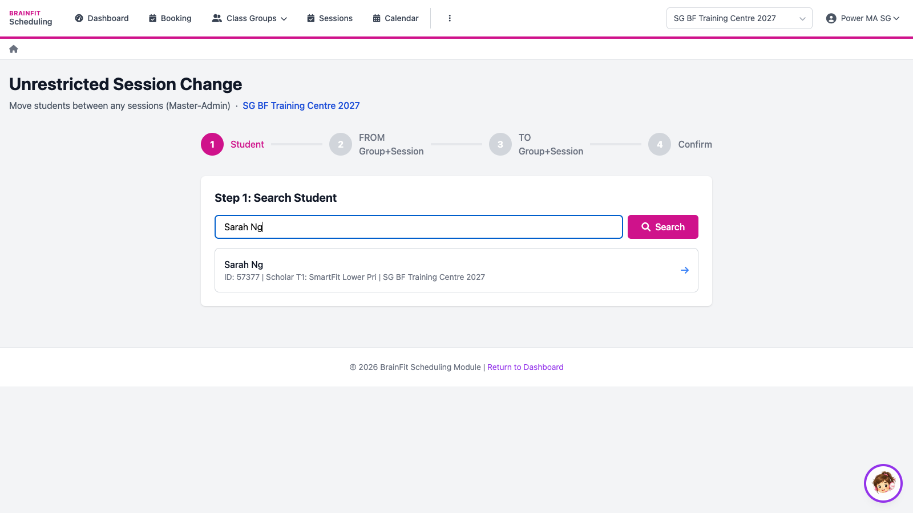
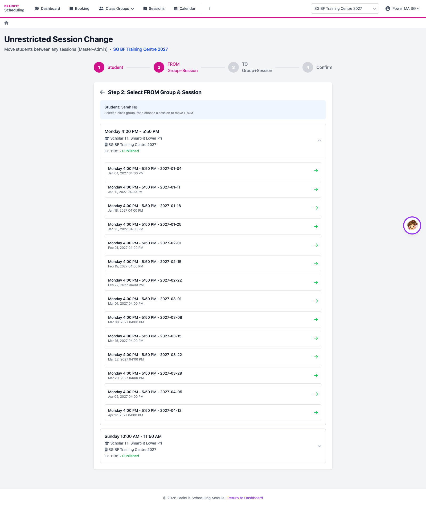
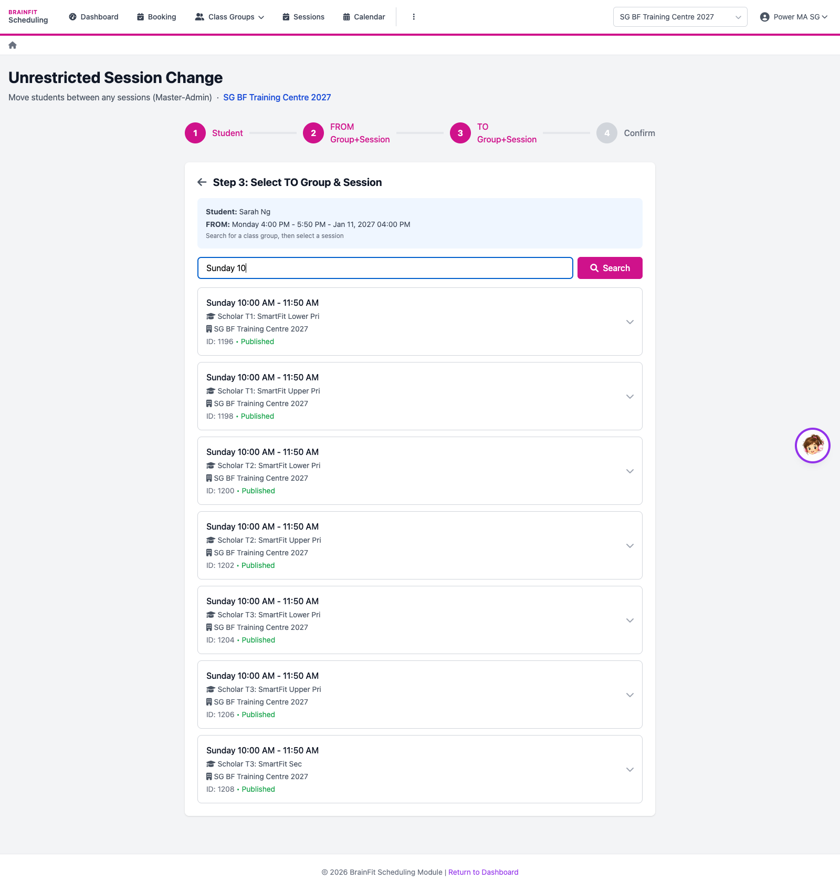
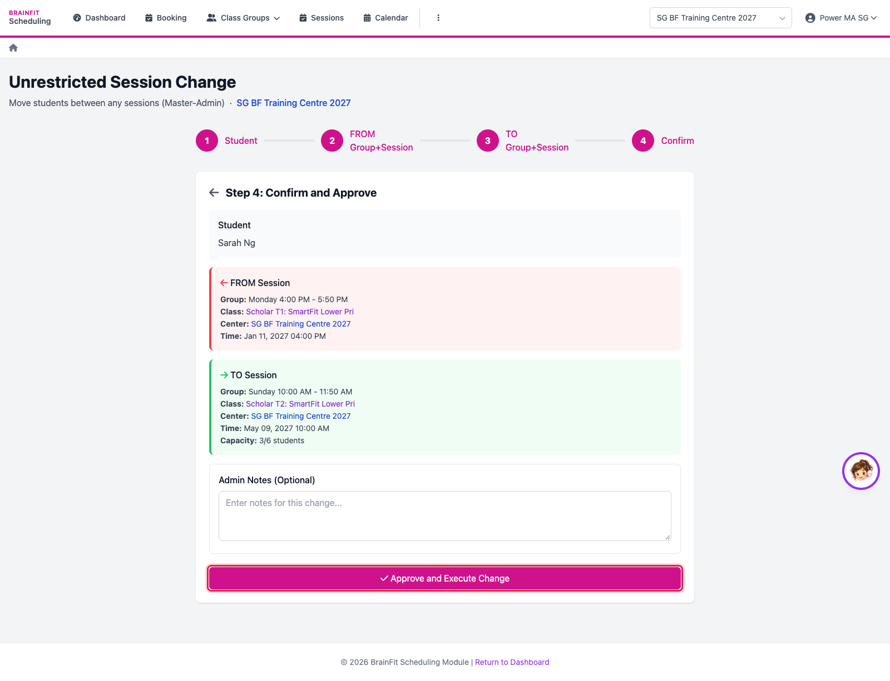

# Unrestricted Session Change
This feature is for SA, ML, MA

**Watch (about 1 min):**

<video controls preload="metadata" width="100%">
  <source src="/video/hq/sch-change.mp4" type="video/mp4" />
</video>

Moves a student from one session to another, in **any** class group, without the usual change-request limits. Use it for special cases; normal changes go through **Requests**.

1. Open **Requests → New (unrestricted)**. Search the student by name and pick them.

2. **FROM**: pick the student's class group, then the session they won't attend.

3. **TO**: search the class group they will join instead (by class or group name) and pick the session.

4. Check the FROM and TO sessions, add a note if needed, and click **Approve and Execute Change**. The change happens straight away.

