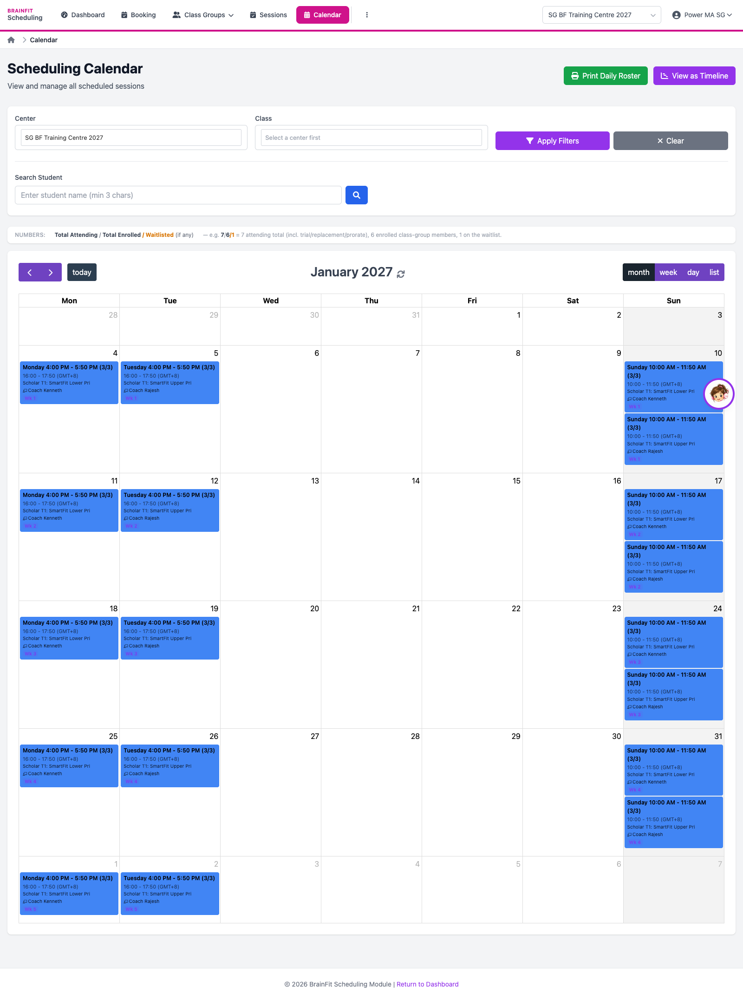
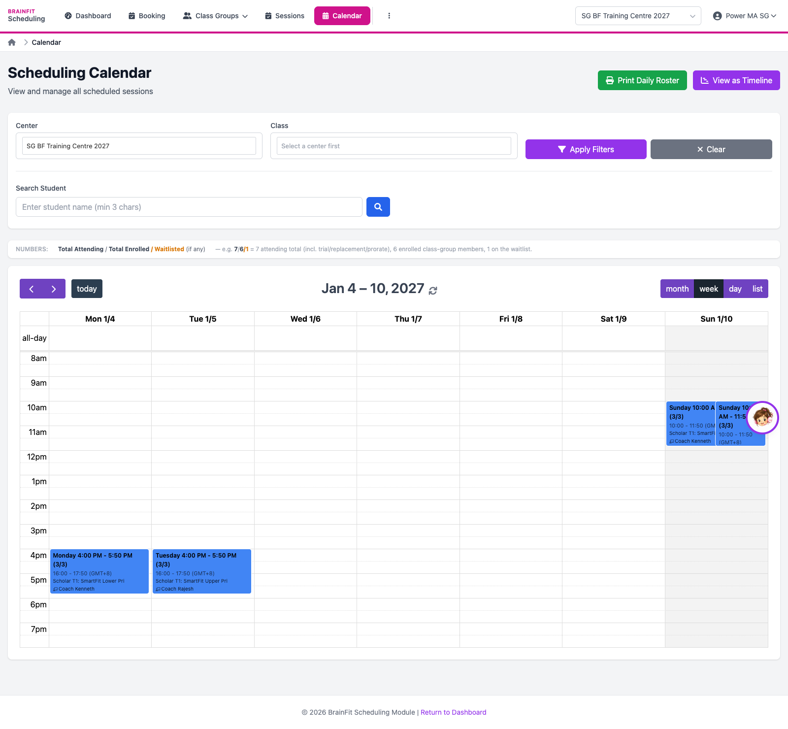
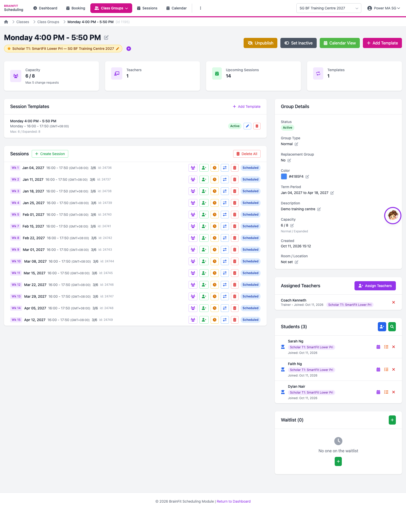

# View the Schedule
This feature is for SA, ML, MA, CA, Trainer

**Watch (about 40 s):**

<video controls preload="metadata" width="100%">
  <source src="/video/hq/sch-calendar.mp4" type="video/mp4" />
</video>

1. Open **Calendar**. Pick the **Centre** (and a class if you like). The month view shows every session as a block; use the arrows to move between months. The training centre's classes start in **January 2027**.

2. Switch to **week** (or **day** / **list**) to see the times. Click a session to see who is coming and to take attendance.

3. To see one class group's whole term, open it from **Class Groups**: its session template (day and time), every week's session with its attendance count, the trainer, the students and the waitlist.

