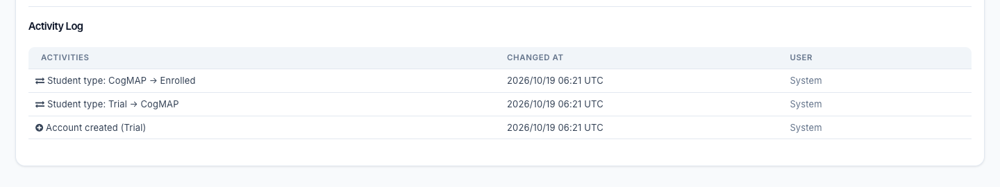

# See a student's type changes
Every journey on the [Student Journey page](./student-journey.md) comes from the student's own history. You can read that history on the student's page.

1. Go to **Students → Student List** and open the student.
2. Scroll down to the **Activity Log**.

The Activity Log now shows:

- **Account created (Trial)**, or **(CogMAP)**, or **(Enrolled)**: the type the student had when the account was made.
- **Student type: Trial → CogMAP**, **Student type: CogMAP → Enrolled** and so on: each change of student type, with the date and who made it.
- **Account merge: …**: when a CogMAP account was merged into a programme account.

The Activity Log is visible to the same people who can open the student's page.
