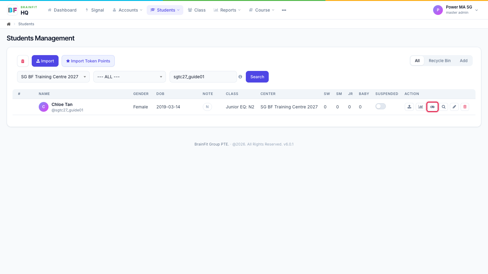
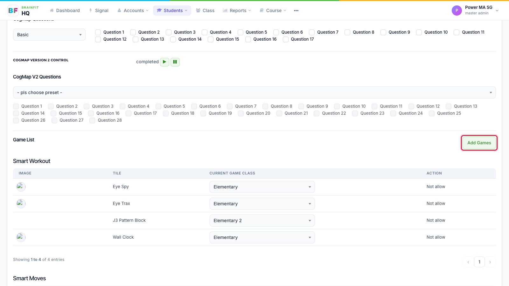
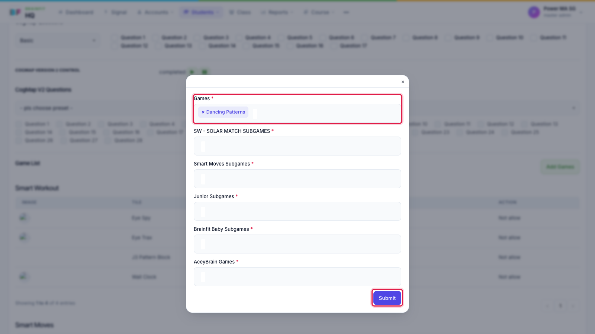
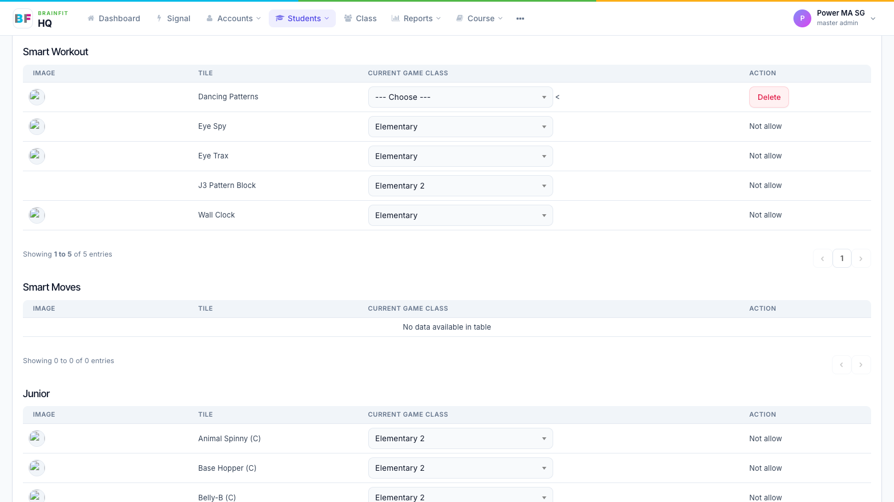

# Assign Games to a Student
This feature is for SA, ML, MA, CA

Students get their centre's games and their class's games automatically. Use this page to give one student extra games of their own.

1. In **Students**, click the **gamepad** icon on the student's row.

2. On the student's **Game config** page, scroll to **Game List** and click **Add Games**.

3. Pick the games (and the Smart Moves / Junior / Baby subgames if needed), then click **Submit**.

4. The game appears in its list. Choose the **game class** (level) the student starts on. **Delete** removes a game the student was given here.

**Note:** the CogMAP sections at the top of this page are covered in **CogMAP Management**.
