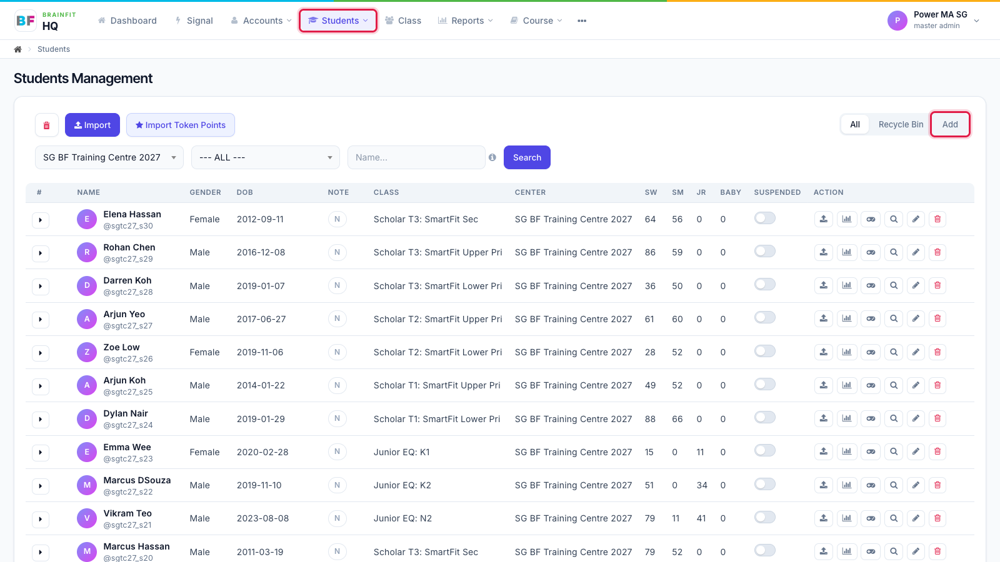
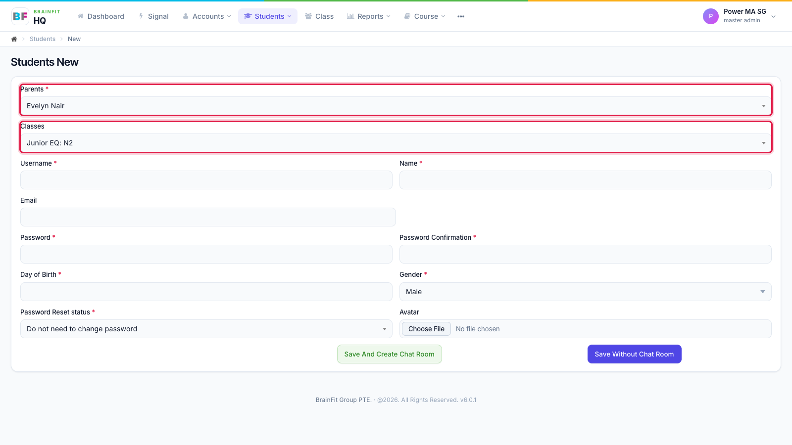
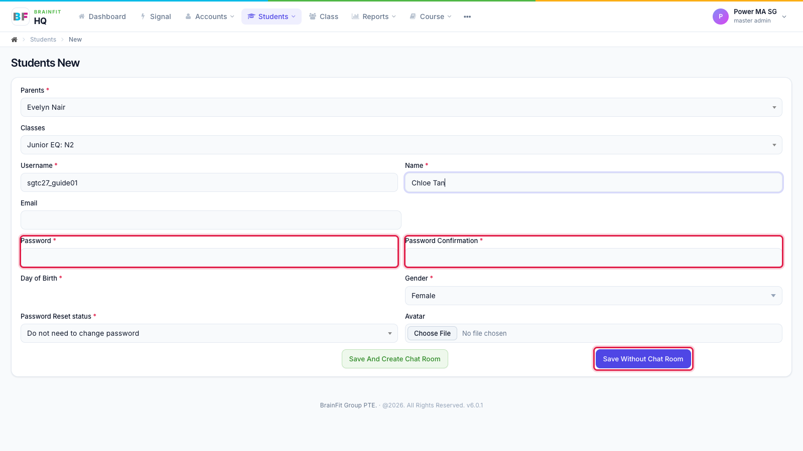
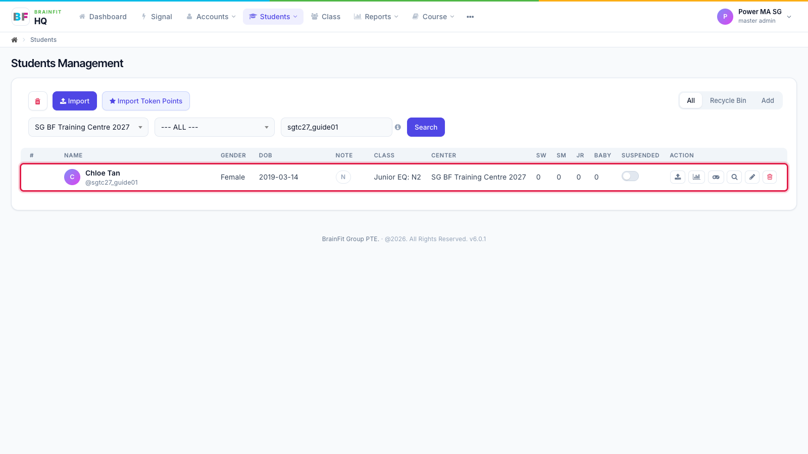

# Create a Student
This feature is for SA, ML, MA, CA

**Watch (about 1 min):**

<video controls preload="metadata" width="100%">
  <source src="/video/hq/student-create.mp4" type="video/mp4" />
</video>

A student account always belongs to a parent, and normally to a class. Create the parent first if they don't have an account yet.

1. Open **Students** in the top menu, then click **Add** at the top right of the student list.

2. Choose the **Parent**. The **Classes** list then shows the classes of that parent's centre; pick the student's class.

3. Fill in **Username**, **Name**, **Day of Birth** and **Gender**. Type a **Password** twice (the student uses it to log in to the app), then click **Save Without Chat Room**.

4. The new student shows in the list, with their class and centre.

**Note:**
- **Save And Create Chat Room** does the same, and also opens a private chat room between the parent and the trainer.
- **Password Reset status**: choose whether the student must change the password on first login.
- Usernames must be unique across BrainFit.
