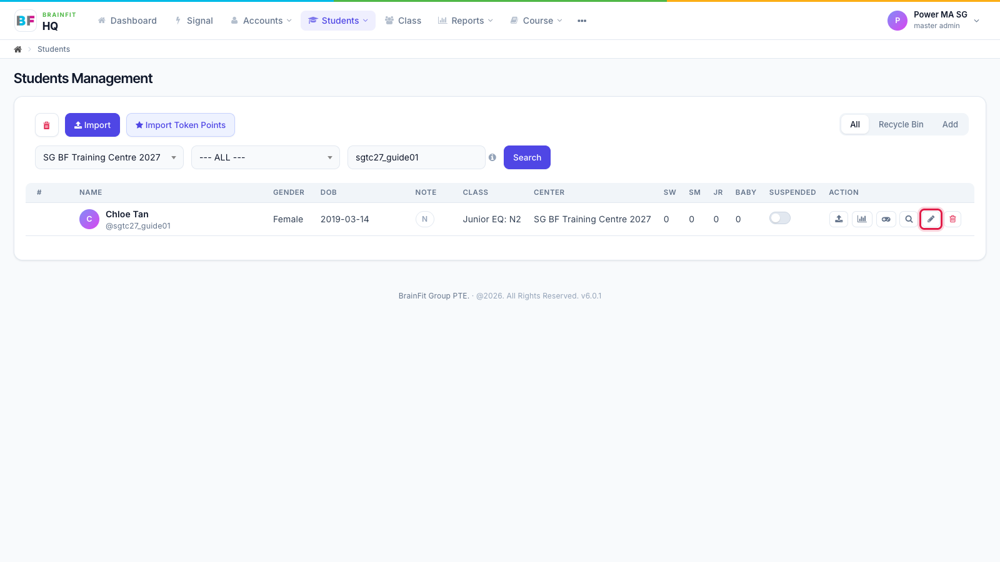
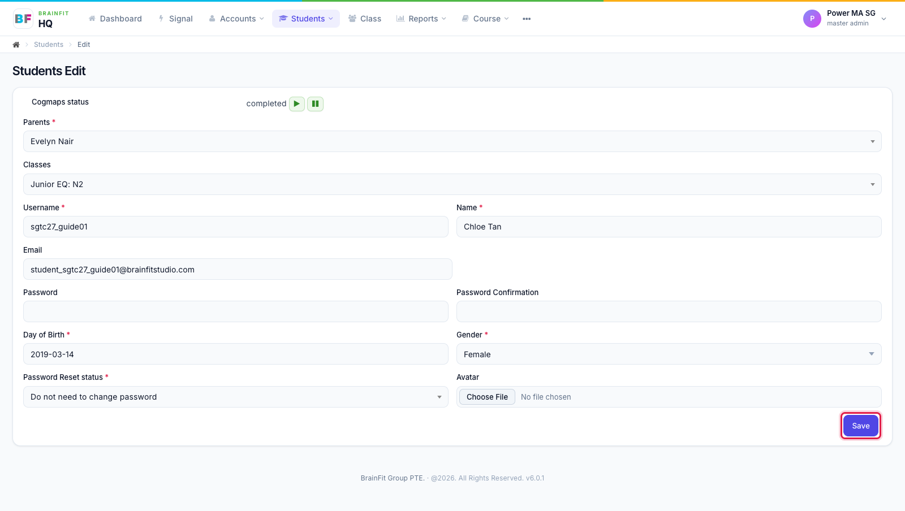

# Edit a Student
This feature is for SA, ML, MA, CA

1. In **Students**, find the student (search by name or username), then click the **pencil** icon in the Action column.

2. Change what you need (parent, class, name, email, date of birth, gender) and click **Save**. Leave **Password** empty to keep the current password.

**Note:** moving a student to another class here changes which class games they get. Their progress so far is kept.
