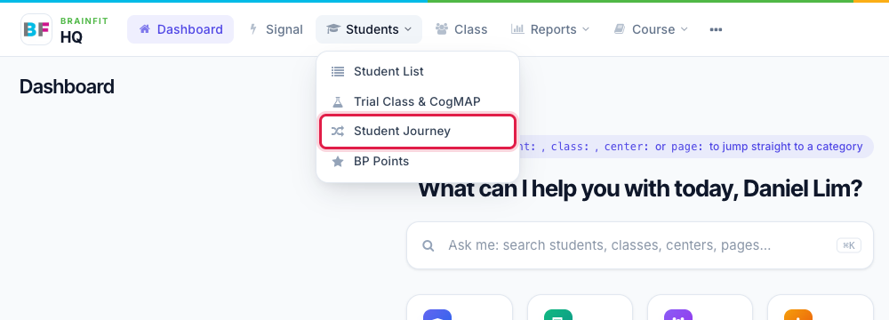
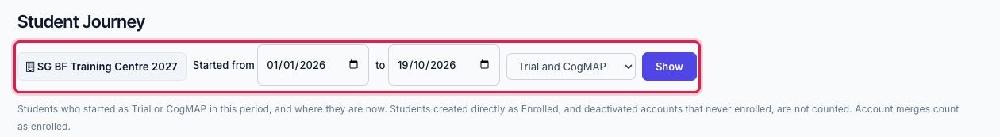
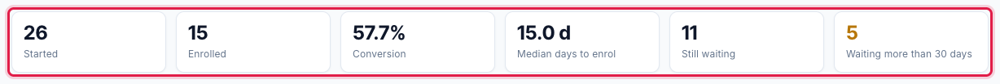
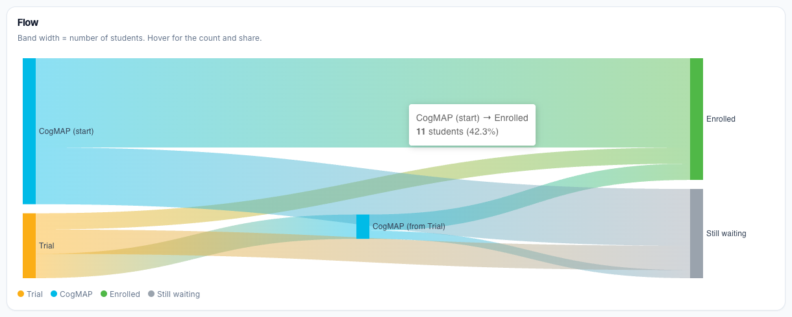
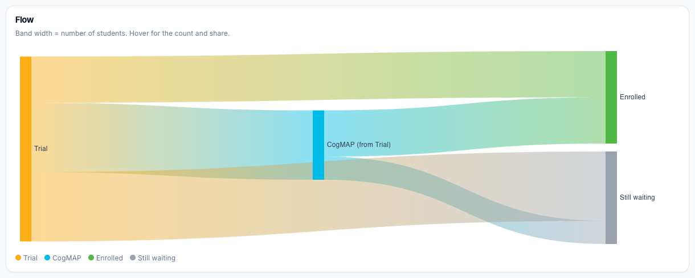
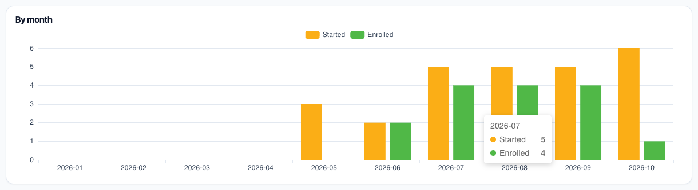
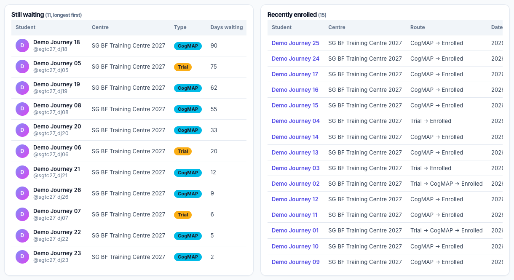

# Read the Student Journey page
Student Journey shows what happens to students who **start as Trial or CogMAP**: how many of them enrol, how long it takes, and who is still waiting. Use it to see how well Trial and CogMAP turn into enrolments, and to find the students to follow up.

**Watch (about 2 minutes):**

<video controls preload="metadata" width="100%">
  <source src="/video/hq/student-journey.mp4" type="video/mp4" />
</video>

**Who can see it:** Super Admin sees every centre. Master Licensee, Master Admin and Master User see the centres of their licensee. Centre Admin, Trainer and Assistant Coach see their own centre only. Front Desk does not have this page. It is part of the Brain HQ look; in the classic ACP the link is hidden.

## 1. Open the page

Open the **Students** menu and click **Student Journey**. It sits right under **Trial Class & CogMAP**.

## 2. Choose what to look at

The filters at the top are:

- **Centre.** You only see your own centres. A Centre Admin or Trainer sees their one centre; a Master Licensee can pick one of the centres they own, or all of them.
- **Started from / to.** The dates when the students started as Trial or CogMAP. The default is 1 January of this year until today.
- **Starting type.** Trial and CogMAP, only Started as Trial, or only Started as CogMAP.

Click **Show** to apply them.

:::note What is counted
Only students who **started as Trial or CogMAP** in the chosen dates. Students who were created directly as Enrolled are not counted, and neither are deactivated accounts that never enrolled. An account merge (a CogMAP account folded into a programme account) counts as enrolled. Journeys are recorded from January 2026, so students created before then are not in the page.
:::

## 3. The six key numbers

| Number | What it means |
| --- | --- |
| **Started** | Students who started as Trial or CogMAP in the period |
| **Enrolled** | How many of them are now Enrolled |
| **Conversion** | Enrolled divided by Started |
| **Median days to enrol** | The middle value of the days between starting and enrolling |
| **Still waiting** | Students still Trial or CogMAP |
| **Waiting more than 30 days** | The part of *Still waiting* that started more than 30 days ago |

## 4. The flow chart

The flow chart follows the students from where they started to where they are now. The **width of each band is the number of students**. Move the mouse over a band to see how many students it holds and their share.

- **Trial** and **CogMAP** on the left are the starting types.
- **CogMAP (from Trial)** is a Trial student who did CogMAP before moving on.
- **Enrolled** and **Still waiting** on the right are where they are now.

Choose **Started as Trial** (or **Started as CogMAP**) and click **Show** to look at one group. The key numbers and the chart change to match.

## 5. By month

The bar chart shows, for each month, how many students **started** and how many **enrolled**. Move over a bar to see the numbers.

## 6. The two lists

- **Still waiting** lists the students who have not enrolled yet, longest first, with their centre, type (Trial or CogMAP) and the number of days they have waited. These are the students to follow up.
- **Recently enrolled** lists who enrolled, the centre, the route (**Trial → Enrolled**, **CogMAP → Enrolled**, **Trial → CogMAP → Enrolled** or **Account merge**) and the date. The table scrolls sideways inside its card when it is wider than the screen.

Click a student's name to open the student's page. Each list shows 50 students per page.
