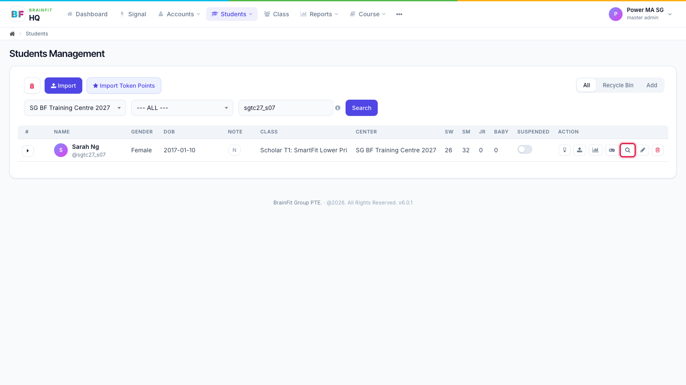
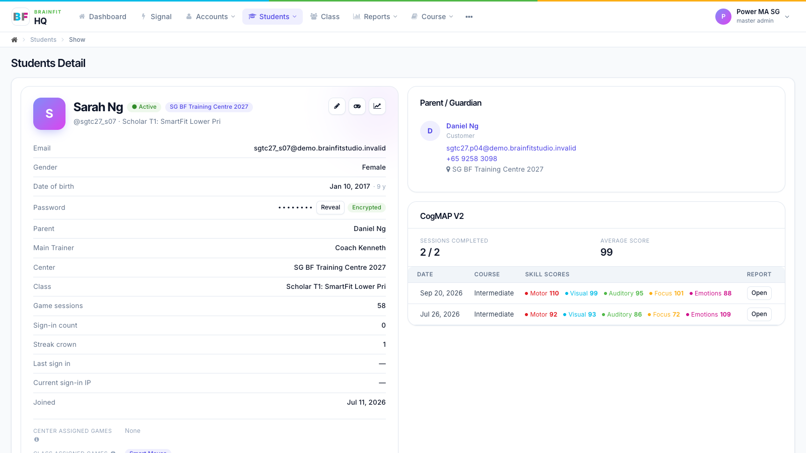
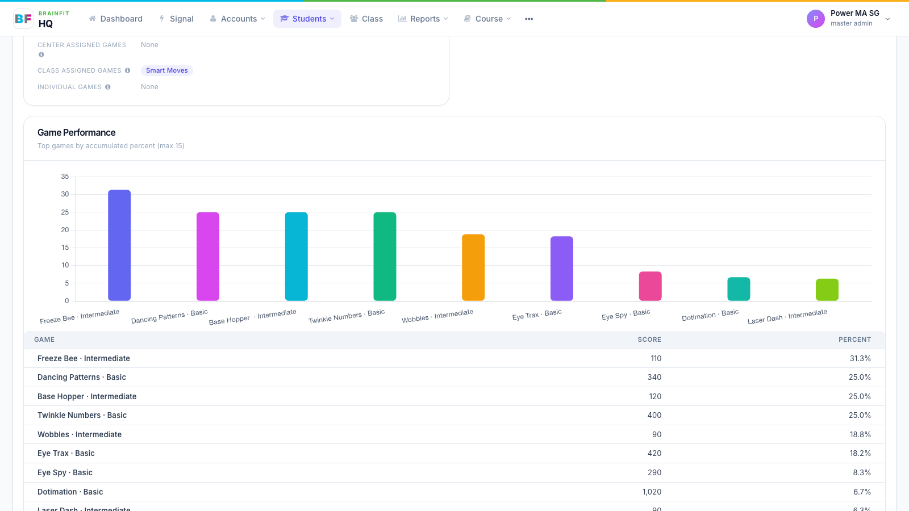
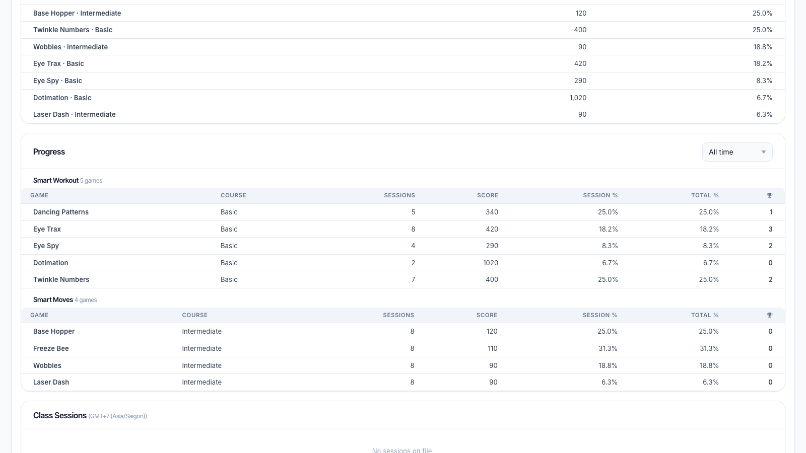
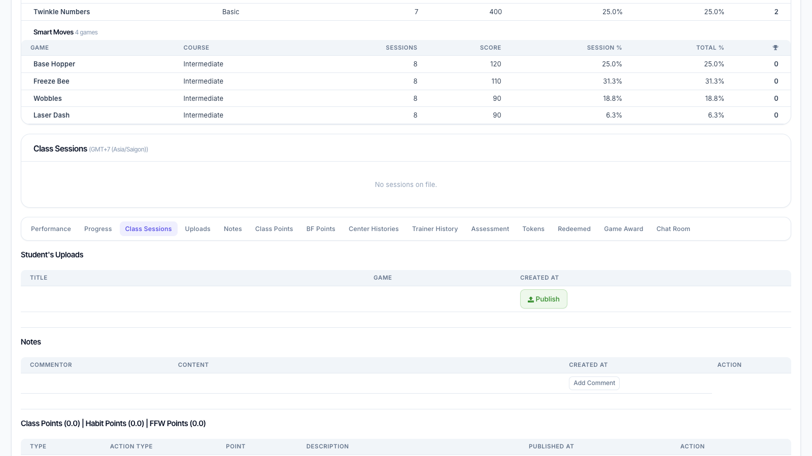
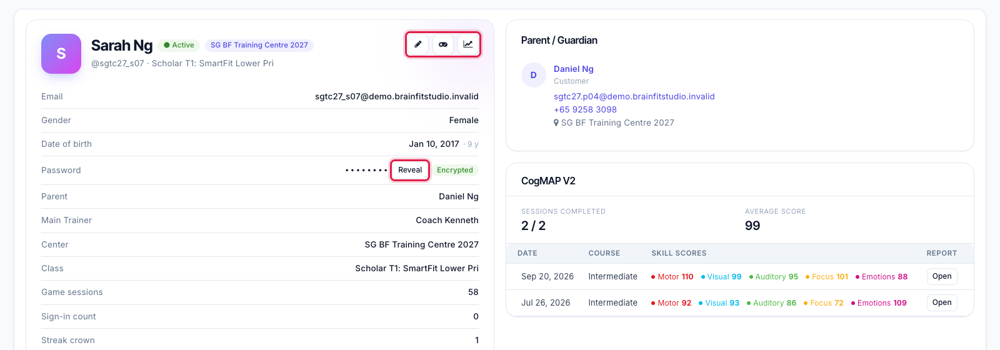

# View a Student
This feature is for SA, ML, MA, CA, Trainer, Assistant Coach

**Watch (about 1 min 10 s):**

<video controls preload="metadata" width="100%">
  <source src="/video/hq/student-view.mp4" type="video/mp4" />
</video>

The student page puts everything about one student on one page: profile, parent, CogMAP, game performance, progress and class sessions, followed by uploads, notes, points and history.

1. In **Students**, click the **magnifier** icon on the student's row.

2. The top of the page shows the **profile** on the left (centre, class, parent, trainer, game counts) and the **Parent / Guardian** and **CogMAP V2** cards on the right. CogMAP shows sessions completed, the average score and each skill's score per round; **Open** shows that round's report.

3. **Game Performance** shows the student's best games by completion.

4. **Progress** lists Smart Workout and Smart Moves results; change the period at the top right. The **section bar** stays at the top while you scroll: click a section to jump to it.

5. **Class Sessions** shows upcoming and past class sessions from the scheduling app, in your own time zone.

6. The buttons at the top right go to **Edit**, **Game config** and **Progress report**. **Reveal** shows the student's password for 30 seconds (every reveal is logged; not available to Front Desk).

