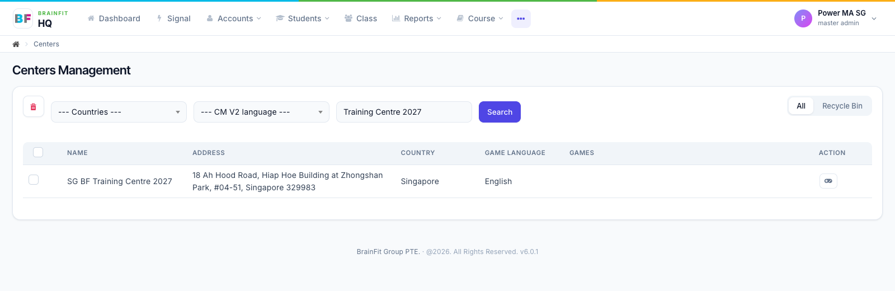
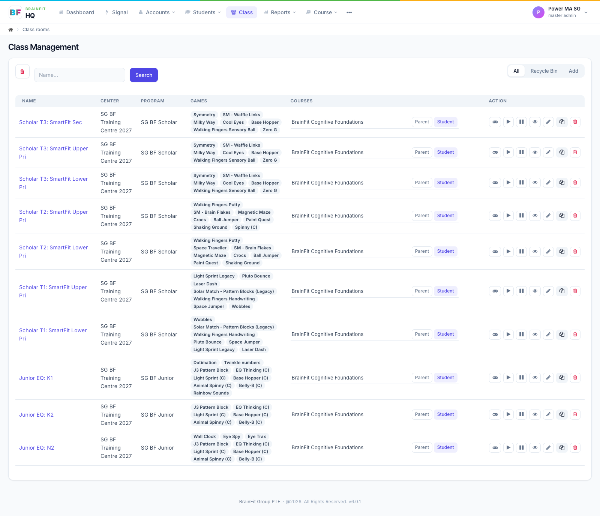
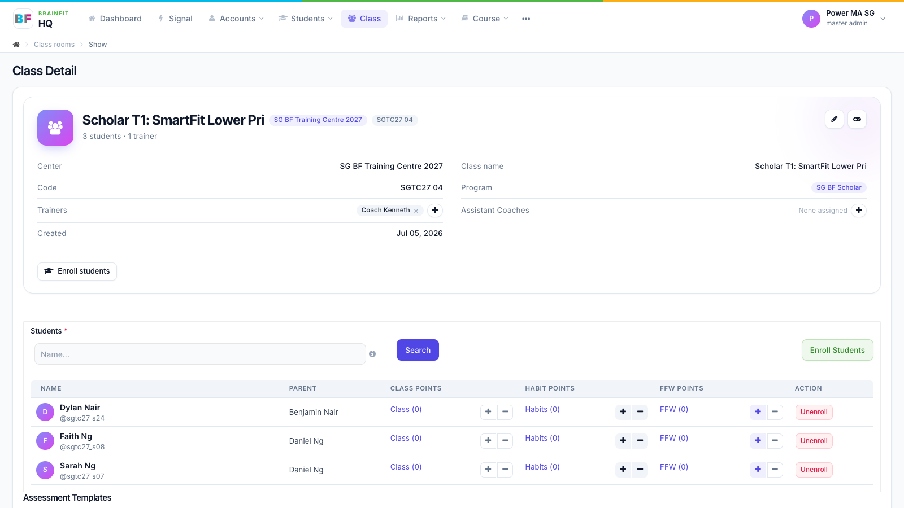
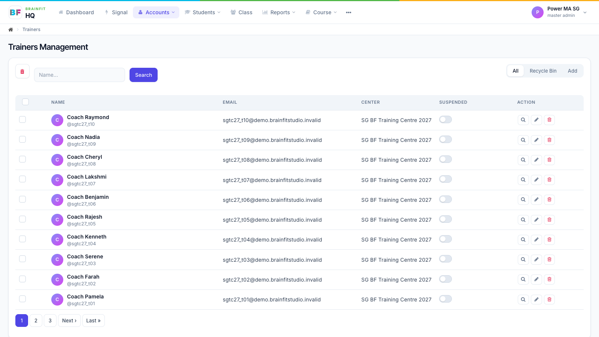
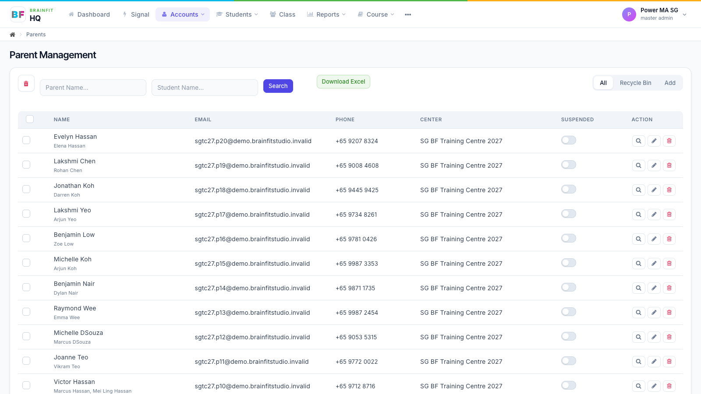
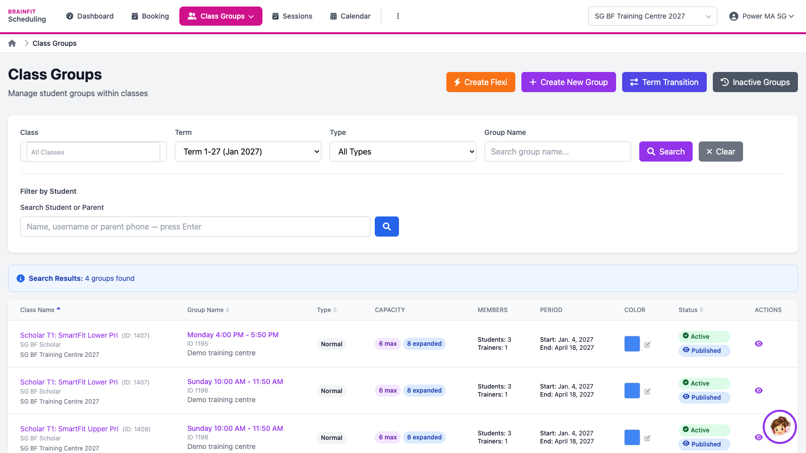

# Training Centre

**SG BF Training Centre 2027** is a practice centre full of pretend students, parents and coaches, so new staff can learn BrainFit (ACP, CoachSpace and Scheduling) without touching real families. It sits under the SG group (sggroupml), next to the real centres; the group's Master Admins see it straight away.

:::caution House rules
- Practice only. Never add real students or families to the Training Centre.
- Parents have fake email addresses (`…@demo.brainfitstudio.invalid`): emails, password resets and messages go nowhere.
- Practice students count in the group's totals and reports, and can show up on leaderboards.
- The practice progress isn't topped up, so "this month" screens get quieter over time.
:::

## What's in it

| What | How many | Details |
|---|---|---|
| Centre | 1 | SG BF Training Centre 2027 (Singapore, English) |
| Centre admins | 2 | For day-to-day centre admin work |
| Coaches (trainers) | 10 | One per class |
| Classes | 10 | 3 Junior EQ (N2, K2, K1) and 7 Scholar SmartFit (T1, T2, T3), each with its program |
| Students | 30 | 3 per class, about 12 weeks of Smart Workout / Smart Moves / Junior / AceyBrain progress; a mix of strong, steady, struggling, lapsed and new students |
| Parents | 20 | 10 with two children, 10 with one |
| CogMAP V2 | 6 sessions | Presets set on every class; results for 4 students (2 of them with two rounds, 1 in progress) |
| Course | 1 | *BrainFit Cognitive Foundations* assigned to the centre and all classes (students and parents) |
| Scheduling | 14 class groups | 2 per Scholar class (a weekday and Sunday), weekly sessions in the 2027 terms: T1 4 Jan–18 Apr, T2 3 May–15 Aug, T3 6 Sep–19 Dec |

## Accounts

All accounts share **one password**. Ask BrainFit HQ for it, and give it only to the staff you are training.

| Role | Log in with | Name |
|---|---|---|
| Centre admin | `sgtc27_ca01`, `sgtc27_ca02` | Daniel Lim, Jasmine Tay |
| Coach | `sgtc27_t01` … `sgtc27_t10` | Coach Pamela (Junior EQ: N2), Coach Farah (K2), Coach Serene (K1), Coach Kenneth (Scholar T1 Lower Pri), Coach Rajesh (T1 Upper Pri), Coach Benjamin (T2 Lower Pri), Coach Lakshmi (T2 Upper Pri), Coach Cheryl (T3 Lower Pri), Coach Nadia (T3 Upper Pri), Coach Raymond (T3 Sec) |
| Student | `sgtc27_s01` … `sgtc27_s30` | Students with CogMAP results: `sgtc27_s01`, `sgtc27_s07` (Sarah Ng, two rounds), `sgtc27_s09`, `sgtc27_s10` (in progress) |
| Parent | `sgtc27.p01@demo.brainfitstudio.invalid` … `sgtc27.p20@…` | Parents log in with their email |

Your own Master Admin / Super Admin login also sees the centre.

## A quick tour

The centre in **⋯ → Centers**:

Its 10 classes (**Class**, centre filter *SG BF Training Centre 2027*):

A class, with its coach and students:

Students (**Students**, centre filter):

A student with progress and CogMAP results:

Coaches (**Accounts → Trainers**) and parents (**Accounts → Parents**):

Its class groups in BrainFit Scheduling (term *Term 1-27*):

## What to practise

| Who | Log in as | Try this |
|---|---|---|
| Centre admins | a centre admin | Find a student, open their page and progress report, check monthly progress, look at a class and its coach, enrol a student, add a coach to a class ([Student](../Student%20Management/student-view.md) and [Class Management](../Class%20Management/class-view.md)). |
| Coaches | a coach, in CoachSpace | My Students, a student's profile, alerts, write a note, set a task, book a Progress Meeting. |
| Scheduling | a centre admin | Find the classes on the calendar (from January 2027), book a CogMAP assessment, move a student to another session ([Scheduling](../Scheduling/view-schedule.md)). |
| Everyone | — | Compare a strong student with a struggling one and practise what you'd tell their parent. |

**Note:** the screenshots in these guides are taken from a copy of this centre on the test server, so they look the same as the real one.
