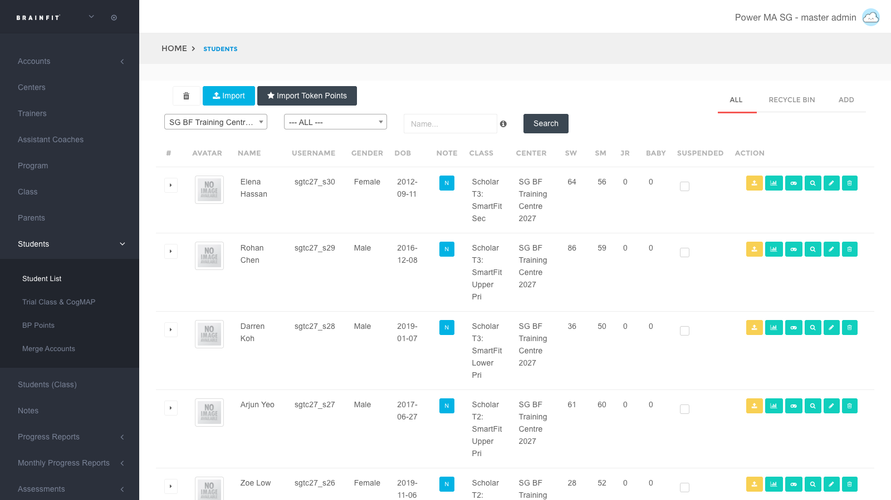
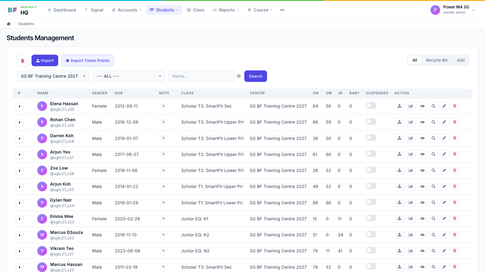
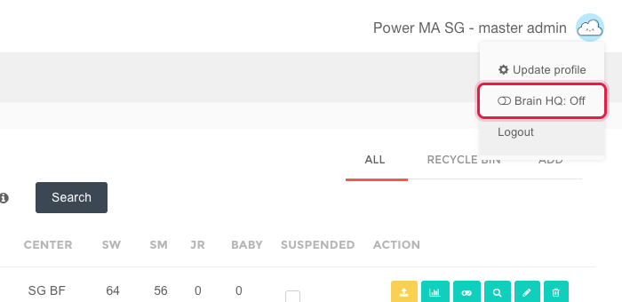
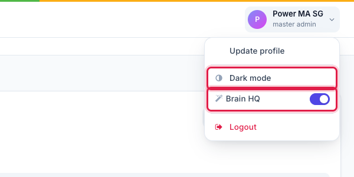
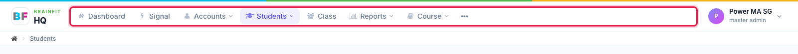
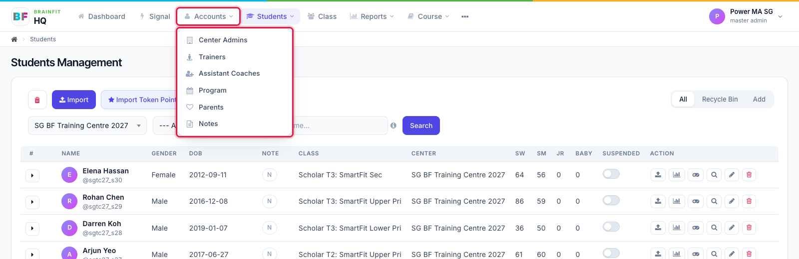
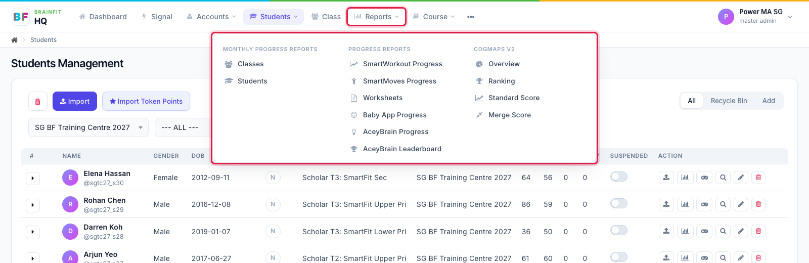
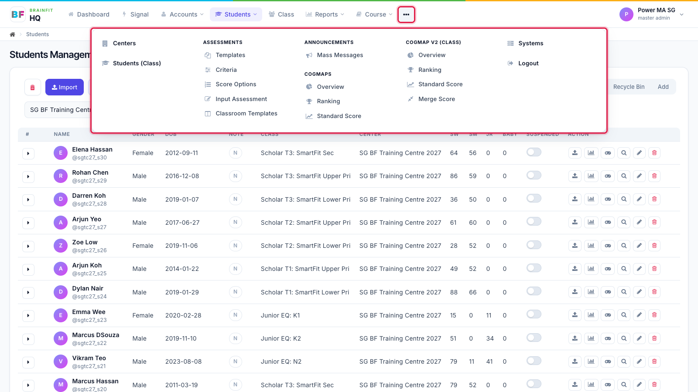
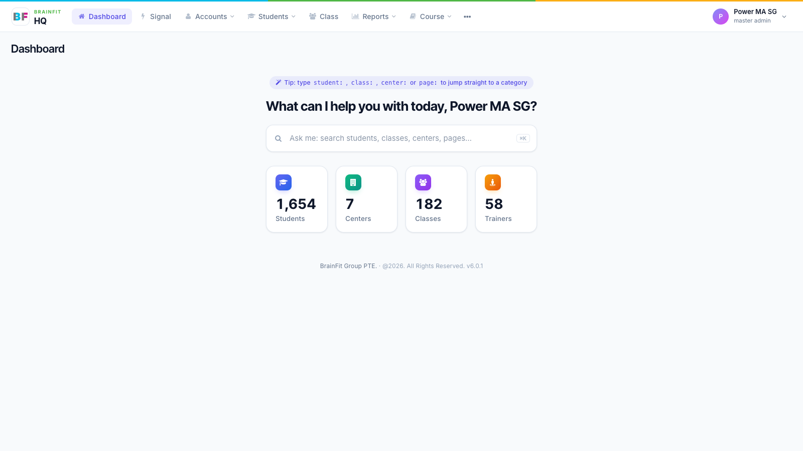
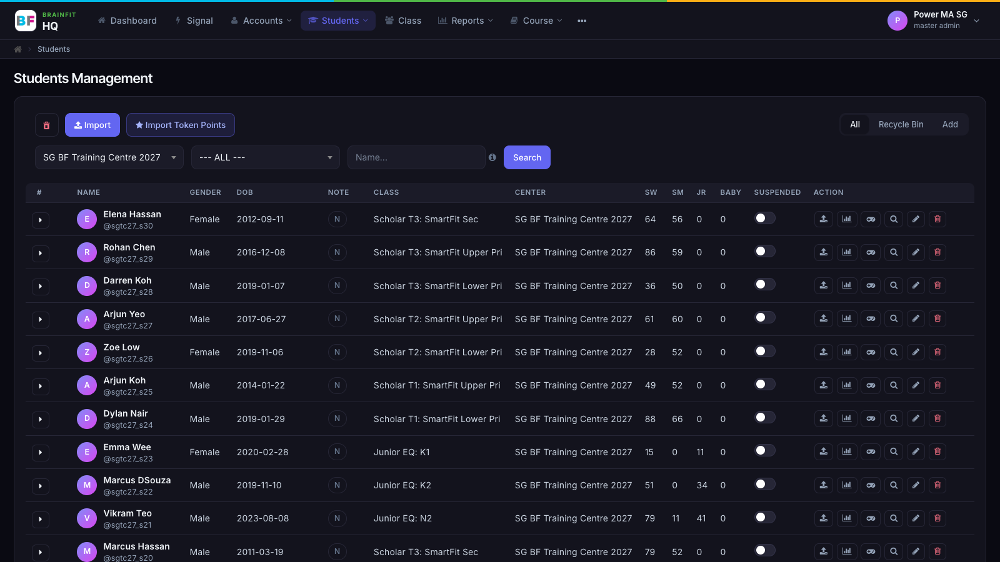

import DocCardList from '@theme/DocCardList';

# BrainFit HQ

**Brain HQ** is the new look for BrainFit ACP. It is the same ACP, with the same data, permissions and features, in a cleaner, faster layout. You can switch it on and off any time; nothing about your data changes.

The screenshots in these guides come from a practice training centre with pretend students and parents.

## Why Brain HQ

- **More room for your work.** The menu moves from the left sidebar to a bar across the top, so tables and forms use the full width of the screen.
- **Cleaner screens.** Lighter tables, clearer buttons and forms, one consistent style on every page.
- **Fewer clicks.** Related menus are grouped, the dashboard has a search box that jumps straight to a student, class or centre, and student and class pages show everything on one page.
- **Easier to learn.** Every button has a tooltip, and every menu item has an icon.
- **Light and dark mode**, and it works on phones and tablets.

| Classic | Brain HQ |
|---|---|
|  |  |

## How to turn it on

1. Click your **profile picture** at the top right.
2. Click **Brain HQ: Off** to switch it on.

To go back, open your name at the top right and switch **Brain HQ** off. The same menu has **Dark mode**.

Your choice is remembered on that computer and browser.

## What changed the most

### 1. A menu across the top

All main sections now sit in one bar at the top: **Dashboard, Signal, Accounts, Students, Class, Reports, Course** and **⋯** (more).

### 2. Related menus are grouped

- **Accounts** holds the people menus: Center Admins, Trainers, Assistant Coaches, Program, Parents and Notes.

- **Reports** brings together what used to be three separate menus: **Monthly Progress Reports**, **Progress Reports** and **CogMaps V2**, side by side in one panel.

### 3. The ⋯ menu

Everything else (Centers, Students (Class), Assessments, Announcements, CogMAP, Systems and more) is in the **⋯** menu at the end of the bar, grouped by area.

### 4. A new dashboard

The dashboard starts with a search box: type a student, class or centre name and jump straight there (shortcut: ⌘K / Ctrl K). Below it are the numbers for the centres you look after.

### 5. Dark mode

## Guides

<DocCardList />
