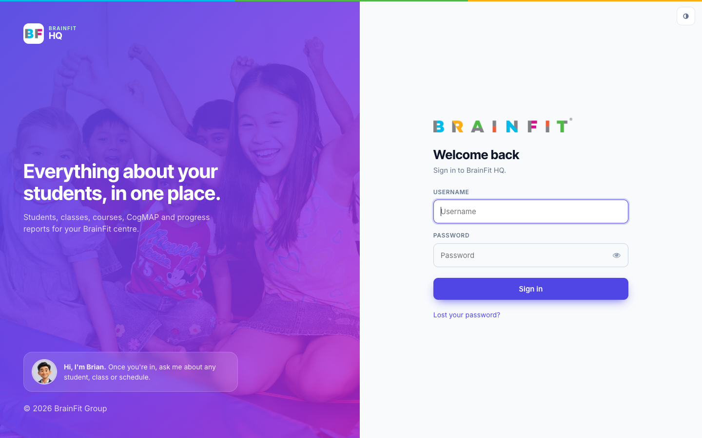
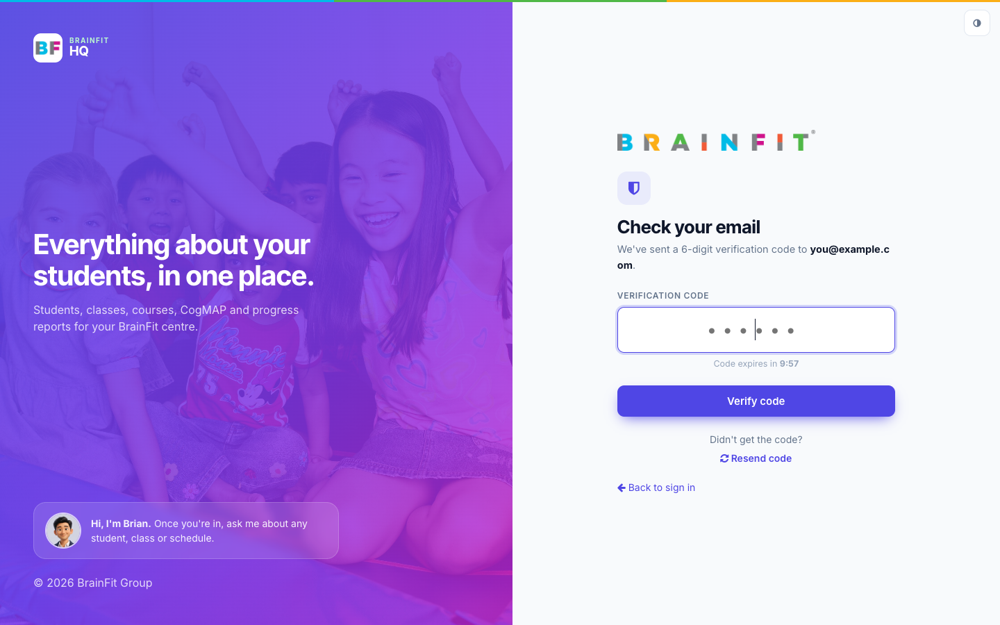
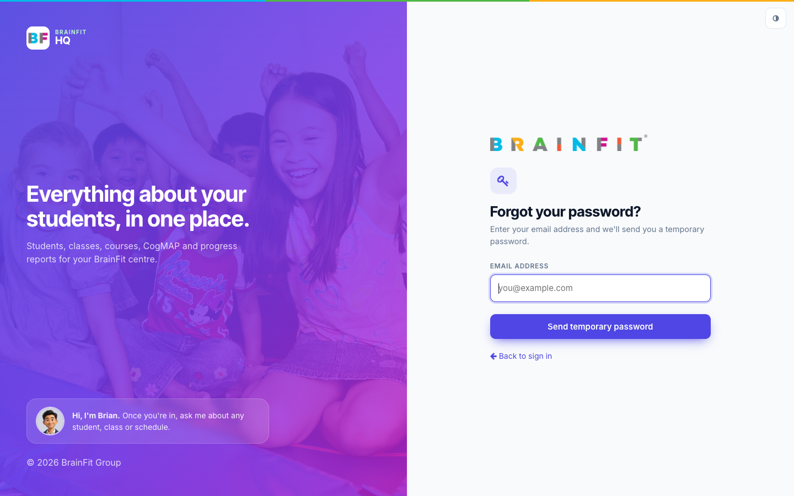
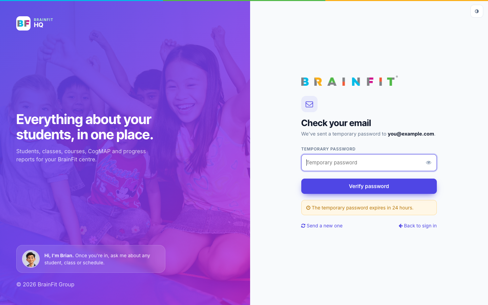
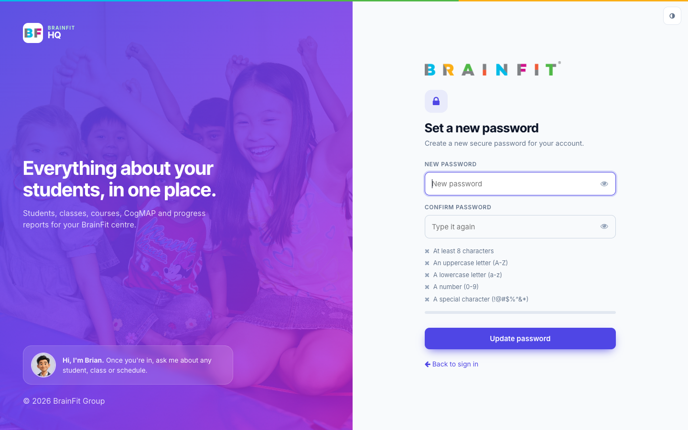
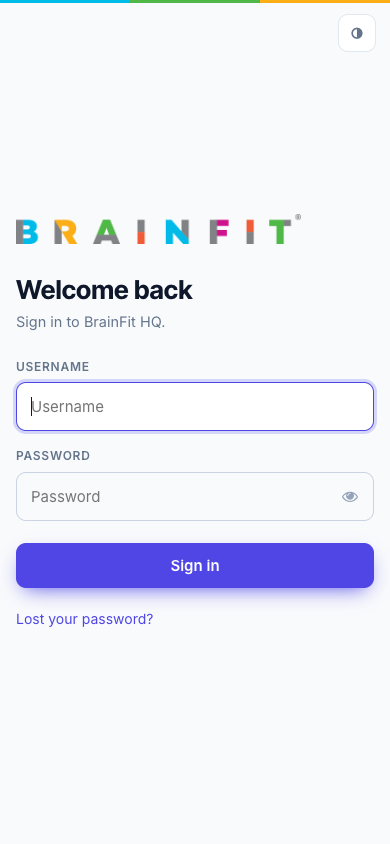

import DocCardList from '@theme/DocCardList';

# BrainFit HQ

**Brain HQ** is the new look for BrainFit ACP. It is the same ACP, with the same data, permissions and features, in a cleaner, faster layout. You can switch it on and off any time; nothing about your data changes.

The screenshots in these guides come from a practice training centre with pretend students and parents.

## Why Brain HQ

- **More room for your work.** The menu moves from the left sidebar to a bar across the top, so tables and forms use the full width of the screen.
- **Cleaner screens.** Lighter tables, clearer buttons and forms, one consistent style on every page.
- **Fewer clicks.** Related menus are grouped, the dashboard has a search box that jumps straight to a student, class or centre, and student and class pages show everything on one page.
- **Easier to learn.** Every button has a tooltip, and every menu item has an icon.
- **Light and dark mode**, and it works on phones and tablets.

| Classic | Brain HQ |
|---|---|
|  |  |

## How to log in to BrainFit HQ

BrainFit HQ has its own address: **[hq.brainfitstudio.com](https://hq.brainfitstudio.com)**. It always opens the new Brain HQ look. The older address, acp.brainfitstudio.com, still works exactly as before, with its own login and the theme switch.

**First time on hq?** Log in once: signing in on acp does not carry over to hq.

**Watch (about 1½ minutes):**

<video controls preload="metadata" width="100%">
  <source src="/video/hq/hq-login.mp4" type="video/mp4" />
</video>

### 1. Sign in

Type your **username** and **password**, then click **Sign in**. The eye icon shows or hides what you type.

### 2. Enter the code (staff with two-factor sign-in)

If your account uses two-factor sign-in, we email you a **6-digit code**. Type it in: it submits by itself. The code lasts 10 minutes, and **Resend code** sends a new one.

### 3. If you forgot your password

Click **Lost your password?**, enter your email address and click **Send temporary password**.

Copy the temporary password from the email and enter it. It is valid for 24 hours; if it has expired, click **Send a new one**.

Then choose a new password that meets the requirements (the list and the strength meter update as you type), type it again to confirm, and click **Update password**.

### On a phone

The login page works on a phone too.

## What changed the most

### 1. A menu across the top

All main sections now sit in one bar at the top: **Dashboard, Signal, Accounts, Students, Class, Reports, Course** and **⋯** (more).

### 2. Related menus are grouped

- **Accounts** holds the people menus: Center Admins, Trainers, Assistant Coaches, Program, Parents and Notes.

- **Reports** brings together what used to be three separate menus: **Monthly Progress Reports**, **Progress Reports** and **CogMAP V2**, side by side in one panel.

### 3. The ⋯ menu

Everything else (Centers, Students (Class), Assessments, Announcements, CogMAP, Systems and more) is in the **⋯** menu at the end of the bar, grouped by area.

### 4. A new dashboard

The dashboard starts with a search box: type a student, class or centre name and jump straight there (shortcut: ⌘K / Ctrl K). Below it are the numbers for the centres you look after.

### 5. Dark mode

## Guides

<DocCardList />
