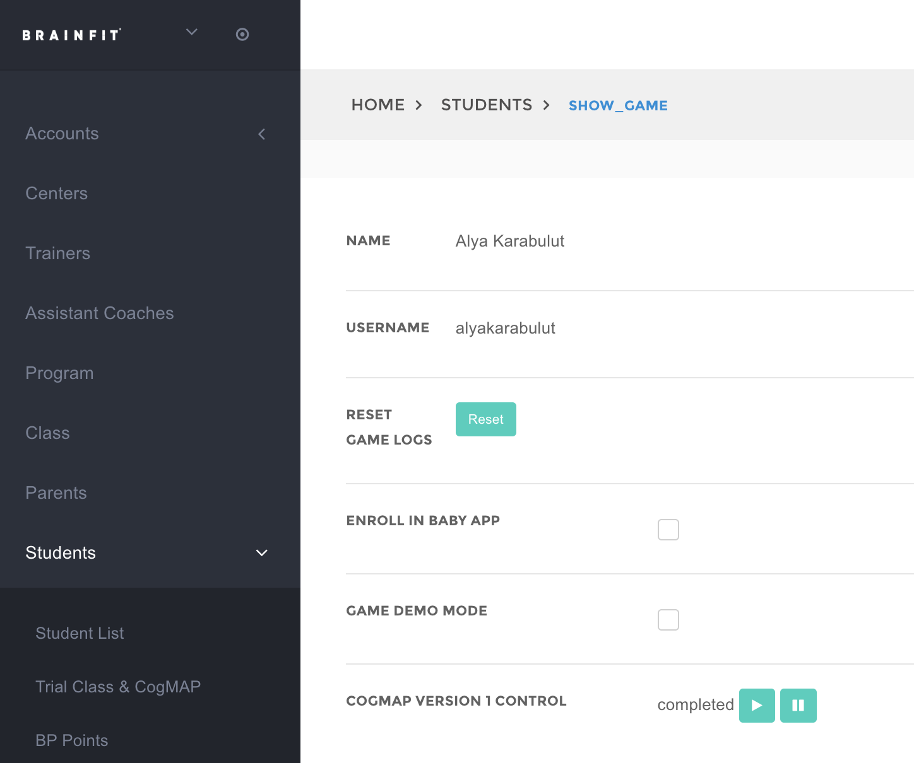
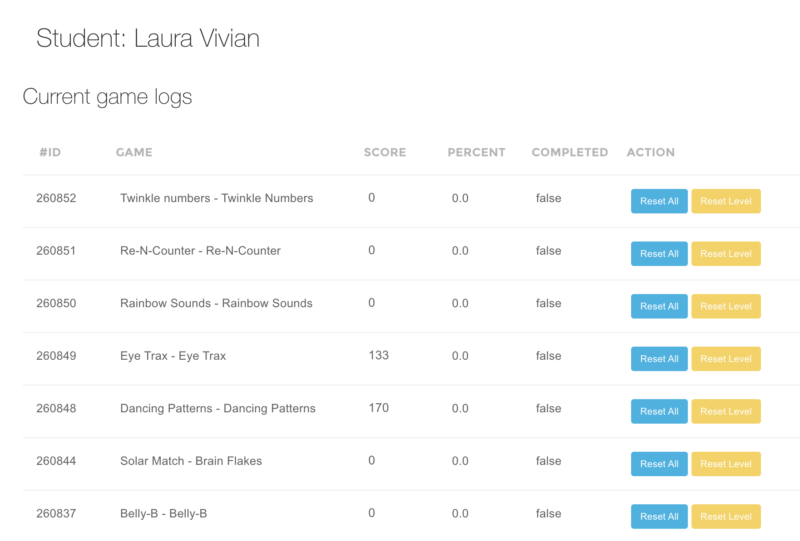

This feature is for SA (all actions), ML and MA (per-student reset only — see role note below).

There are two separate reset actions, and two separate places to use them depending on whether you're resetting one student or many.

## Pre-step — where the Reset button lives on a student's page

1. **Navigate** to the student's detail page on [BrainFit ACP](https://acp.brainfitstudio.com/acp) and open their **Show Game** tab (`https://acp.brainfitstudio.com/acp/students/<id>/show_game`).
2. Find the **Reset Game Logs** row and click the **Reset** button.

   

3. This takes you to the student's **Reset Games** page, where every game/subgame row has its own **Reset All** and **Reset Level** buttons.

   

## The two reset actions

- **Reset All** — archives the game/subgame's progress entirely (score, level, everything). This is a soft-delete: the old data is still visible afterward in the "Archived game logs" table on the student's Reset Games page, it just stops counting toward anything until restored. The next time the student plays, it starts completely fresh.
- **Reset Level, Retain Score** — only resets the level back to the start of each course. The student's score and full play history are left untouched. Use this when a student needs to replay content from the beginning but you don't want to lose their score/history.

## Option 1 — Reset one student

Use this when you're already on a specific student's page (see pre-step above) and just need to reset one game/subgame row at a time.

1. On the student's **Reset Games** page, find the row for the game/subgame you want to reset.
2. Click **Reset All** or **Reset Level** for that row (tooltip on Reset Level: "Resets to the first level but retain score"), then confirm the prompt. The page reloads showing the updated state.

This covers **any** game the student has played (Smart Moves, Solar Match, Junior, BrainFit Baby, and every other game with subgame-level tracking) — one row per game/subgame, no bucket restriction.

**Role access:** Super Admin, Master Licensee, and Master Admin can all do this. Center Admin, Trainer, and Assistant Coach can view a student's game details but do **not** have access to either reset button on this page.

## Option 2 — Reset many students at once

Use this when you have a list of students (e.g. a center sent a roster) who all need the same reset applied.

**Role access:** Super Admin only.

Unlike Option 1, the bulk tool resets a whole **bucket** of games at once rather than one row at a time, so you pick one of **4 modes** (2 actions × 2 buckets):

- **Smart Workout** — the 14-game cognitive collection (Dancing Patterns, Rainbow Sounds, Twinkle Numbers, Solar Match, the Math games, etc).
- **Smart Moves** — Smart Moves only.

:::info Junior and BrainFit Baby aren't covered by either bucket
Reset those two individually via Option 1 above instead.
:::

1. **Navigate** to [BrainFit ACP](https://acp.brainfitstudio.com/acp) and log in as a Super Admin.
2. In the left sidebar, open **Developer**, then click **Reset**.
3. From here you have two ways to pick students:
   - **Search & Select** — search by student name or username, tick the ones you want (tick across multiple searches — your picks are kept in a "Selected Students" panel and don't get cleared out when you search again), then choose a mode and click **Stage Selected Students for Review**.
   - **New Import** — upload an Excel/CSV file with columns **Last Name**, **First Name**, **Username** (matched to real accounts by Username), choose a mode, and click **Upload and Preview**.
4. Either path takes you to a **review page** first — nothing is reset yet. It shows, per student, exactly what will change (which games/subgames, how many levels, or that they'll be archived) before you confirm anything.
5. Review the list. Rows with a red "no matching student" or validation error won't be resettable — fix the username or drop that row.
6. Click **Apply Reset to All Pending Row(s)** to run the reset for everyone at once, or use the play button on an individual row to apply just that one student.
7. Every reset (either option) is logged, so there's always a record of who reset what and when.
